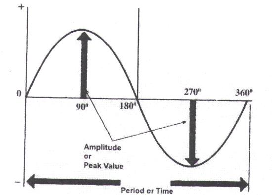
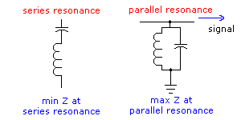
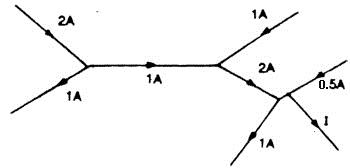
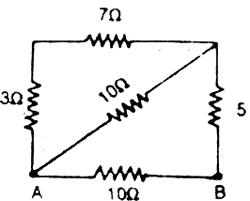
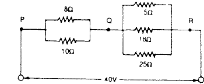
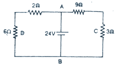
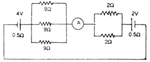

## 7. AC FUNDAMENTALS

The sinusoidal (sine) wave is a pattern of instantaneous changes in the value of an alternating voltage or current.

### FREQUENCY (F)

The number of cycles per second is the Frequency.

The unit of the frequency is called hertz (Hz).

50 Hz 50 cycles/seconds

### PERIOD (T)

The amount of time taken to complete one cycle is the period.

### WAVE LENGTH

Wave length is the length of one complete cycle. The wave length depends upon the frequency of the variation and its velocity.

### WAVE LENGTH OF RADIO WAVES

For electro magnetic radio waves, the velocity in air is 186,000 miles for second or 3 x 10¹⁰ cm/sec. which is equal to speed of light.

### VOLTAGE AND CURRENT VALUES FOR A SINEWAVE

PEAK VALUE: This is the maximum value VM or IM. The peak value applies either to positive or negative peak

### AVERAGE VALUE

This is an arithmetical average of all values in half a cycle. This average value equals to 0.637 of peak value.

Vavg = 0.637 x VPeak

### RMS VALUE

RMS value of an alternating current is defined as the value of the equivalent direct current which can produce the same average heating effect in a conductor as the given alternating current The value is termed as RMS value because it is obtained by finding the mean of the squares of the instantaneous currents and then taking the square root. VRMS = VPeak 1 / √2 or 0.707 VPeak

### PHASE

It is the angular position of Armature in A.C generator. One sine wave consists of two phases i.e. +ve and -ve. The alternating quantities which rise and fall in step alternating their individual maximum and minimum values simultaneously is said to be in phase.

### PHASE ANGLE

Suppose the voltage A started its cycle where maximum output voltage is produced at the same time B starting at zero output. This angular difference is the phase angle between Wave A leading wave B by 90 degrees.

### REACTANCE

Reactance is the property of resisting or impeding the flow of ac current or ac voltage in inductors and capacitors. Note particularly we speak of alternating current only ac, which expression includes audio af and radio frequencies rf. NOT direct current dc.

### INDUCTIVE REACTANCE

When ac current flows through an inductance a back emf or voltage develops opposing any change in the initial current. This opposition or impedance to a change in current flow is measured in terms of inductive reactance. Inductive reactance is determined by the formula: 2πfL [or says 2 * pi * f * L]

where: 2 * π = 6.2832; f = frequency in hertz and L = inductance in Henries

### CAPACITIVE REACTANCE

When ac voltage flows through a capacitance an opposing change in the initial voltage occurs, this opposition or impedance to a change in voltage is measured in terms of capacitive reactance. Capacitive reactance is determined by the formula: 1 / (2πfC)

Where: 2 * π = 6.2832; f = frequency in hertz and C = capacitance in Farads

### EXAMPLES OF REACTANCE

What reactance does a 6.8 μH inductor present at 7 MHz? Using the formula above we get: XL = 2 * π * f * L

where: 2 * π = 6.2832; f = 7,000,000 Hz and L = .0000068 Henries

Answer: = 299 ohms

What reactance does a 33 pF capacitor present at 7 MHz? Using the formula above we get: XC = 1 / (2 * π* f * C)

where: 2 * π = 6.2832; f = 7,000,000 Hz and C = .0000000000033 Farads

Answer: = 689 ohms

### IMPEDANCE

The opposition offered to the current in the combination of one or more components like inductor, resistor or capacitor is called impedance.

### POWER FACTOR

It is defined as the ratio of True power to the apparent power. P.F= R/Z = Cos∅

### CIRCUIT

This is a closed path comprising of a few components like resistors, capacitors, inductors, voltage source etc. There are two types: one is open and second is short circuit.

### RESONANCE

Resonance occurs when the reactance of an inductor balances the reactance of a capacitor at some given frequency. In such a resonant circuit where it is in series resonance, the current will be maximum and offering minimum impedance. In parallel resonant circuits the opposite is true.

In series A.C. circuit, inductive reactance leads the zero reference angle of resistance by 90 degrees while capacitive reactance lags by 90 degrees. Therefore XL and XC are 180 degrees out of phase which means they are opposite and get cancelled. Then the only opposition to the current is the coil resistance. At resonance impedance is minimum and resistive. The current at resonant frequency is maximum. The formula for resonance is: 2πfL = 1/(2πfC)

where: 2π = 6.2832; f = frequency in hertz L = inductance in Henries and C = capacitance in Farads

Which leads us on to: f = 1 / [2 π (sqrt LC)] where: 2 * pi = 6.2832; f = frequency in hertz L =

inductance in Henries and C = capacitance in Farads

A particularly simpler formula for radio frequencies (make sure you learn it) is:

LC = 25330.3 / f ² where: f = frequency in Megahertz (MHz) L = inductance in microhenries (uH) and C = capacitance in picofarads (pF) Following on from that by using simple algebra we can determine:

LC = 25330.3 / f ² and L = 25330.3 / f ² C and C = 25330.3 / f ² L

Impedance at Resonance

In a series resonant circuit the impedance is at its lowest for the resonant frequency whereas in a parallel resonant circuit the impedance is at its greatest for the resonant frequency. See figure below.

### Resonance in series and parallel circuits

"For a series circuit at resonance, frequencies becoming far removed from resonance see an ever increasing impedance. For a parallel circuit at resonance, frequencies becoming far removed from resonance see an ever decreasing impedance". That was a profoundly important statement. Please read it several times to fully understand it.

A typical example to illustrate that statement are the numerous parallel circuits used in radio. Look at the parallel resonant circuit above. At resonance that circuit presents such a high impedance to the resonant circuit to the extent it is almost invisible and the signal passes by. As the circuit departs from its resonant frequency, up or down, it presents a lessening impedance and progressively allows other signals to leak to ground. At frequencies far removed from resonance, the parallel resonant circuit looks like a short path to ground. For series resonance the opposite is true.

### Exercice
1. Resistivity of a wire depends on

(A) length (B) material (C) cross section area (D) none of the above
2. Resistance of a wire is r ohms. The wire is stretched to double its length, then its resistance in

ohms is (A) r / 2 (B) 4 r (C) 2 r (D) r / 4
3. Ampere second could be the unit of

(A) power (B) conductance (C) energy (D) charge
4. Conductance is expressed in terms of

(A) ohm / m (B) m / ohm (C) mho / m (D) mho
5. We have three resistances of values 2 Ω, 3 Ω and 6 Ω. Which of the following combination will give an effective resistance of 4 Ω?

(A) All the three resistances in parallel (B) 2 Ω resistance in series with parallel combination of 3 Ω and 6 Ω resistance (C) 3 Ω resistance in series with parallel combination of 2 Ω and 6 Ω resistance (D) 6 Ω resistance in series with parallel combination of 2 Ω and 3 Ω resistance
6. Three equal resistors connected in series across a source of emf together dissipate 10 watts of

power. What would be the power dissipated in the same resistors when they are connected in parallel across the same source of emf? (A) 10 watts (B) 30 watts (C) 90 watts (D) 270 watts
7. Current I in the figure is

(A)1.5A (B)0.5A (C)3.5A (D)2.5A
8. Four identical resistors are first connected in parallel and then in series. The resultant

resistance of the first combination to the second will be (A) 1 / 16 times (B) 1 / 4 times (C) 4 times (D) 16 times
9. The unit of electrical conductivity is

(A) mho / metre (B) mho / sq. m (C) ohm / metre (D) ohm / sq. m
10. Which of the following bulbs will have the least resistance?

(A) 220 V, 60 W (B) 220 V, 100 W (C) 115 V, 60 W (D) 115 V, 100 W
11. The ratio of the resistance of a 100 W, 220 V lamp to that of a 100 W, 110 V lamp will be

nearly (A) 4 (B)2 (C) 1 / 2 (D) 1 / 4
12. Two 1 kilo ohm, 1/2 W resistors are connected in series. Their combined resistance value and

wattage will be (A) 2 kΩ, 1/2 W (B) 2 kΩ, 1 W (C) 2 kΩ, 2 W (D) l kΩ, 1/2 W

Three 3 ohm resistors are connected to form a triangle. What is the resistance between any two of the corners? (A) 3 / 4 ohms (B) 3 ohms (C) 2 ohms (D) 4/3 ohm
14. Five resistances are connected as shown in figure below. The equivalent resistance between

the points A and B will be

(A) 35 ohms (B) 25 ohms (C) 15 ohms (D) 5 ohms
15. How many different combinations may be obtained with three resistors, each having the

resistance R? (A) 3 (B) 4 (C) 5 (D) 6
16. Ohm's law is not applicable to

(A) DC circuits (B) high currents (C) small resistors (D) semi-conductors

For next 3 Questions refer to Figure given below.

17. Five resistances are connected as shown and the combination is connected to a 40 V

supply. Voltage between point P and Q will be (A) 40 V (B) 22.5 V (C) 20 V (D) 17.5 V
18. The current in 5 ohm resistor will be

(A) 2.1 A (B) 2.7 A (C) 3.0 A (D) 3.5 A
19. Least current will flow through

(A) 25 ohm resistor (B) 18 ohm resistor (C) 10 ohm resistor (D) 5 ohm resistor
20. Total power loss in the circuit is

(A) 10 W (B) 50.2 W (C) 205 W (D) 410 W
21. A resistance of 5 ohms is further drawn so that its length becomes double. Its resistance will

now be (A) 5 ohms (B) 7.5 ohms (C) 10 ohms (D) 20 ohms.
22. Specific resistance of a substance is measured in

(A) ohms (B) mhos (C) ohm-m (D) cm/ohm.
23. A wire of resistance R has it length and cross-section both doubled. Its resistance will become

(A) 4 R (B)2 R (C) R (D) R / 4
24. Ohm's law is not applicable in all the following cases Except

(A) Electrolytes (B) Arc lamps

The element of electric heater is made of (A) copper (B) steel (C) carbon (D) nichrome
26. Two aluminum conductors have equal length. The cross-sectional area of one conductor is

four times that of the other. If the conductor having smaller cross-sectional area has a resistance of 100 ohms the resistance of other conductor will be (A) 400 ohms (B) 100 ohms (C) 50 ohms (D) 25 ohms
27. Variable resistors are

(A)Wire wound resistors (B)Thin film resistors (C)Thick film resistors (D)All of the above
28. Temperature coefficient of resistance is expressed in terms of

(A) ohms / ohms oC (B) mhos / ohm oC (C) mhos / oC (D) ohms / oC
29. Which material is expected to have least resistivity?

(A) Copper (B) Lead (C) Mercury (D) Zinc
30. A fuse is always installed in a circuit is

(A) Series (B) Parallel
31. The rating of fuse wire is expressed in terms of

(A) Ohms (B) Mhos (C) Amperes (D) Watts
32. Which of the following material is not used as fuse material?

(A) Silver (B) Copper (C) Aluminium (D) Carbon

For next 5 Questions refer to Figure below

33. The voltage drop across the resistor 9 ohm will be

(A) 18 V (B) 12 V (C) 9 V (D) 6 V
34. The voltage drop will be least in which resistor?

(A) 2 ohm (B) 3 ohm (C) 6 ohm (D) 3 ohm and 2 ohm
35. The current through 6 ohm resistor will be

(A) 1 A (B) 2 A (C) 3 A (D) 4 A
36. The ratio of power dissipated in circuit ADB to that in circuit ABC will be

(A) 1 (B) 1.5 (C)0.67 (D) 2
37. Total power dissipated in the circuit is

(A) 80 W (B)100 W (C)120 W (D) 150 W
38. The current carrying capacity of the fuse material depends on

(A) cross-sectional area (B) length (C) material (D) all of the above

Two 1 kilo ohm, 1/2 W resistors are connected in series. Their combined resistance value and wattage will be (A) 2 kohm, 1 / 2 W (B) 2 kohm, 1 W (C) 2kohm, 2 W (D) 1 kohm, 1 / 2 W
40. Ohm's law is not applicable in all the following cases except

(A) Electrolysis (B) Arc lamps (C) Insulators (D) Vacuum radio valves
41. In which of the following circuits will the voltage source produce the most current?

(A) 10 V across a 10 ohm resistance (B) 10 V across two 10 ohm resistance in series (C) 10 V across two 10 ohm resistances in parallel (D) 1000 V across Mega ohm resistance
42. The unit of conductivity is

(A) mho / m (B) mho / sq. m (C) ohm / m (D) ohm / sq. m
43. For the circuit shown in figure given below, the reading in the ammeter A w ill be

(A) 2 A (B) 0.5 A (C) 0.4 A (D) 0.2 A
44. In the color code for resistances black color represents the number

(A) 0 (B) 1 (C) 2 (D) 3
45. In the color code white color represents the number

(A) 9 (B) 8 (C) 6 (D) 5
46. In the color code number 3 is represented by

(A) blue (B) orange (C) grey (D) violet
47. The condition for the validity under Ohm's law is

(A) Temperature at positive end should be more than the temperature at negative end (B) Current should be proportional to the size of resistance (C) Resistance must be wire wound type (D) Resistance must be uniform
48. Two resistors R₁ = 47 k ohm, 1 W and R₂= 0 ohm, 1 W are connected in parallel. The

combined value will be (A) 47 k ohm, 1 W (B) 47 k ohm, 2W (C) 47 kohm, 1 / 2 W (D) 0 kohm, 1W
49. A rheostat differs from potentiometer in the respect that

(A) rheostat has large number of turns (B) rheostat offers larger number of tapings (C) rheostat has lower wattage rating (D) rheostat has higher wattage ratings
50. Which consists of two plates separated by a dielectric and can store a charge?
1. Inductor 2) Capacitor 3) Transistor 4) Relay
