## 17. AERIAL

An aerial is a system of wires used for the transmission of radio waves by transmitting stations and for the reception of waves by receiving installations. In other words, an aerial converts high frequency alternating current into the energy of radio waves, and conversely, converts the radio wave energy into high frequency alternating current energy. Radio waves are also electro magnetic waves.

The transmitting equipment generates the signal, amplifies it to a high power level, and then applies it to an antenna that radiates it into space. At the receiving end, antenna intercepts a portion of the radiated energy and then recovers the intelligence carried by the signal.

An antenna is basically a length of conductor that acts as a conversion device. It converts an electrical signal into electromagnetic energy, as well as electromagnetic energy into an electrical signal.

The first type of conversion takes place when an antenna is used for transmitting purposes. The transmitter output is applied to the antenna terminals and causes current to flow in the antenna. The antenna then converts the current flow into an electromagnetic signal that is radiated into space.

The second type of conversion occurs when an antenna is used for receiving. An electromagnetic signal, when passing an antenna, induces a current in it. The current is then applied as a signal input to the receiver.

For many purposes, any antenna performs both types of conversion equally well. Therefore, the same antenna can often be used either for transmitting or receiving. This is known as’ antenna reciprocity’. Because of antenna reciprocity, a single antenna can be used in applications that do not

require simultaneous transmitting and receiving. The most common example of this is in radar equipment, where the antenna is alternately connected to the output of the transmitter and to the input of the receiver.

### WAVE LENGTH

The radio waves propagated outward from an antenna travel at approximately the speed of light, which is 186,000 miles per second, or 300 million meters per second. All radio waves travel at this speed, regardless of their frequency.

An important characteristic of a radio wave is its wavelength, which you recall, is the distance traveled by the wave in the time required for one cycle. To find the wave length, you divide the speed of the wave by its frequency.

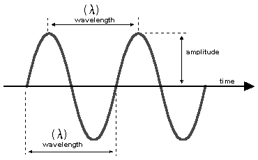

The equation is γ = c/f c = 300,000,000 meters/second where γ = wave length in meters, and f is the frequency of the wave in cycles per second

### ANTENNA IMPEDANCE

Most half-wave dipoles are fed at the centre because the maximum current point is the minimum voltage point, and it is easier to produce transmission lines for low voltage than for high voltage .Also, when the half-wave dipole is resonant, the capacitive reactance and inductive reactance cancel each other, leaving resistance only as the net impedance. Under such conditions the antenna impedance is resistive between any two points equidistant from the center along the antenna length.

### DIRECTIVITY

Radiation emitted by a point source radiator would extend outward equally in all directions. However, this is never true with practical antennas. Consequently, all antennas radiate more energy in some directions. In some directions the radiation is weak, or even zero. Thus every antenna has a characteristic radiation pattern. Graphs, called polar diagrams, are commonly used to give a pictorial representation of these radiation patterns. Thus a pictorial representation of the pattern of radiation is called the directivity pattern’ and applies to reception and transmission.

### TERMS RELATED WITH ANTENNA

Band width, beam width and polarization are three important terms, dealing respectively with the operating frequency range of an antenna, the degree of concentration of its radiation, and the space orientation of the waves that it radiates.

### BANDWIDTH

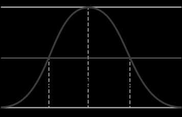

The bandwidth refers to the frequency range over which operation is satisfactory and is generally taken between the halt power points. Therefore, it is a width of frequency over which the antenna maintains certain required characteristics like gain, SWR (Standing Wave Ratio), pattern (shape or direction), Polarization and impedance.

### BEAMWIDTH

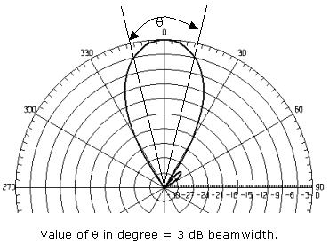

The beam width of an antenna is the angular separation between the two half power points on the power density radiation pattern. It is also, of course, the angular separation between the two 3-db down points on the field strength radiation pattern of an antenna. The term is used more frequently with narrow-beam antennas than with others and refers to the main lobe. Beam width is quoted in degrees.

### POLARIZATION

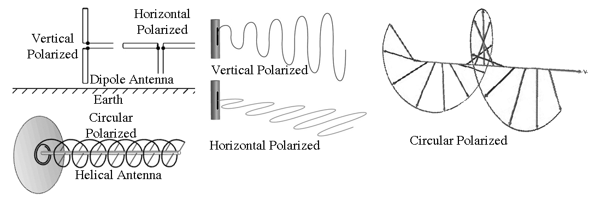

This is defined as the direction of the electric-field component of the wave with respect to ground. As the wave travels through space, its electric field is vertical with respect to ground, the wave is vertically polarized, If the electric field is horizontal with respect to ground, it is horizontally polarized. With a simple antenna the position of the antenna determines the polarization of the wave. Vertically-positioned antennas produce vertically-polarized waves and horizontally- positioned antennas produce horizontally-polarized waves.

### DIPOLE ANTENNA

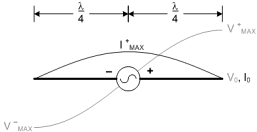

The fundamental radio antenna is a metal rod or tubing which has a physical length approximately equal to one half wavelength in free space at the frequency of operation. Such a structure is known as a half-wave dipole. It is defined as a symmetrical antenna in which the two ends are at equal potential relative to the midpoint.

A half-wave dipole is usually positioned horizontally relative to the earth’s surface. Another identity given the half wave dipole is zero-db gain antenna”. This identification is useful only when some other structure used as an antenna affords certain advantages in the concentration or radiation, and is compared with the half-wave dipole.

Every half-wave dipole (continuous rod split) is the equivalent of a resonant circuit. It has distributed L, C and R. The L is present in the metallic elements when current flows. The R takes the form of electrical losses associated with the r.f. currents rather than the d.c. resistance of the metal, although this too exists.

Like the conventional L-C circuit, a half-wave dipole antenna can be made resonant only to one frequency, the frequency for which it has been cut’. To change the resonant frequency, the length of

the elements is altered as needed.

Although the half-wave dipole is dimensioned to a particular Radio frequency, it will like any resonant circuit, function over a narrow range of frequencies spread equally on both sides of circuit resonance. While it is impossible to set definite limits of the bandwidth of an antenna and apply it to every antenna. we can say that the usual bandwidths embrace several percent of the resonant frequency above and below resonance. Whether the antenna will tune’ broadly or sharply, is a function of its 0’, which in turn is a function of the outside diameter of the antenna. Hence, the

broader the antenna is, larger its acceptance bandwidth.

### VOLTAGE AND CURRENT IN HALF-WAVE DIPOLE

With very few exceptions all types of transmitting antennas function with standing waves of voltage and current along the elements. Voltage is fed to the antenna and current flows to the open end. It cannot go further, hence comes to zero. The related magnetic field collapses back into the antenna and makes the voltage maximum at the ends. A fixed pattern of standing waves develops in the half-wave dipole as long as energy is supplied to the antenna. In the half-wave metal rod (continuous or split) the standing wave pattern of voltage and current has the voltage maximum at the ends and minimum at the centre. The current is maximum at the centre and minimum

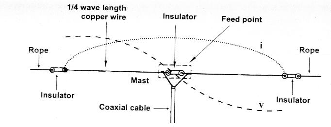

*HALF WAVE DIPOLE* The standing wave of voltage and current is not influenced by the orientation of the antenna; it can be physically positioned horizontally, vertically, or obliquely. Neither is the standing wave pattern is influenced by the amount of energy supplied to the antenna; the pattern is the same for small and large amount of power, and it is the same for small diameter or large diameter elements.

### THE “INVERTED V” ANTENNA

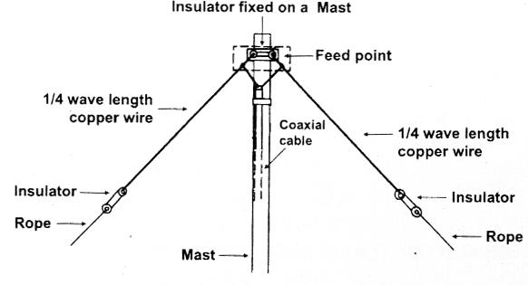

A popular non directional antenna is the so called “inverted V’ or “drooping doublet”. Its principal advantages are that it requires but one supporting structure, and that it exhibits more or less omni- directional radiation characteristics when cut bra single band. The multi band version is somewhat directional above 7 MHz off the ends (not broadside) of the antenna. This is because the legs of the “V’ are long in terms of wavelength at 14,21 and 28 MHz The antenna offers a good compromise between vertical and horizontal polarization, thus making it effective for local as well as DX communications Its low-angle radiation compares favorably with that of a full size one quarter wavelength vertical worked against ground. When fed it serves as an excellent multi band antenna.

For single-band operation the “V” is cut to the same length as a half- wave length doublet, and is fed with 52-ohm coaxial line. Its center (feed point) should be as high above ground as possible, preferably one quarter wavelength or more at the operating frequency. The apex angle should be as close to 90 degrees results. Less than a 90 degree angle causes excessive cancellation of the signal, and should be avoided. Though some operations have reported satisfactory results when supporting the “V” from a metal mast or tower, it is best to use a wooden mast to keep the field of the antenna unobstructed. Good results can be had by supporting the center of the antenna from a limb on a tall tree, provided the area below the limb is completely open.

Single-band, coax-fed inverted V will normally require some pruning to make them resonant at the desired frequency. The standard doublet formula is recommended for a starting point, but because the ends of the “V” are normally in close proximity to ground this antenna will be slightly shorter

than a horizontal dipole. No formula can be given because of the variations in the ground properties in different areas. Also the actual height above ground in a particular installation, plus the proximity of the ends of the antenna to nearby objects, will have a marked effect upon resonance.

The best way to tune the antenna is to insert an SWR bridge in the coax feed line and prune an inch at a time off each end of the “V” until the lowest SWR is obtained.

### PARASITIC ARRAY (YAGI ANTENNAS)

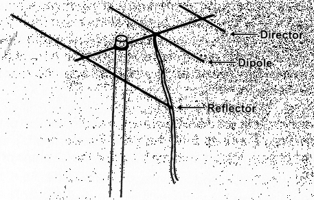

The Parasitic array is a way of using resonant half-wave dipoles to concentrate radiation in a desired direction and minimize radiation in undesired directions. This affords gain in the antenna. The reference is the half-wave resonant dipole previously identified as the zero-db gain antenna. If an antenna design is said to afford a gain of 3 db, the result relative to radiated energy in a chosen direction is the same as if the zero db gain resonant half-wave dipole had been used with twice as much power obtained from the transmitter (3 db = 2 times increase in power; 6 db = 4 times increase in power. 10 db = 10 times increase in power). An antenna with gain tends to concentrate the radiated energy into a narrower beam. Therefore, the antenna must be pointed more accurately.

A parasitic array or beam antenna contains several elements viz a resonant half-wave dipole that receives power from the transmitter, or which delivers 1C received power to the receiver, and is called the driven element; also, one more continuous metal rods (the parasitic elements, which are parallel to e driven element at the same “line-of-sight” level). The rods are electrically coupled to, but not connected to, the driven element. The rod in front of the driven element is the director. Sometimes, two or more directors are used. The rod in back of the driven element is the reflector, of which only one is used. Frequently both director and reflector are used with the driven element in the same antenna.

When treated in terms of transmission, energy is delivered to the driven element. It radiates energy towards the front and the rear. Some of this energy induces current in the parasitic element(s), which in turn re-radiates virtually all the energy. By suitable dimensioning of the parasitic relative to the driven element, as well as the electrical distance between them, the electrical energy “- radiated by the parasitic is ‘timed’ to reinforce the current in the driven element. It also reinforces

the radiation in front of the antenna, while tending to cancel the radiation towards the rear. The result is concentration of the radiation towards the front of the antenna (i.e. towards the desired direction).

When receiving, the parasitic element(s) and the driven element are acted upon by the approaching wave-front, but not at the exact moment because of the spacing between them. By suitable electrical timing (the spacing and the dimensions of the elements) energy received from the front of the antenna is reinforced in the driven element; energy arriving from the rear is effectively cancelled in the driven element. Because the current in the driven element is a combination of that received prom the transmitter as well as from the parasitic element(s), the feed point impedance of the driven element is much less than the 72 ohms of the resonant half-wave dipole.

### FOLDED DIPOLE

A variation of the conventional half-wave dipole is the folded dipole. In effect it is two half-wave length dipoles one a continuous rod and the other split in the center connected in parallel.

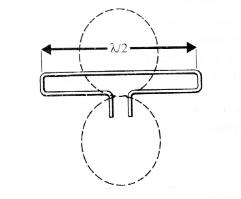

The transmission line is connected to the split dipole. Its half-wave dimensioning is done exactly as for the ordinary half-wave dipole. Its behavior differs from the conventional half-wave dipole in several respects. The directivity of the folded dipole is bidirectional, but because of the distribution of the currents in the parts of the folded dipole its input impedance is very much higher. If all parts of the antenna are made of like diameter rod of tubing, the feed point impedance is 288 ohms. In this way it is an excellent match for 300 ohm twin-lead transmission line.

### THE RHOMBIC

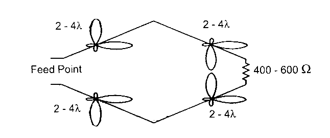

### ANTENNA

The Rhombic is a very efficient antenna of broad frequency capability, and is prominent in all radio communication facilities where the space necessary for the large structure is available. It can be said to be a double ‘V” in which case it becomes a diamond shaped structure lying in the horizontal

plane. It can be terminated or unterminated, the difference between the two being directivity

### KINDS OF RADIO SIGNALS

We have already established that communication by radio is accomplished by electromagnetic energy (electromagnetic waves) which travel from a transmitting antenna to the receiving antenna. This broad statement does not however, identify the kinds of radio signals that come within the boundaries of electromagnetic waves. The differences among radio signals arise principally from the techniques employed in making the intelligence part of the radiated signal prior to radiation.

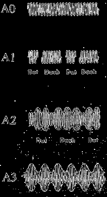

A0 : Continuous oscillations of constant amplitude and frequency, Nonmodulated waves

A1 : Continuous oscillations of constant amplitude and frequency, interrupted (keyed) in a sequence which corresponds to an International code

A2: Modulated telegraphy in which an audio tone amplitude modulates a carrier. The audio tone is keyed in accordance with an International Morse code.

A3: Telephony Constant-frequency oscillations modulated by the intelligence being transmitted.

These differences give rise to different identifications. The identity of each type of radio signal is called a type of emission. Modern communication technology has given rise to a great many kinds of modulation, hence, many kinds of emission.

### Exercice
1. What does AM mean?

a) Angelo Marconi b) Anno median c) Amplitude modulation d) Amperes
2. What frequency range is the High Frequency band?

a) 3-30 KHz b) 30-300 KHz c) 3 to 30 MHz d) 30 to 300 MHz
3. Sometimes computers are connected to a UPS system. What does UPS mean?

a) United Parcel Service b) Uniform Product Support c) Under Paneling Storage d) Uninterruptible Power Supply
4. A given signal's second harmonic is twice the given signal's __________ frequency...?

a) Fourier b) Foundation c) Fundamental d) Field
5. Voltage is sometimes referred to as EMF or Electromotive...?

a) Field b) Factor c) Flash d) Force
6. "FET" is a type of transistor; Its full name is ________ Effect Transistor...?

a) Field b) Factor c) Flash d) Force
7. When measuring the characteristics of a small-signal amplifier, say for a radio receiver, one

might be concerned with its "Noise..."? a) Fundamental b) Fall c) Force d) Figure
8. Which of the following will have least wavelength

a) VHF b) EHF c) HF d) UHF
9. 30 to 300 MHz frequency is categorized as :

a) MF b) VHF c) UHF d) SHF
10. For a frequency of 30 MHz the wavelength will be :

a) 10m b) 1m c) 0.1m d) 0.01m
11. The range of audio frequency is :

a) 20kHz to 15 MHz b) 20 kHz to 150 MHz c) 20 Hz to 15MHz d) 20 Hz to 15 kHz

The unit of electric field intensity E is :

a) Volts/metre b) Ampere/metre c) Coulombs/metre d) Henry/metre
13. The current distribution on a half wave dipole is :

a) uniform b) sinusoidal c) triangular d) complex
14. For very high frequencies earth acts as a :

a) conductor b) dielectric c) resistor d) None of these
15. A wavelength of 15mm could be expected in :

a) VHF b) HF c) EHF d) SHF
16. The gain of an antenna :

a) varies inversely as wavelength b) varies inversely as square of wavelength c) is independent of wavelength d) varies directly as wavelength
17. Yagi antenna is used for :

a) television b) radar c) medium wave broadcasting d) None of these
18. Which of the following will increase the antenna radiation efficiency?

a) Use of larger section of conductor b) providing insulation on conductor c) top loading of antenna d) any of the above
19. The director in a Yagi antenna :

a) is longer than the radiating element b) is shorter than the radiating antenna c) can be longer or shorter than the radiating element d) does not exist.
20. Antenna used in radar is :

a) dipoles b) yagi antenna c) parabolic dishes d) None of these
21. Television receiver antenna is usually :

a) rhombic antenna b) yagi antenna c) parabolic dishes d) turnstile antenna
22. Which of the following antennas gives circular polarization :

a) yagi ± uda b) parabolic c) dipole d) helical
23. Which of the following statement is false?

a) A grounded l/4 antenna is one half the length of a l/2 dipole.

b) A vertical antenna transmits in all directions, in a circle in a horizontal plane.

c) A grounded vertical antenna transmits ground waves and sky waves.

d) A counter poise must be a good insulator.

Which of the following can make the antenna electrically longer? a) Series capacitor b) capacitive top loading c) vertical polarisation d) Circular polarsation
25. A unipole is also known as :

a) omnidirectional radiator b) unidirectional radiator c) line radiator d) None of the above
26. Radiation intensity does not depend upon :

a) the antenna direction b) distance from the radiator c) both (a) and (b) above d) None of the above
27. In case of antenna, the ratio of the power radiated in the desired direction to the power radiated in the opposite direction is known as :

a) transmission efficiency b) front to back ratio c) loss coefficient d) None of the above
28. In case of antenna decreasing Q :

a) increases bandwidth b) decreases bandwidth c) independent of bandwidth d) None of the above
29. The directional pattern of loop antennas:

a) depends on shape of antenna loc b) is independent of shape of the loop c) depends on number of turns of loop d) None of the above
30. The ratio of radiation intensity in a particular direction to average radiated power is called a) directive gain b) power gain c) directivity d) DIRP

### Model Type Questions
1. The following Amplifier is not used as audio amplifier because of distortion.

a) Class A b) Class B d) Class C d) Both A & B
2. It is desired to receive amplitude amplitude modulated signal of frequency of 2000 Hz. If the IF of the receiver is 465 KHz the LO frequency should be a) 2465 KHz b) 2000 KHz c) 465 KHz d) None
3. The range of MF is a) 30 to 300 KHz b) 300 to 3000 KHz c) 3 to 30 KHz d) None
4. The polarization of electromagnetic wave is defined by its a) Propagation b) The E field c) The H field d) The transmitting antenna
5. The half wave dipole aerial has a theoretical impedance of a) 650 Ohms b) 720 Ohms c) 800 Ohms d) None
6. A half wave antenna resonant on 7100 kHz is approx. the following meters long a) 20 Meters b) 40 Meters c) 80 Meters d) 160 Meters
7. As temperature increases, the resistance of a metallic conductor:

a) Decreases b) Increases c) remains Constant d) Become negative
8. Impedance is a combination of a) Reactance with reluctance b) Resistance with conductance b) Resistance with reactance d) Reactance with radiation
9. An inductor and a capacitor are connected in series. At resonant frequency impedance is a) Minimum b) Maximum c) Totally resistive d) Reactance with radiation
10. The major charge carriers of a NPN transistor is a) Holes b) Electrons c) Ions d) None
11. A diode in proper biasing condition converts a) AC to DC b) DC to AC c) AC to pulsating DC d) None
12. One milli volt is equal to a) 0.01volt b) 0.0001 volt c) 0.001volt d) None

### Additional Syllabus for General Grade

### Radio Theory and Practice
