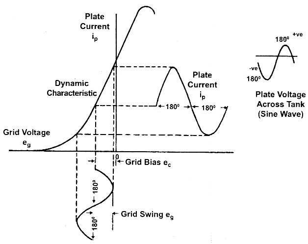
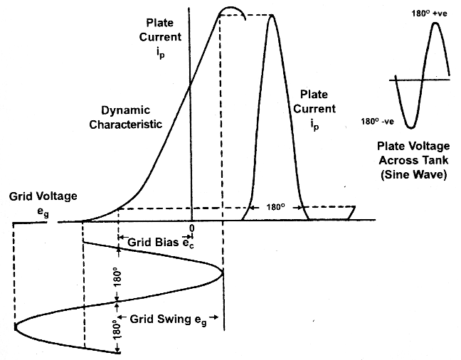
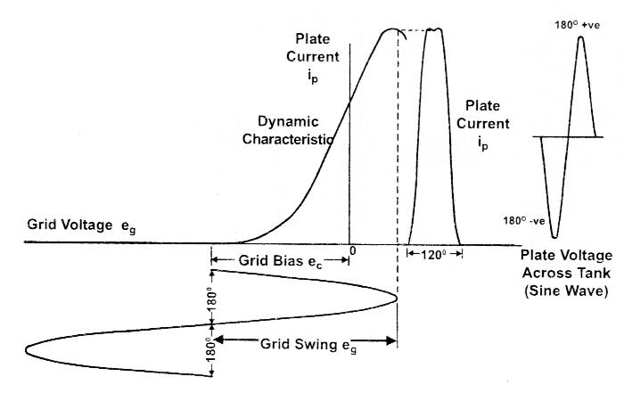
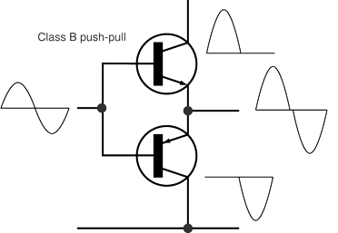
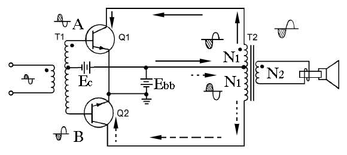
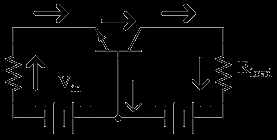
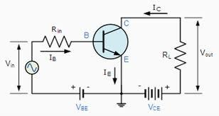
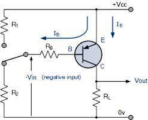

## 11. AMPLIFIER

A device which amplifies weak signals to strong signals is called an amplifier.

### CLASSIFICATION OF AMPLIFIERS

Power amplifiers use special valves or transistors capable of large output current values and able to dissipate power at anode through special arrangement.

### CLASS ‘A’ AMPLIFIER

Class A amplifiers are those in which the grid bias and plate voltage are so chosen that the tube operates over the linear portion of dynamic curve or it is an amplifier in which plate current flows over the entire cycle.

### CHARACTERISTICS
1. Since the tube operates over the linear portion of the dynamic curve, hence the waveform at the output is exactly similar to that of input. Therefore they are used where freedom from distortion is the main factor.
2. It has high voltage amplification and very little distortion.
3. In practice the power output is small because both current and voltage are restricted to comparatively small variations.

### CLASS ‘B’ AMPLIFIER

These amplifiers are biased to cut-off or approximately so, hence plate current flows during positive half cycle of the input voltage.

### CHARACTERISTICS
1. Since negative half cycles are totally absent in the output, the distortion is high as compared to that in class A’ amplifiers.
2. Since voltage required in the input is large, voltage amplification is reduced.
3. The plate efficiency is 50%. This is due to the reason that plate current flows only when signal is applied
4. For a given tube rating, the power output is relatively high.

### CLASS ‘AB’ AMPLIFIER

The grid bias and signal voltages are so adjusted that the plate current flows for more than half and less than entire cycle. The characteristic of this amplifier lie in between those of class A’ and class ‘B amplifiers.

### CLASS ‘C’ AMPLIFIER

In these type of amplifiers the tube s biased beyond cut off point, the grid bias is as much as twice the cut off value. Hence the plate current flows in pulses of less than one half cycle.

### CHARACTERISTICS
1. Since the grid may be driven to the plate saturation value of grid voltage, so plate pulses beat no resemblance to the input waveform. Hence distortion is exceedingly high.
2. Since input signal used is vary large, the voltage amplification is very low.
3. Power output per tube is higher as compared to class B’ amplifier.
4. Plate efficiency is as high as 85% to 90%. This is due to the fact that the plate current flows only when the grid is driven positive

These amplifiers are not used as audio frequency amplifiers because of high distortion. But they are used as radio frequency amplifiers for high power output.

### PUSH PULL AMPLIFIER

In order to increase the efficiency in power amplification, two Transistors are used in push pull arrangements in the output stage. One Transistor amplifies the +ve half cycle of the signal while the other Transistor amplifies the -ve half cycle of the signal

Push pull arrangement: when one Transistor is pushing (conduction), the other is pulling (stopping conduction).

Circuit details: Below figure shows the circuit where two Transistors Q1 and Q2 are used in push pull. Both the Transistors are operated in class B operation i.e. plate current is nearly zero in the absence of the signal. The centre tapped secondary of the input transformer T1 supplies equal and opposite voltage to the grid circuit of the two Transistors. The output transformer T2 has centre tapped primary. The output is taken across the secondary of output transformer T2.

Operation: During the +ve half cycle of the signal, the end A of the input transformer is +ve and end B is -ve. This will make the base of transistor Q1 more +ve and that of Transistor Q2 more -ve. This does not means that grid will actually become +ve. It cannot happen because the DC base bias keeps both base at a -ve potential. Thus transistor Q1 conducts and Transistor Q2 is cut off. Therefore, this half cycle of the signal is amplified by transistor Q1 and appears in upper half of the output transformer primary. ln the next half cycle of the signal, transistor Q2 conducts and transistor Q1 is cut off therefore this half cycle of the signal is amplified by transistor Q2 and appears in the lower half of the output transformer primary. The plate current flow on alternate half cycle of the signal through the center tapped primary of the output transformer and since they are in opposite direction, the effect is the same as a normal sine wave AC. This induces voltage in the secondary of the output transformer.

### Advantages: Its efficiency is high (About 80%)

For the same base current dissipation, the output power is nearly 5 times of a single Transistor amplifier.

Ex: Public address system

### DISTORTION IN AMPLIFIERS

The output of an amplifier is said to be distorted, if the output waveforms of the output voltage and currents are different from that of input.

### (i) NONLINEAR HARMONIC DISTORTION

Due to the nonlinearity of the dynamic characteristic, the output current and voltage waves, in addition to the fundamental wave of input signal frequency, contain harmonic components, the number and magnitude of which depends on the amplitude of input signal

### (ii) FREQUENCY DISTORTION

It is produced due to the unequal amplification of the different component frequencies present in the given signal In the case of audio signals, frequency distortion leads to a change in quality of sound.

### (iii) PHASE DISTORTION

It is said to take place when the phase angles between the component waves of the output are not the same as the corresponding angles of the input. The changes in phase angles are due to the presence of reactive elements in the tube (grid-cathode capacitance). The human ear is unable to distinguish the phase difference and is thus not sensitive to the distortion. Hence phase distortion is of no practical significance in audio amplifiers.

### Transistor Amplifiers

Amplifier circuits used with transistors fall into one of three types, known as the common-base, common-emitter and common-collector circuits. The three circuits shown in the figure correspond approximately to the grounded-grid, grounded-cathode and cathode-follower circuits, respectively, used with vacuum tubes.

### Common Base Circuit

The input circuit of a common-base amplifier must be designed for low impedance, since the emitter-to-base resistance is of the order of 26/Ie ohms, where I.e. is the emitter current in milli amperes. The optimum output load impedance, RL may range from a few thousand ohms to 100,000 depending on the requirements. In this circuit the phase of the output (collector) current is the same as that of the input emitter) current. The parts of these currents that flow through the base resistance are likewise in phase, so the circuit tends to be regenerative and will oscillate if the current amplification factor is greater than one.

### Common Emitter Circuit

The common-emitter circuit shown in the figure corresponds to the ordinary grounded-cathode vacuum-tube amplifier. The base current is small and the input impedance is therefore fairly high- several thousand ohms in the average case. The collector resistance is some tens of thousands of ohms, depending on the signal source impedance. The common-emitter circuit has a lower cutoff frequency than does the common-base circuit, but it gives the highest power gain of the three configuration.

### Common Collector Circuit

Like the vacuum tube cathode follower, the common-collector transistor amplifier has high input impedance and low output impedance. The input resistance depends on the load resistance. The input resistance is directly related to the load resistance is a disadvantage of this type of amplifier if the load is one whose resistance or impedance varies with frequency. The output and input currents are in phase.
