## 3. CAPACITORS

When two conducting plates are separated by dielectric and connected to a Potential Difference then one of the plates becomes negatively charged with respect to the other plate. This means a Potential Difference is created by dielectric.

Capacitance is the ability to store electric charge. The unit is FARAD.

Symbol of capacitor

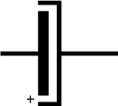

The charging of the capacitor continues until the Potential Difference across the capacitor is equal

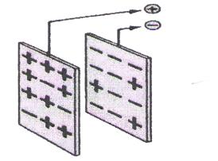

to the applied voltage.

THE CHARGED CAPACITOR

*While one plate has excess of positive charges(electricity)*

*the other plate has excess of negative charges(electricity)*

### CAPACITANCE

It is the ability of a component by which the amount of electrical charge is stored.

The capacitance of a condenser is directly proportional to the plate area and inversely proportional to the distance between the plates and also depends on the dielectric constant of the dielectric. C=K*A/D

Where C is the capacitance. A is the area of the plates. K is the dielectric Constant. D is the distance between the plates

### NATURAL CAPACITOR

A capacitance formed when two conductors are placed near each other but separated by an insulator.

### ARTIFICIAL CAPACITOR

In almost all radio circuit’s capacitance is required for various purposes. The capacitance is

introduced in the circuit by means of built in capacitors of different types are artificial.

Capacitors can be mainly divided into two categories.

### Fixed Type and Variable Type

FIXED CAPACITORS: The fixed capacitors are further classified according to the material used for the dielectric. The types of fixed capacitors are:
1. Paper Dielectric Capacitors 2. Mica Capacitors 3. Ceramic Capacitors 4. Glass Dielectric Capacitors 5. Vacuum and Gas Dielectric Capacitors 6. Oil Dielectric Capacitors
7. Electrolytic Capacitors

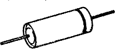 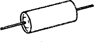 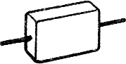 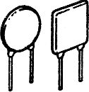

*METALLIZED TYPE* *PAPER TUBULAR SILVER MICA* *(Sealed in metal tube) CERAMIC* *DISC*

VARIABLE CAPACITORS: The capacitance can be varied either by altering the distance between the plates or by altering the area of the plates.

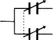 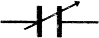

Gang Capacitor Trimmer

### TYPES OF VARIABLE CAPACITORS
- Air Dielectric Variable capacitors.
- Straight Line Capacity Variation Capacitors.
- Straight Line wave length Capacitors.
- Straight Line frequency Capacitors.
- Multiple or Gang Capacitors.
- Midget and Micro Capacitors.
- Differential Capacitors.
- Split Stator Capacitors.

The charging of the capacitor continues until the Potential Difference across the capacitor is equal to the applied voltage.

### SERIES CAPACITANCE

Capacitors connected in series is equivalent to increasing the thickness of dielectric, which means combined capacitance is less than the smallest individual value. It can be written as

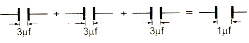

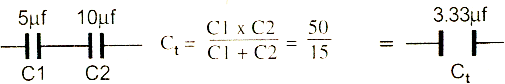

To calculate capacitance in series use the formula: 1/CT = 1/C1 +1/C2 +1/C3 + ...+ 1/Cn

### PARALLEL CAPACITANCE

Capacitors connected in parallel is equivalent to adding the plate area, which means the total capacitance is the sum of the individual capacitance. It can be written as

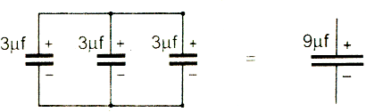

To calculate capacitances in parallel use the formula: CT=C₁+C₂+C₃= …. +Cn
