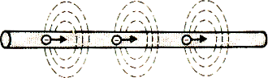
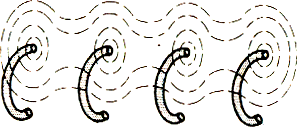
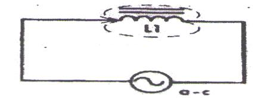
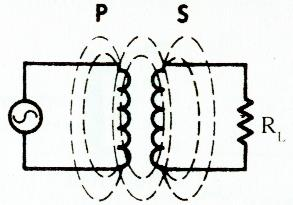

## 5. INDUCTOR

A coil or loop, which has the property to oppose any change in alternating current is called an inductor.

L

### INDUCTANCE

It is the property of a circuit or a component that opposes a change in current. Represented by L and the unit is Henry (H).

Inductance of a coil depends on
1. The number of turns; more the number of turns, greater is the inductance of the coil.
2. Permeability

*Conductor Contains Inductance*

*Flux between coils* 3. Cross section larger the cross section of the core, higher is the inductance,
4. Spacing of the turns: the smaller the spacing between turns of the coil, the higher is the inductance.

### INDUCTANCE IS OF TWO TYPES

## 1. SELF INDUCTACNE 2. MUTUAL INDUCATANCE

### SELF-INDUCTANCE

The ability of a conductor to induce voltage in itself when the current changes. When current flows through a coil, a magnetic field is developed around the coil. If this current is changed the lines of force around the coil will also change, which will induce a voltage in the coil. This is called self- inductance.

### MUTUAL INDUCTANCE

When two coils are placed nearby and one of the coils is carrying current then flux is produced in it, which also links with second coil thereby inducing an emf in it. The transformer works on the principle of Mutual Inductance.

Maximum coupling (unity or 1) occurs when all the flux lines from each coil cuts all the turns of *the opposite coil*

### COEFFICIENT OF COUPLING

The fraction of magnetic flux from one coil linking another coil is the coefficient of coupling between two coils and is denoted by letter K. If all the flux of L1 links L2, then the coefficient of coupling K is 1. Generally it can be expressed as

K = flux linkages between Li and L2 / flux produced by L1.

The coefficient of coupling increases if the coils are closely placed. A high value of K is called high coupling, induces more voltage in the other coil. A low value of K is called loose coupling and induces less voltage. If coils are kept far apart there is no mutual inductance and the coefficient of coupling is zero.
