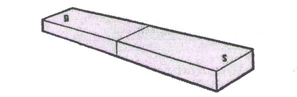
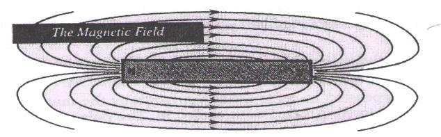

## 4. MAGNETISM

A piece of iron, nickel, cobalt, steel, alloy (e.g. alloy made from non-magnetic copper, manganese and aluminum) etc. usually in the form of a bar having properties of attracting or repelling iron is called a magnet. In a magnetic bar, there are two poles: North and South. They are marked as ‘North’ and ‘South’

poles because, when the magnetic bar is suspended horizontally, one of the ends will always point towards the Earth’s geographical north and the other pole towards the Earth’s geographical south. This is because of the fact that the Earth itself behaves like a huge magnet. In a magnet, the like poles repel and the unlike poles attract-a reason for the specific alignment of the magnetic bar.

The magnetic bar is surrounded by the invisible lines of forces which originate from the ‘North’ pole and terminate in the ‘South’ pole.

MAGNETIC FLUX: The entire group of magnetic field lines which flow outward from the North Pole to the south pole of a magnetic is called flux. It’s C.G.S. unit is MAXWELL (MX) and it’s

M.K.S. unit is WEBER (WB).

1 Weber = 10 Maxwell

FLUX DENSITY (B): It is the number of magnetic field lines per unit area of a section perpendicular to the direction of flux. B = ∅/A or Flux density = total Flux/area

In CGS system the unit is GAUSS (g) and in MKS system it is TESLA (T).

### PERMANENT MAGNETS

Permanent magnets are those we are most familiar with, such as the magnets hanging onto our refrigerator doors. They are permanent in the sense that once they are magnetized, they retain a level of magnetism. As we will see, different types of permanent magnets have different characteristics or properties concerning how easily they can be demagnetized, how strong they can be, how their strength varies with temperature, and so on.

Use of Permanent magnets in Electronics:

Permanent magnets are used in electronics to make electric meters, headphones, loudspeakers, radar transmitting tubes etc.

### ELECTROMAGNETS

An electromagnet is a tightly wound helical coil of wire, usually with an iron core, which acts like a permanent magnet when current is flowing in the wire. The strength and polarity of the magnetic field created by the electromagnet are adjustable by changing the magnitude of the current flowing through the wire and by changing the direction of the current flow.

### MATERIALS USED FOR PERMANENT MAGNETS

There are four classes of permanent magnets:

Neodymium Iron Boron (NdFeB or NIB)

Samarium Cobalt (SmCo)

Alnico

Ceramic or Ferrite

MAGNETO-MOTIVE FORCE (MMF): This is called magnetizing force or magnetic potential. The current (I) and number of turns (N) together produces flux.

MMF = NI

In MKS System the unit is Ampere turn/meter

### RELUCTANCE

Opposition to the production of flux is called reluctance.

### PROPERTIES OF MAGNETS

(a) A magnet attracts pieces of iron.

(b) The magnetism appears to be concentrated at two points on the magnet known as the poles of the magnet.

(c) The line joining the poles is known as the magnetic axis and the distance between the poles as the magnetic length.

(d) When freely suspended so as to swing horizontally the magnet comes to rest with its poles in an approximately North-South direction. The pole pointing to the north is called the North Pole and that pointing to the south is called the South Pole.

(e) When two magnets are brought together it is found that like poles repel each other and unlike poles, attract each other.
