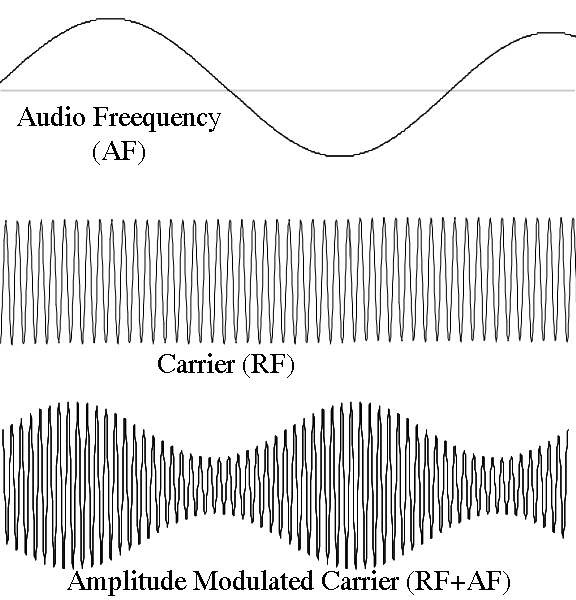
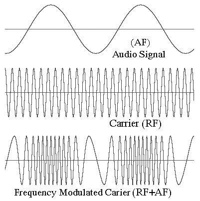
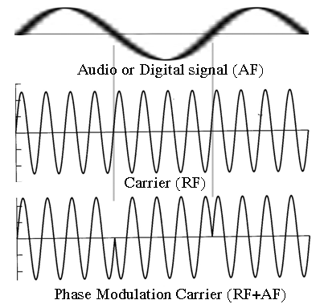
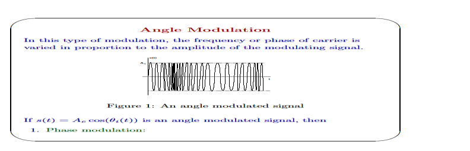
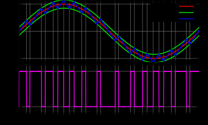
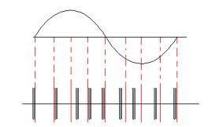
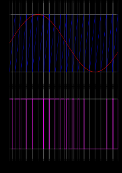
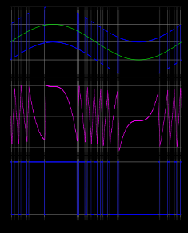

## 13. MODULATION

The audio frequency signals cannot be radiated out from the aerial directly because transmission at audio frequencies is not practical. For this purpose oscillations of very high frequency or radio frequency are produced with the help of oscillators. These electromagnetic waves so produced are of constant amplitude and of extremely high frequencies. The audio frequency signal is then super imposed on the RF waves which are known as Carrier waves (because they carry AF signals through space to distant places). The process by which AF signal is super imposed on the Carrier wave is known as Modulation. The RF and the AF travel through the space and at the receiving end they strike the receiver aerial and enter the receiver which separates the RF from the AF. The audio frequency signal is converted back into sound. This process by which RF waves and AF waves are separated is known as detection or demodulation (because it is the reverse of modulation). There are three types of Modulations, namely

I) Amplitude Modulation

ii) Frequency Modulation

iii) Phase Modulation

### AMPLITUDE MODULATION

A method of transmission and reception of radio waves in which the amplitude of the carrier wave is made to vary in accordance with the audio frequency wave.

### FREQUENCY MODULATION

In this method the carrier wave is modulated by changing its frequency in relation to the AF signal without changing its amplitude. This process is known as frequency modulation (FM).

### PHASE MODULATION

A method of conveying information via radio frequency carrier waves in which the instantaneous phase of the carrier is shifted in accordance with the audio frequency wave. Phase Modulation is very similar to FM wave.

### Major Modulation Systems

The broadcast category of modulation systems is how the main carrier is modulated. The major types are amplitude modulation, angle modulation and pulse modulation.

### Angle Modulation

Two particular forms of angle modulation are frequency Modulation (FM) and Phase Modulation (PM). The term frequency modulation is often used to cover various forms of angle modulation. Amateurs use FM when referring to angle modulated VHF&UHF radios which may use either FM

or PM. Frequency and Phase modulations are not independent, since the frequency cannot be varied without also varying the phase, and vice versa. The communications effectiveness of FM and PM depends almost entirely on the receiving methods. If the receiver will respond to frequency and phase changes but is insensitive to amplitude changes, it will discriminate against most forms of noise, particularly impulse noise such as that from ignition systems.

### Pulse Modulation

 

Pulse Modulated signals are usually sent as a series of short pulses separated by relatively long stretches of time with no signal being transmitted. (A typical pulse transmission might use1-µs pulses with a 1000-Hz pulse rate. Thus, the peak power of a pulse transmission is usually much greater than its average power.

### PULSE WAVE SOLID – STATE BASICS

 

Demodulation is the process of deriving the original modulation signal from a modulated carrier wave. The received signal usually contains noise and distortion picked up along the way. Demodulation is part of the receiving process and is performed in a demodulator. While a demodulator is a normal part of a radio receiver, external demodulators are used for some types of communications.
