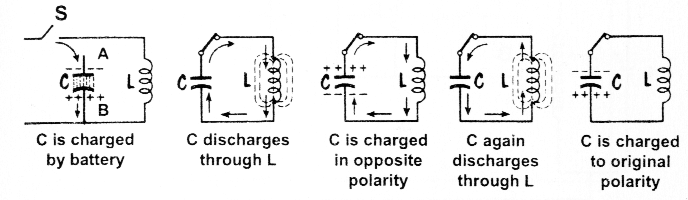
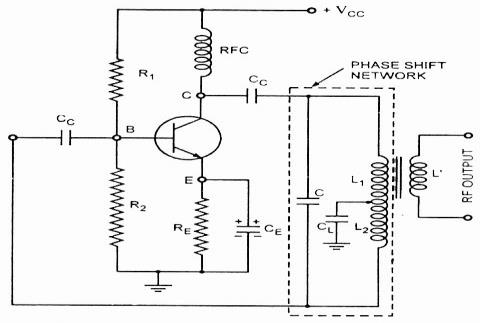
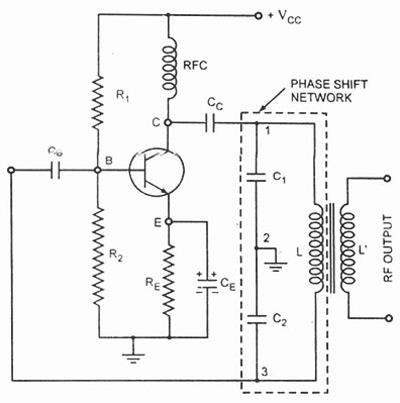
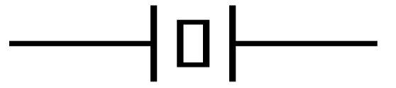
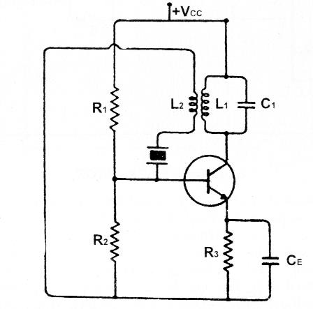

## 12. OSCILLATOR

An oscillator is a mechanical or electronic device that works on the principles of Oscillations, a periodic fluctuation between two things based on changes in energy. Computers, clocks, watches, radios, and metal detectors are among the many devices that use oscillators.

A clock pendulum is a simple type of mechanical oscillator. The most accurate time piece in the world, the atomic clock, keeps time according to the oscillation within atoms. Electronic Oscillators are used to generate signals in computers, Wireless Receivers and Transmitters, and Audio- Frequency equipment, particularly music synthesizers. There are many types of electronic oscillators, but they all operate according to the same basic principle. An oscillator always employs a sensitive amplifier whose output is fed back to the input in phase. Thus, the signal regenerates and sustains itself. This is known as positive feedback. It is the same process that sometimes causes unwanted "howling" in public-address systems.

The frequency at which an oscillator works is usually determined by a quartz crystal. When a direct current is applied to such a crystal, it vibrates at a frequency that depends on its thickness, and on the manner in which it is cut from the original mineral rock. Some oscillators employ combinations of inductors, resistors, and/or capacitors to determine the frequency. However, the best stability (constancy of frequency) is obtained in oscillators that use quartz crystals.

In a computer, a specialized oscillator, called the clock, serves as a sort of pacemaker for the microprocessor. The clock frequency (or Clock Speed) is usually specified in megahertz (MHz), and is an important factor in determining the rate at which a computer can perform instructions.

### How Oscillators Work

A basic oscillator is a capacitor and inductor connected together. As the capacitor discharges, the current creates a magnetic field in the inductor. When the capacitor is fully discharged, the field collapses and induces an opposite current that charges the capacitor again. This cycle continues until all the energy is lost through resistance. The frequency of the oscillations depends on the size of the capacitor and inductor.

Every component has some inherent electrical noise, and this noise provides the initial signal for an oscillator. The output noise is sent back to the input as feedback to be filtered and amplified. This process eventually turns the noise into a steady signal.

### OSCILLATIONS IN AN L-C TANK CIRCUIT

*S- Switch C – Capacitor L - Inductor* First charge up the condenser, then

(i) When Switch S is closed, electrons move from plate A’ to plate ‘B’ through coil L

(ii)As electronic current starts flowing, the self induction of the coil opposes the current flow hence the rate of discharge of electrons is somewhat slowed down.

(iii) As plate ‘A’ losses its electrons by discharge, the electron current has a tendency to die down because both the plates are reduced to the same potential. But due to self induction or electric inertia of the coil more electrons are transferred to ‘B’ than are required to fill the deficiency of electrons at B’.

opposite direction.

(v) After this, the condenser discharges in the opposite direction and charging the condenser again.

(vi) This sequence of charging and discharging continues and constitutes oscillating current.

But these oscillations are damped because some energy is dissipated in the form of heat and some in the form of electromagnetic waves.

### HARTLEY OSCILLATOR

Here the plate coil is continues with grid con, the former having less number of turns than the latter, but is also tuned. The frequency is determined by LC. The feed back is adjusted by moving the tap upwards for including more plate coil turns.
1. On closing the switch ‘S’ an EMF is applied to L through C₁, hence damped oscillations are set upon the LC circuit.
2. The variations in grid voltage produced due to oscillatory discharge of C produces variations in plate current.
3. These variations in plate voltage are fed back to LC circuit through C1.
4. Due to the tapped construction of coil L, the phase of the feed back is correct. When end ‘A’ of coil L is positive the ‘B’ is negative or 180 degree out of phase with each other. Since A’ is

connected to grid and C’ is connected to anode they are, at 180 degree out of phase. This results in total phase difference of 360 degrees. This makes AC plate energy feed back to grid exactly in phase with grid energy. Hence the oscillations can be maintained.
5. The function of radio frequency choke (RFC) is to prevent the RF energy set up in L from being short circuited through the battery supply.

### COLPITT’S OSCILLATOR

In this circuit the tap is taken between two condensers instead of between two coils as in Hartley oscillator. Here the feed back is through electrostatic coupling whereas in Hartley circuit it is through electromagnetic coupling.

OPERATION: When switch S is closed the capacitors Cl and C2 are charged. These capacitors discharge through coil L, setting up oscillations of a given frequency. The oscillations across C2 are applied to the grid and appear in the amplified form in the plate circuit and supply losses to the tank

circuit. The amount of feedback depends upon the relative capacitance values of Cl and C2. The smaller the capacitance Cl, the greater the feedback. It is easy to ascertain that energy feedback to tank circuit is of correct phase. The capacitors Cl and C2 act as a simple alternating voltage divider. Therefore, points A & B are 180 Degrees out of phase. The plate output produces a further phase shift of 180 Degrees. In this way, feedback is properly phased to produce continuous un-damped oscillations.

### PIEZOELECTRIC EFFECT

Certain crystalline materials, namely; Rochelle salt, quartz and tourmaline exhibit the piezoelectric effect i.e. when we apply an AC voltage across them, they vibrate at the frequency of the applied voltage. Conversely, when they are compressed or placed under mechanical strain to vibrate, they produce an AC voltage. Such crystals, which exhibit piezoelectric effect, are called piezoelectric crystals. Of the various piezoelectric crystals, quartz is most commonly used because it is inexpensive and readily available in nature.

### TRANSISTOR CRYSTAL OSCILLATOR

A tank circuit L1-C1 is placed in the collector and the crystal is connected in the base circuit. Feedback is obtained by coil L2 inductively coupled to coil Li. The crystal is connected in series with the feedback winding. The natural frequency of L C circuit is made nearly equal to the natural frequency of crystal.

CIRCUIT OPERATION: When the power is turned on, capacitor Cl is charged. When this capacitor discharges, it sets up oscillations. The voltage across Li is fed to coil L2 due to mutual inductance. This positive feedback causes the oscillator to produce oscillations. The crystal controls the frequency of oscillations in the circuit. It is because the crystal is connected in the base circuit and hence its influence on the frequency of the circuit is much more than LC circuits. Consequently, the entire circuit vibrates at the natural frequency of the crystal. As the frequency of crystal is independent of temperature etc, therefore, the circuit generates a constant frequency.

Advantages:
1. They have a high order of frequency stability.
2. The quality factor Q of the crystal is very high. It is high as 10,000 compared to about 100 of LC tank.

Disadvantages:
1. They are used in low power circuits.
2. The frequency of oscillators cannot be changed.

### Exercise
1. A semi-conductor is

(A) one which conducts only half of applied voltage (B) a material whose conductivity is same as between that of a conductor and an insulator (C) a material made of alternate layers of conducting material and insulator (D) a material which has conductivity and having average value of conductivity of metal and insulator.
2. A p-n junction is said to be forward biased, when

(a) the positive pole of the battery is joined to the p-semiconductor and negative pole to the n-semiconductor (b) the positive pole of the battery is joined to the n-semiconductor and negative pole of the battery is joined to the p-semiconductor (c) the positive pole of the battery is connected to n- semiconductor and p- semiconductor (d) a mechanical force is applied in the forward direction
3. At absolute zero, Si acts as?

(a) non-metal (b) metal (c) insulator (d) none of these
4. When N-type semiconductor is heated?

(a) number of electrons increases while that of holes decreases (b) number of holes increases while that of electrons decreases (c) number of electrons and holes remain same (d) number of electron and holes increases equally.
5. Radio waves of constant amplitude can be generated with

(a) FET (b) filter (c) rectifier (d) oscillator
6. The depletion layer in the P-N junction region is caused by?

(a) drift of holes (b) diffusion of charge carriers (c) migration of impurity ions (d) drift of electrons
7. To use a transistor as an amplifier

(a) The emitter base junction is forward biased and the base collector junction is reversed biased (b) no bias voltage is required (c) both junction are forward biased (d) both junctions are reversed biased.
8. For amplification by a triode, the signal to be amplified is given to

(a) the cathode (b) the grid (c) the glass-envelope (d) the anode
9. A piece of copper and other of germanium are cooled from the room temperature to 80K, then

(a) resistance of each will increase (b) resistance of copper will decrease (c) the resistance of copper will increase while that of germanium will decrease (d) the resistance of copper will decrease while that of germanium will increase
10. Diamond is very hard because?

(a) it is covalent solid (b) it has large cohesive energy (c) high melting point (d) insoluble in all solvents

The part of the transistor which is heavily doped to produce large number of majority carriers is (a) emitter (b) base (c) collector (d) any of the above depending upon the nature of transistor
12. An Oscillator is nothing but an amplifier with

(a) positive, feedback (b) negative feedback (c)large gain (d) no feedback
13. When a P-N junction diode is reverse biased the flow of current across the junction is mainly

due to (a) diffusion of charge (b) drift charges (c) depends on the nature o material (d) both drift and diffusion of charges
14. Which of the following, when added as an impurity, into the silicon, produces n-type semi

conductor (a)Phosphorous (b) Aluminum (c)Magnesium (d) both ‘b’ and ‘c’
15. 21. When a n-p-n transistor is used as an amplifier then?

(a) the electrons flow from emitter to collector (b) the holes flow from emitter to collector (c) the electrons flow from collector to emitter (d) the electrons flow from battery to emitter
16. When arsenic is added as an impurity to silicon, the resulting material is?

(a) n-type semiconductor (b) p-type semiconductor (c) n-type conductor (d) Insulator
17. To obtain a p-type germanium semiconductor, it must be doped with?

(a)arsenic (b)antimony (c)indium (d)phosphorus
18. A semi-conducting device is connected in a series circuit with a battery and a resistance. A

current is found to pass through the circuit. If the polarity of the battery is reversed, the current drops to almost zero. The device may be (a) A p-n junction (b) An intrinsic semi-conductor (c) A p-type semi-conductor (d) An n-type semi-conductor
19. The cause of the potential barrier in a p-n diode is ?

(a) Depletion of positive charges near the junction (b) Concentration of positive charges near the junction (c) Depletion of negative charges near the junction (d) Concentration of positive and negative charges near the junction

In forward bias, the width of potential barrier in a p-n junction diode? (a) increases (b) decreases (c) remains constant (d) first increases then decreases
21. A depletion lay consists of?

(a) electrons (b) protons (c) mobile ions (d) immobile ions
22. Which of the following when added acts as an impurity into silicon produced n-type semi

conductor? (a) P (b) Al (c) B (d) Mg
23. In a junction diode, the holes are due to

(a) protons (b) extra electrons (c) neutrons (d) missing electrons
24. The intrinsic semiconductor becomes an insulator at

(a)0°C (b)0 K (c) 300K (d) -100°C
25. In a p-n junction

(a) The potential of the p and n sides becomes higher alternately (b) The p side is at higher electrical potential than the n side (c) The n side is at higher electrical potential than the p side (d) Both the p and n sides are at the same potential
26. if a full wave rectifier circuit is operating from 50 Hz mains, the fundamental frequency in the

ripple will be (a)100Hz (b) 25Hz (c)50Hz (d) 70.7 Hz
27. A n-p-n transistor conducts when?

(a) both collector and emitter are negative with respect to, the base (b) both collector and emitter are positive with respect to the base (c) collector is positive and emitter is negative with to the base (d) collector is positive and emitter is at same potential as the base
28. Barrier potential of a p-n junction diode does not depend on?

(a)doping density (b) diode design (c)temperature (d) forward bias
29. Reverse bias applied to a junction diode

(a) increases the minority carrier current (b) lowers the potential barrier (c) raises the potential barrier (d) increases the majority carrier current
30. In semiconductors at a room temperature

(a) the conduction band is completely empty (b) the valence band is partially empty and the conduction band is partially filled (c) the valence band is completely filled and the conduction band is partially filled (d) the valence band is completely filled
