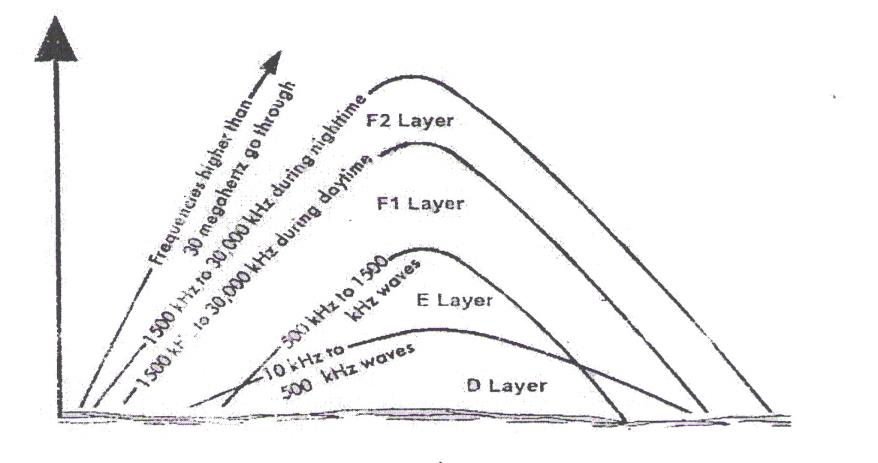
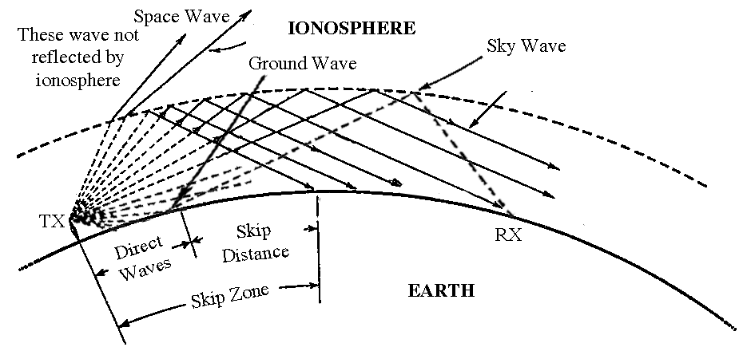

## 16. RADIO WAVE PROPAGATION

The ionosphere is a section of the atmosphere that acts like mirror for the reflection of HF waves, which makes long distance communication possible. The ionosphere is the upper portion of the atmosphere, which receives sufficient energy from the sun for its molecules to splits into positive and negative irons. They remain these ionized for long periods of time. There are variations in the physical properties of the atmosphere, such as temperature, density. At high altitudes the air of the atmosphere becomes ionized under the influence of the sunrays, cosmic rays and other factors.

The ionosphere has four main layers. They are D, E, Fl and F2 layer. Each layer reflects different frequencies of radio waves.

### Refraction in the ionosphere bends sky-wave signals back to earth.

D LAYER: - It is the lowest, existing at an average height of 70 Km. This layer disappears at night is the least important layer from the point of HF propagation. It reflects some VLF and LF waves and absorbs MF and HF waves to certain extent.

E LAYER: - It is next in height, existing at about 100 Km. Like the D layer it disappears at night the reason for disappearances is the recombination of the ions into molecules. One more reason is due to the absence of the sun at night, when radiation is consequently no longer received. The main effect of the E layer is to reflect some HF waves in daytime.

F1 LAYER: It exists at a height of 180 Km in daytime and combines with the F2 layer at night. Although some HF waves are reflected from it, most pass through to be reflected from the F2 layer. The main effect of the Fl layer is to provide more absorption for HF waves.

F2 LAYER: It is the most important reflecting medium for HF radio waves. F2 layer height ranges from 250 to 400 km in daytime. At night it falls to a height of about 300-km because it combines with the Fl layer. It may be noted that the F layer exists at night. The reasons are
1. Since this is the top most layer, it is also the most highly ionized hence there is some chance for the ionization to remain at night, at least to some extent.
2. Although ionization density is high in this layer the air density is not, so most of the molecules in it are ionized. So the ionization does not disappear as soon as the sun sets.
3. Better HF reception is possible at night because of the combination of the Fl and F2 layers into one F layer.

### SELECTIVE FADING

The variation in frequency in the sidebands of a modulated wave is differently affected giving rise to distortion of modulated wave. This effect is known as selective fading.

### DIVERSITY RECEPTION

Automatic volume control is helpful in minimizing fading effects. However AVG is not a complete solution to the problem of fading signals. These fading effects are almost perfectly over-come by the use of a diversity receiving system of which two types
1. Space diversity and 2.frequency diversity.

Depending primarily on frequency, radio waves may travel from transmitting to receiving antenna in a number of line of sight and sky wave.

### GROUND WAVE

The electromagnetic field is propagated parallel to the surface of the earth. The ground wave actually consists of three distinct components namely direct wave or line of sight, the reflected wave and the surface wave. Each of these three components contributes to the ground wave signal.

The direct wave or line of sight wave travels in a straight line from the transmitting antenna to the receiving antenna this phenomenon is observed very effectively at very high frequency where the path taken by electromagnetic wave is a straight line.

### SKY WAVE

An electromagnetic wave is called a Sky Wave if it has been returned to the earth by the ionosphere. Sky Wave propagation can be used by either E Layer or F Layer of ionosphere. Sky Waves are observed at various times of day at different frequencies. It is this form of propagation that is responsible for the most of the long distance communication that takes place. Sky Waves are affected by the season of the year and the level of sunspot activity, as well as the time of the day and the operating frequency.

### SKIP ZONE

Skip is actually the tendency of signals to pass over a certain geographical region. When skip occurs in an ionospheric F-Layer communication circuit, the signals from a transmitting station cannot be received by other stations located with in a certain a geographical area. This “dead” area is called skip zone.

At very low and medium frequencies skip zone is never observed. In high frequency spectrum skip zone is often present. In the upper part of the high frequency band, A skip zone is always observed.
