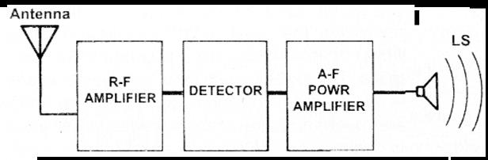
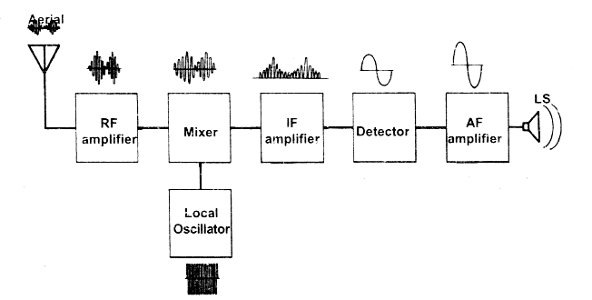
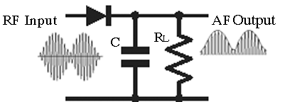
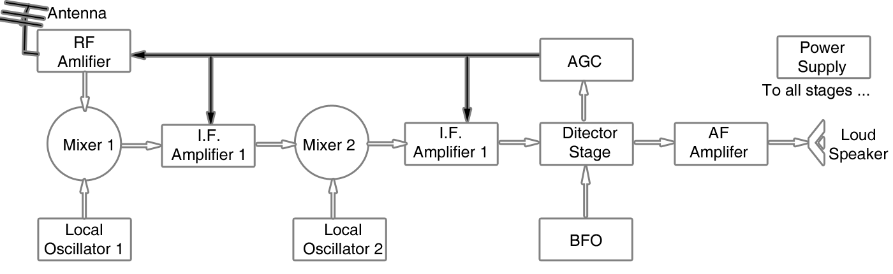
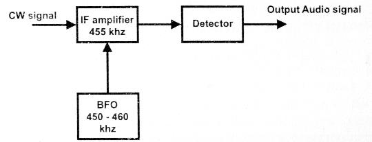
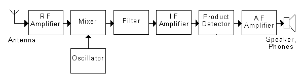

## 14. RADIO RECEIVER

A radio receiver is an electronic device that takes a transmitted signal, extracts the original signal from it and amplifies that signal. The process of extracting the signal is called demodulation. A radio station, for example, will broadcast a signal which is then detected by a radio receiver. The receiver, in turn, will separate that signal from many others and then play it through its speakers. There are several different types of signals that the receiver can be designed to demodulate and decode including sounds, pictures and digital data, to name a few.

### CHARACTERISTICS OF RECEIVER

### SENSITIVITY

The ability of a radio receiver to pick up and reproduce weak radio signals is called sensitivity. The sensitivity of a radio receiver is determined by the value of high frequency voltage that must be fed to its input circuit (between the aerial earth terminals) in order to secure a normal output power i.e. to secure a normal reception. The lower is such input voltage necessary for the normal reception; the higher is the receiver sensitivity. The sensitivity of modern radio receivers ranges from several micro volts to several mill volts and depends upon the number of amplification stages and upon their quality.

### SELECTIVITY

The ability of a radio receiver to separate the signal of a required radio station from the signals of unwanted stations, operating on other frequencies, is called selectivity. In other words, the selectivity of a radio receiver is its ability of receiving radio signals within a comparatively narrow frequency band

The selectivity of radio receivers is of paramount importance when a great number of radio stations, in many cases operating on nearly equal frequencies, are on the air.

The selectivity of a radio receiver depends upon the number and the quality of tuned circuits employed by the receiver. The greater the number of tuned circuits adjusted to resonance in a radio receive and the higher the quality of such tuned circuits (i.e. higher the Q), the higher is the selectivity at such a receiver.

### FIDELITY

It can be defined as the quality or precision with which the output is reproduced or (The lower the distortion introduced by a radio receiver, the higher is the quality of reproduction or fidelity of such a receiver.)

### STABILITY

Stability may be defined as a measure of the ability of a radio receiver to deliver a constant amount of output for a given period of time when the receiver is supplied with a signal of constant amplitude and frequency. There are two types of stabilities.
- 1 Mechanical
- Electrical stability.

### TUNED RADIO FREQUENCY (TRF) RECEIVER

The general design principle of a T R F receiver is shown in the block diagram below

The radio frequency waves picked up by the aerial are first fed to the tuned input circuit of the receiver this circuit being coupled to the aerial. The input circuit tuned to the frequency of the

incoming signal, provides a certain amount of amplification and also gives some preliminary selectivity, separating the signal of a desired radio station from the signals of numerous other stations simultaneously picked up by the receiving aerial.

The radio frequency voltage built up across the tuned circuit at the input of the receiver is then applied to the first stage of RF amplification. The RF amplifier usually consists of not more than two stages.

Having passed through the RF amplifier, the amplified RF signal reaches the detector stage where it is rectified.

The low frequency (audio frequency) signal developed at the output of the detector is, next, amplified in AF amplifier stages. The output of AF amplifier feeds the loudspeaker or a pair of earphones.

### SUPER HETERODYNE RECEIVER

RF amplifier stage: The radio waves from various broadcasting stations are intercepted by the receiving aerial and are coupled to this stage. This stage selects the desired radio wave (using a tuned circuit) and raises the strength of the wave to the desired level.

Mixer stage: The amplified output of RF amplifier is fed to the mixer stage where it is combined with the output of a local oscillator. The two frequencies beat together and produce an intermediate frequency (IF). The intermediate frequency is the difference between oscillator frequency and radio frequency i.e. IF = oscillator frequency - radio frequency. The IF is always 455 kHz regardless of the frequency to which the receiver is tuned.

*BLOCK DIAGRAM OF SUPERHETRODYNE RECEIVER*

Local oscillator: The locally generated oscillations in a superhetrodyne receiver are usually of a frequency higher than the frequency of the incoming signals.

IF amplifier stage: The output of mixer is always 455 kHz and is fed to fixed tuned IF amplifiers. These amplifiers are tuned to one frequency (i.e. 455 kHz) and render nice amplification. Detector stage: The output from the IF amplifier stage is coupled to the input of the detector stage. Here, the audio signal is extracted from the IF output. Usually, diode detector circuit is used because of its low distortion and excellent audio fidelity.

The modulated wave of desired frequency is selected by the parallel tuned circuit and is applied to the Diode. During the positive half-cycles of modulated wave, the diode conducts while during negative half cycles, it does not. The result of this rectifying action is that output of the diode consists of positive half-cycles of modulated wave as shown.

*AM DIODE DETECTOR*

The rectified modulated wave contains radio frequency and the signal and cannot be fed to the speaker for sound reproduction. The RF Component is filtered by the capacitor C shunted

across the speaker. The value of this capacitor is sufficiently large to present low reactance to the RF Component while presenting a relatively high reactance to the audio signal. The result is that the RF components are by-passed by the capacitor C and the signal is passed on to the speaker for sound reproduction.

AF amplifier stage: The audio signal output of detector stage is fed to a multistage audio amplifier. Here, the signal is amplified until ii. is sufficiently strong to drive the speaker. The speaker converts the audio signal into sound waves corresponding to the original sound at the broadcasting station.

### ADVANTAGES OF A SUPERHETRODYNE RECEIVER OVER T.R.F.
1. The Superhetrodyne receiver is having good sensitivity. This is because of the fact that the signal, after the frequency conversion is amplified at a single and convenient, frequency for amplification.
2. The selectivity is good as the IF amplifier stages use tuned stages with good selectivity and required bandwidth.
3. Continuous tuning is limited to the three tuned circuits namely the R.F. amplifier, Mixer (frequency converter) and the local oscillator.

4 The fidelity of the receiver will be better as the bandwidth of the I. F. amplifier is of the required value.

5 The R.F amplifier stage improves signal to noise ratio, reduces I.E interference and it offers a better coupling between antenna and the input of the receiver

### COMMUNICATION RECEIVER

It uses the principle of Superhetrodyne reception. In addition it uses two stages of mixers, with two local oscillators The two mixers produce different intermediate frequencies (First at 2 MHZ 2nd 200 KHz). This receiver is provided with good adjacent channel selectivity as well as good image rejection ratio. The first block indicates the special provisions for the antenna coupling circuit. It is followed by a stage of RF amplification. The output of the RF amplifier goes to the mixer. The local oscillator supplies the required frequency to get the intermediate to the second mixer stage where another frequency conversion takes place.

*BLOCK DIAGRAM OF COMMUNICATION RECEIVER*

The first intermediate frequency signal obtained from the first mixer stage is sufficiently amplified using one or two stages of IF amplification. The second mixer produces the II intermediate frequency. This signal is sufficiently amplified in one or two stages of 2nd IF amplifiers. The second mixer is provided with a crystal local oscillator, which does not suffer from frequency drift. Thus it is ensured that always-correct IF output is obtained. The beat frequency oscillator, provided to Detector stage which can be switched in to the circuit or switched off. This is useful in the reception of code signals transmitted by the radio telegraph transmitters.

AGC is provided to all the IF and RF amplifier sections. The detector and the audio amplifier sections follow the IF amplifier.

### SALIENT FEATURES OF A COMMUNICATION RECEIVER

A rotary switch or the like will be provided for the selection of the frequency band. Usually the frequency range will be from 200 KHz to 30 MHz, divided into six to eight wave ranges. A fine tuning control will be provided for getting the optimum signal strength.

It is provided with a high gain RF amplifier stage An RF gain control is also provided.

Communication receivers are provided with amplified and delayed AGC. There will be provision to select the AGC and to work the receiver without the AGC.

The selectivity of the receiver is adjustable. Narrow-medium and wide band width selection will be provided with a selector switch which modifies the circuit accordingly.

Usually the second mixer is provided with a fixed frequency crystal oscillator as the local oscillator. The same oscillator can be used for the calibration of the dial of the receiver periodically to maintain the accuracy of tuning.

A noise limiter circuit is provided with the inter-channel noise suppressor, or muting circuit.

Automatic frequency control circuit and a tuning indicator is provided. An ‘S’ meter is provided from which the input signal strength can be measured.

Circuit design is made to receive FM signals and also to receive S.S.B. Signals.

Frequency synthesizer may be provided in certain communication receivers.

Microprocessor control may be used in some of the communication receiver.

The power supply used is a fully regulated power supply.

### NOISE LIMITER

The noise limiter simply removes from the output of a radio receiver the voltage that is excess of a predetermined level. Normally this level will be adjustable.

### TUNING INDICATOR

Tuning indicator is a visual display that indicates the proper tuning of the station in a radio receiver

### MUTING CIRCUIT

The other names for this circuit arrangement are, inter channel noise suppressor. Squelch system, quieting system, tuning silencer and CODAN (Carrier Operated Device Anti-noise) Radio telephone receivers and communication receivers use this circuit.

### BEAT FREQUENCY OSCILLATOR

A communication receiver should be capable of receiving transmissions of Morse code. i.e. pulse modulated RF carrier. In the diode detector of a normal receiver, there is no provision for registering the difference between the presence and the absence of a carrier. Accordingly, such pulse modulated dots, dashes and spaces would produce no output whatever from the detector.

In order to make Morse code audible, the receiver has a Beat frequency oscillator at the detector. The BFO is not really a beat frequency oscillator at all; it is merely a simple LC oscillator.

### AUTOMATIC GAIN CONTROL

Automatic gain control is necessary in communication receivers because of the wide variations in signal strength encountered at the antenna terminal. The automatic gain control or AGC (also sometimes called “automatic volume control” or AVC), is used to smooth out variations in signal

loudness as the radio is tuned across the band. There is a tremendous variation in the strength of radio signals picked up by the antenna. If there were no A.G.C circuit, the listener would turn up the volume to hear a weak station, then again it would be blasted out of the room when he tuned in a very strong station. The listener would turn up and down the gain to keep that from happening, and may miss weaker stations. The job of the A.G.C is to increase the gain on weak signals, and then decrease it on strong signals.

### SQUELCH

When no carrier is present at the input, i.e. in the absence of transmissions on a given channel of between stations, a sensitive receiver will produce a disagreeable amount of loud noise. This is because AGC disappears in the absence of any carrier. So the receiver acquires its more sensitivity and analyses the noise present at its input. In some circumstances this is not particularly important, but in other situations it can be annoying and tiring. Systems such as those used by the police, ambulances and coast radio stations, in which a receiver must be monitored at all times but transmission is sporadic, are the principal benefits of squelch. It enables the receiver’s output to remain cut off unless the carrier is present Apart from eliminating inconvenience, such a system naturally increases the efficiency of the operator. Squelch is also called Muting or Quieting.

### AUTOMATIC VOLUME CONTROL (AVC)

The purpose served by the automatic gain control sometimes referred to as automatic volume control is as follows. This control automatically equalizes the amplification of the radio receiver when the level of the incoming radio signal varies as a result of fading. Such automatic equalization prevents the overloading of the receiver and at the same time, keeps the output signal level at a comparatively constant value in spite of fading of the HF signal level in the aerial.

### IMAGE INTERF ERENCE OR IMAGE FREQUENCY SIGNALS

It is possible that with a certain value of oscillator frequency, the desired value of intermediate frequency can be obtained from two different carrier frequencies at the same time. For example an RF signal of 550 KHz and an oscillator frequency of 1005 KHz will produce an IF signal of 455 KHz. It is also possible to obtain a 455 KHz IF signal with the same oscillator frequency if an RF signal of 1460 KHz reaches the first detector of these two 455 KHz. If a signal only one is desired, the undesired signal is called the image frequency signal or image interference. The effect of image frequency signals may be minimized or limited by providing one or more stages of RF tuning or pre-selection. The ratio of the output signal to that from the undesired RF signals is called the signal to image ratio or image ratio. The effect of the image frequency interference signals is present mostly in shortwave receivers.

### SIGNAL TO NOISE RATIO

An ideal receiver would generate no noise in its tubes or semiconductors and circuits and the minimum detectable signal would be limited only by the thermal noise in the antenna. In a practical receiver, the limit is determined by how well the amplified antenna noise overrides the other noise of the input stage. Since the noise figure is a ratio, it is usually given in decibels: it is around 5 to 10 dB (Decibels) for a good communications receiver below 30 MHz.

### ADJACENT CHANNEL INTERFERENCE

The use of low IF values that is in the order 130,175 and 262 KHz has the advantage of improved selectivity of stations on adjacent channels This becomes apparent when the difference in frequency between stations on adjacent channels is expressed as a percentage frequency at which tuning and amplification takes place. As adjacent channels frequencies may be as little as 10 KHz apart this percentage for an IF of 175 KHz is 5.7% ,for 262 KHz it is 3.8% and for 455 KHz it is 2 1%.To reduce adjacent channel interference select higher value of IF preferably between 450 KHz to 470 KHz.

### RECEIVER NOISE

All types of radio receivers develop a certain amount of internal noise, which is reproduced as interference at the output of the receiver. This internal noise, referred to as the receiver noise, is caused by various irregularities of the emission in the electron valves and also by the haphazard thermal movement of the electrons in receiver wiring and resistances. Because of the greater number of valves employed by superhetrodyne receivers and because of the greater gain provided by such receivers, the internal noise is much higher in a superhetrodyne receiver than in a T.R.F. Receiver

### SIDE BAND

When an R.F. carrier is modulated by a single audio note, two additional frequencies are produced they are the upper frequency which is equal to the sum of the R.F. carrier and the frequency of audio. The lower frequency is the difference between the R.F. carrier frequency and the audio frequency. The frequency which is higher than the carrier frequency is called the upper side and the one lower than the carrier frequency is called lower side frequency. The band of frequencies containing the side frequencies is called Side Band.

The Side Band containing the sum of the carrier and the modulating frequencies is known as the upper side band and the band containing the difference frequencies is known as the lower side band.

### SINGLE SIDEBAND RECEIVER

The electromagnetic waves from the antenna are passed to the RF amplifier. All the unwanted Radio waves are bypassed at this stage and only the frequency selected by the tuning circuit is amplified and passed on to the next stage i.e. mixer. The mixer converts the incoming Radio signal to the intermediate frequency i.e. around 455 kHz. The local oscillator generates a standard frequency which is to be used by the mixer to generate output signal at a fixed intermediate frequency. The signal is then passed on to the next stage i.e. IF amplifier.

The signal level i.e. is received from the mixer stage are quite low, the IF section must have sufficient gain to provide a usable signal level at the detector.

Product detectors are preferable for SSB reception, because they minimize the generation of inter modulation distortion in the demodulating process. The desired audio product is selected among the several undesired products that appear in the product detector and the signal is fed to the next stage i.e. audio amplifier.

The desired audio signal is amplified to a level that it can drive the speaker and a clear audio is
