## 9. RECTIFIER

RECTIFIER: An electronic device that converts alternating current into direct current is called a rectifier

HALF-WAVE RECTIFIER: In half wave rectification the rectifier conducts current only during the positive half cycles of input AC supply. The negative half cycles of AC supply is suppressed. Therefore current always flows in one direction through the load after every half cycle.

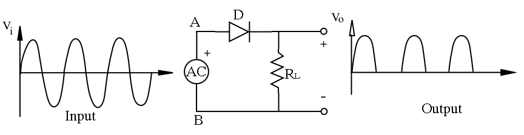

CIRCUIT DETAILS: A single crystal diode acts as a half wave rectifier. The AC supply is applied in series with the diode and load resistance RL. AC supply is given through the transformer. There are two advantages using transformer.
1. It allows to step up or step down the AC input voltage according to the requirement
2. The transformer isolates the rectifier circuit from power line to reduce the risk of electric shock.

OPERATION: During positive half cycle of input AC voltage end A becomes positive with respect to end B. This makes the diode D forward biased and hence it conducts current. During the negative half cycle end A is negative with respect to B terminal. Under this condition the diode is reverse biased and it does not conduct current because semi-conductor diode conducts current only when it is forward biased. Therefore, the current flows through the diode during positive half cycles of input AC voltage only. It is blocked during the negative half cycles. In this way current flows through the load RL always in the same direction. DC output is obtained across R. The output across RL is pulsating DC. These pulsations in the output are removed with the help of filter circuits.

DISADVANTAGES: The pulsating output across load contains alternating component and direct Component.

Alternating components basic frequency is equal to the supply frequency. Therefore wide filtering network is required to produce steady direct current.

The AC supply delivers power only halt cycle Therefore the output is low.

### FULL WAVE RECTIFIER

In full wave rectification, current flows through the load in the same direction for both half cycles of input voltage. This can be achieved by using two diodes working alternately. I.e., for the positive half cycles, voltage flow through one diode supplies current to the load and for the negative half cycle the other diode. Therefore a full wave rectifier utilizes both half cycles of input AC voltage.

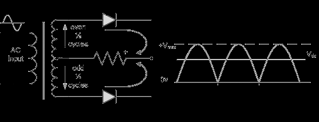

In the figure both the diodes are joined together at “F’ to give the +ve end of the output. The

secondary of the transformer is Centre tapped and its two ends are connected to the diodes.

The center point serves as the -ve end of the output. In one half cycle when “M” is at +ve potential and “N’ is at -ve potential. The diode A conducts and the current flows along MAFX. In the next

half cycle when N becomes +ve then diode B conducts and the currents flows along NBFX. So we find that output current keeps on flowing through load resistor RL in the same direction during both half cycles of AC input.

### Difference between a half-wave and full-wave rectifier

In half-wave rectification, the rectifier conducts current only during the positive half cycles of input AC supply.

It consists of only single diode. The efficiency of Half-Wave rectifier is 40.6 %.Centre tapped transformer is not necessary.

In full-wave rectification, current flows through the load in the same direction for both half cycles of input AC supply

The efficiency of Full-Wave rectifier is 81 .2 %.

The output frequency is twice that of the AC supply frequency.

### BRIDGE RECTIFIER

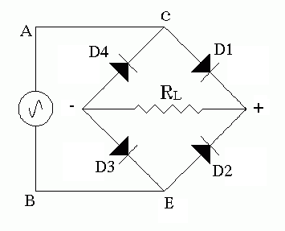 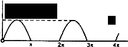

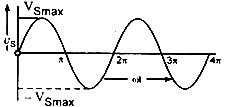 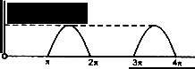

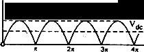

The need of a centre tapped power transformer is eliminated in the bridge rectifier. It consists of four diodes Dl, D2, D3 and D4 connected in the form of bridge. The AC supply is applied to the diagonally opposite ends of the bridge through the transformer. The other two ends of the bridge at one end of the load resistance RL is connected at the other end are grounded.

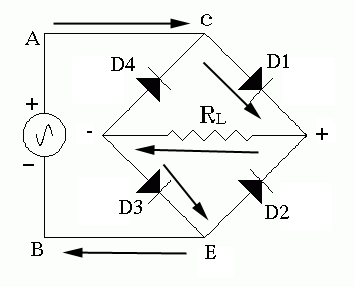 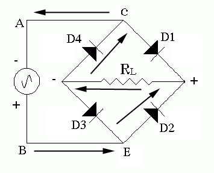

Operation: During the positive half cycle of secondary voltage terminal ‘A’ becomes positive and ‘B’ is negative. This makes diode Dl, and D3 are forward biased and while D2 and D4 are reverse

biased. Therefore only Dl and D3 conduct. These two diodes will be in series through the load RL.

During the negative half cycle, voltage at terminal ‘B’ becomes negative and terminal ‘A’ positive

this makes diode D2 and D4 forward biased and Dl and D3 reverse biased. Therefore D2 and D4 conduct. These two diodes will be in series through the RL. Therefore, DC output is obtained across load RL.

### Advantages

1). The need for centre tapped transformer is eliminated.
2. The output is twice that of the centre tap circuit for the same secondary voltage.

### Disadvantages

It requires four diodes

During each half cycle of AC input voltage two diodes are conducting in series so the voltage drop in the internal resistance of the rectifying unit will be twice. This is objectionable when secondary voltage is small.

### SMOOTHING OR FILTER CIRCUIT

The rectifier output is not steady and is pulsating. So filter circuits must be used to smooth out the variations in output voltage in order to obtain a steady output of direct voltage.

### TYPES OF FILTER CIRCUITS

### CAPACITOR INPUT FILTER. CHOKE INPUT FILTER.

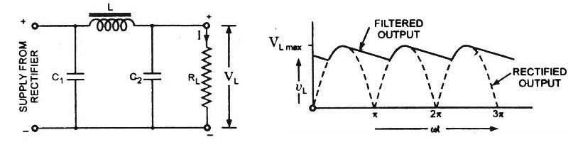

### REGULATING CIRCUITS

Almost all electronic devices used in electronic circuits need a dc source of power to operate. The source of dc power is used to establish the dc operating points (Q-points) for the passive and active electronic devices incorporated in the system. The dc power supply is typically connected to each and every stage in an electronic system. It means that the single requirement common to all phases of electronics is the need for a supply of dc power. For portable low-power systems batteries may be used, but their operating period is limited. Thus for long time operation frequent recharging or replacement of batteries become much costlier and complicated. More frequently, however, electronic equipment is energized by a power supply, derived from the standard industrial or domestic ac supply by transformation, rectification, and filtering. The combination of a transformer, a rectifier and a filter constitutes an ordinary dc power supply, also called an unregulated power supply.

### UNREGULATED POWER SUPPLY-BLOCK DIAGRAM

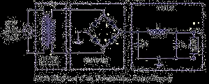

The block diagram of an ordinary power supply is depicted in the figure. Usually, a small dc voltage, in the range of 2—24 volts is required for the operation of different electronic circuits, while in India, single-phase ac supply is available at 230 V. A step-down transformer is used to reduce the voltage level. The rectifier converts the sinusoidal ac voltage into pulsating dc. The filter block reduces the ripples (ac components) from the rectifier output volt age. The filter passes dc component to the load and blocks ac components of the rectifier output.

### Poor Regulation

The output voltage is far from constant as the load varies. Voltage drop in the internal resistance of the supply increases directly with an increase in load current.

### Variations in the ac supply mains

The dc output voltage is proportional to the input ac voltage, therefore, varies largely.

### Variation in temperature

The DC output voltage varies with temperature, particularly if semiconductor devices are employed. For instance, in oscillators the frequency will shift, in transmitters output will get distorted, and in amplifiers the operating point will shift causing bias instability. Some feedback arrangement (acting as a voltage regulator) is employed in conjunction with an unregulated power supply to overcome the above mentioned three shortcomings and also to reduce the ripple voltage. Such a system is called a regulated power supply.

### REGULATED POWER SUPPLY

Regulated power supply is an electronic circuit that is designed to provide a constant DC voltage of predetermined value across load terminals irrespective of ac mains fluctuations or load variations.

A regulated power supply essentially consists of an ordinary power supply and a voltage regulating device, as illustrated in the figure. The output from an ordinary power supply is fed to the voltage regulating device that provides the final output. The output voltage remains constant irrespective of variations in the ac input voltage or variations in output (or load) current.

Figure given below shows the complete circuit of a regulated power supply with a transistor series regulator as a regulating device. The ac voltage, typically 230 Vrms is connected to a transformer which transforms that ac voltage to the level for the desired dc output. A bridge rectifier then provides a full-wave rectified voltage that is initially filtered by a ∏ (or C-L-C) filter to produce a dc voltage. The resulting dc voltage usually has some ripple or ac voltage variation. A regulating circuit use this dc input to provide a dc voltage that not only has much less ripple voltage but also remains constant even if the input dc voltage varies somewhat or the load connected to the output dc voltage changes. The regulated dc supply is available across a voltage divider.

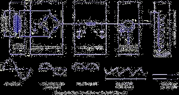

### Regulated Power Supply Circuit

Often more than one DC voltage is required for the operation of electronic circuits. A single power supply can provide as many as voltages as are required by using a voltage (or potential) divider, as illustrated in the figure. As illustrated in the figure a potential divider is a single tapped resistor connected across the output terminals of the supply. The tapped resistor may consist of two or three

resistors connected in series across the supply. In fact, bleeder resistor may also be employed as a potential divider.

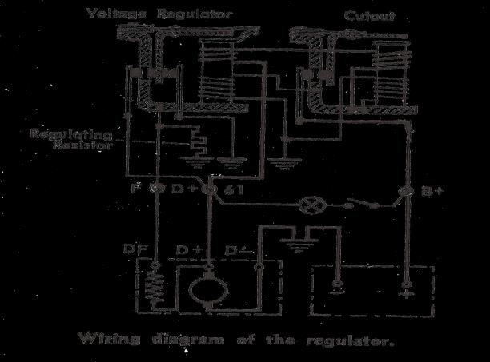

### REGULATION

The output voltage of a power supply always decreases as more current is drawn, not only because of increased voltage drops in the transformer and filter chokes, but also because the output voltage at light loads tends to soar to the peak value of the transformer voltage as a result of charging the first capacitor . Proper filter design can eliminate the soaring effect. The change in output voltage with load is called voltage regulation, and is expressed as a percentage.

PERCENT REGULATION = 100(E1-E2)/E2 Where E1= the no-load voltage, E2= the full-load voltage A steady load ,such as represented by a receiver, speech amplifier or unkeyed stages of a transmitter, does not require good (low) regulation as long as proper voltage is obtained under load conditions. However, the filter capacitors must have a voltage rating safe for the highest value to which the voltage will soar when the external load is removed. When essentially constant voltage regardless of current variation is required (for stabilizing a oscillator), special voltage regulating circuits are used.

### Electronic Voltage Regulation

When extremely low ripple is required or when the supply

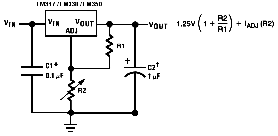

voltage must be constant with large fluctuations of load current and line voltage, a closed loop amplifier is used to regulate the supply. There are two main categories of electronic regulators: linear regulators, in which the condition of the control element is varied in direct proportion to the line voltage or load current; and switching regulators, in which the control device is switched ON and OFF, with the duty cycle proportion to the line or load conditions. Each system has relative ad vantages and disadvantages, and there are applications for both types in amateur radio equipment.

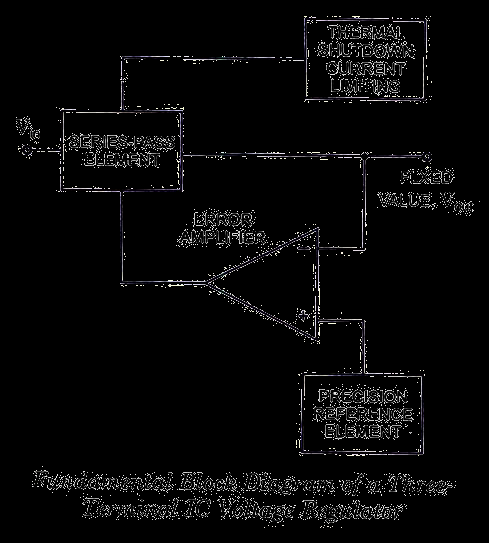

### IC Voltage Regulators

The modern trend in regulators is toward the use of three- terminal devices commonly referred to as three terminal regulators. Inside each regulator is a reference, a high gain error amplifier, temperature compensated voltage sensing resistors and transistors and a pass element. Many currently available units have thermal shutdown over voltage protection and current fold back, making them virtually fool proof.

Three terminal regulators are available as positive or negative types. In most cases positive regulator is used to regulate a positive voltage and a negative regulator to a negative regulator. However, depending on the systems ground requirement each regulated type may be used to regulate the “opposite” voltage.

### SWITCHING REGULATORS

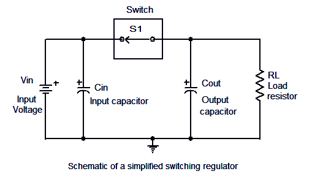

Just as the transistor has replaced the inefficient vacuum tube, the linear voltage regulator is rapidly being replaced by the switching regulator. This transition is being assisted by the availability of components made especially for switching supplies, such as high–speed switching transistors and diodes, capacitors, transformer cores and so on .The introduction of switching-regulator integrated circuits has also lowered the complexity of switchers to a degree that rivals linear regulators, and new circuit design techniques have reduced regulator noise and ripple to acceptable levels for communications equipment. The switching regulator (also known as a switching mode regulator or SMR) offers several advantages over the linear type: Much higher efficiency resulting from minimal regulator dissipation. Very desirable for battery–powered applications. Lighter in weight as a result of less heat sink material smaller in size.

VOLTAGE STABILIZATION (Zener Diode Regulation)

Zener diode can be used to maintain the voltage applied to

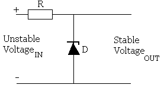

the circuit at a practically constant value, regardless of the voltage regulation of the power supply or variations in load current. The typical circuit is shown in the figure. Note that the cathode side is connected to the positive side of the supply. Zener diodes are available in a wide variety of voltages and power ratings. The voltages range from less than two to a few hundred, while the power ratings (power the diode can dissipate) run from less than 0.25 watt to 50 watts. The ability of the Zener diode to stabilize a voltage depends on the conducting impedance of the diode. This can be as low as one ohm or less in a low voltage, high-power diode or as high as a thousand ohms in a high voltage, low power diode.
