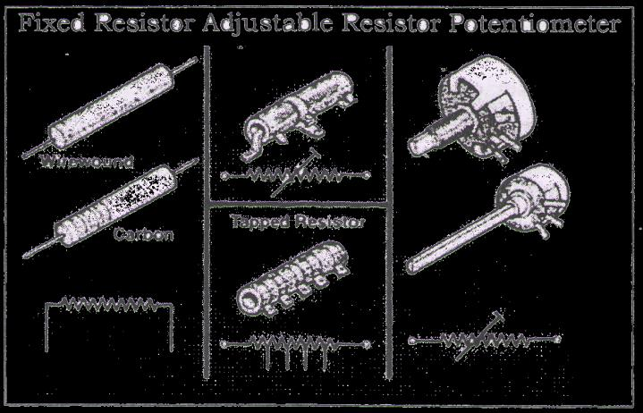
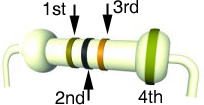
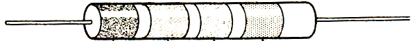
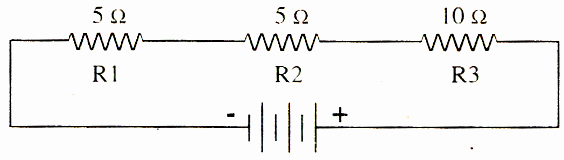
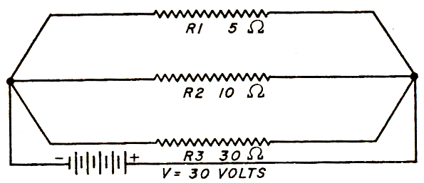
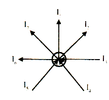
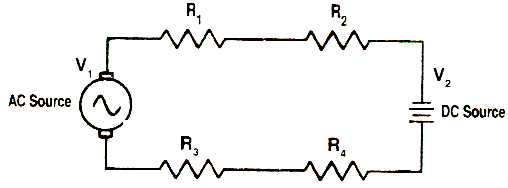

## 2. RESISTOR

A resistor is an electronic component that is deliberately designed to have a specific amount of resistance. Resistors are available in many different forms. An often used type of resistor in electronic devices is the carbon variety, values range from less than 1 ohm to millions of ohms.

Resistor is a package of resistance made up into a single unit. The unit is Ohms and measured by Ohm meter.

### RESISTANCE

The opposition that a substance offers to the free flow of electric current in a circuit is called resistance. It is often introduced into a circuit deliberately to limit the current and I or to provide various levels of voltage. This is done with components called Resistors. The standard unit of resistance is ohms (Ω), Resistance is mathematical reciprocal of conductance.

### SPECIFIC RESISTANCE

This is the resistance of a body of unit length and cross section. If ρ (roe) is the specific resistance

of material of the body then the resistance of the body is given by R=ρ*L/A

Where L = Length of the body in cms.

A = Area of cross section in cm² ρ = Specific Resistance in Ohm - cm

### TYPES OF RESISTORS

Most of the resistors used today are carbon resistors, composition type: film resistors, carbon and metal film, resistors and wire wound resistors.

### STANDARD COLOUR CODE

The usefulness of a resistor is measured by its electrical rating. There are three factors used to determine this rating. The ohmic value, the heat dissipating capability, and the resistance tolerance. The tolerance of a resistor is the variation from the expected value. The ohmic value cannot be recognized merely by looking at the resistor, hence the resistor is labeled. The resistors usually have three values stamped on them. In the case of carbon film resistor, a color code indicates the ohmic value and tolerance. To read the value of a resistor the resistor must be held such that the colored bands appear on the left and the value read from left to right. If no tolerance indication is given, a tolerance of 20% can be assumed. In the resistance color code, the first two bands represent the figure of resistance value and the third band represents the multiplying factor. The fourth band represents the tolerance.

### RESISTANCE COLOUR CODE CHART

| Colour | First band Second band Third band |  |  |  |  | Fourth band |
|---|---|---|---|---|---|---|
|  |  |  |  | (Multiplier) |  | (Tolerance) |
| BLACK |  | 0 | 0 |  | 10⁰ | - |
| BROWN |  | 1 | 1 |  | 10¹ | ±1% |
| RED |  | 2 | 2 |  | 10² | ±2% |

| ORANGE | 3 | 3 | 10³ | ±3% |
|---|---|---|---|---|
| YELLOW | 4 | 4 | 10⁴ | ±4% |
| GREEN | 5 | 5 | 10⁵ | ±5% |
| BLUE | 6 | 6 | 10⁶ | - |
| VIOLET | 7 | 7 | - | - |
| GREY | 8 | 8 | - | - |
| WHITE | 9 | 9 | - | - |
| GOLD | - | - | 0.1 | ± 5% |
| SILVER | - | - | 0.01 | ±10% |
| NO COLOUR - |  | - | - | ±20% |

Ex: - A resistor is color coded Yellow, Violet. Orange and Silver.

It would read FOUR, SEVEN, THREE ZEROS AND 10% tolerance meaning = 47000 ohms ± 10%

Yellow Violet Orange Silver

First Second Third Fourth Colour Colour Colour Colour =47000 Ω ± 10%

### RESISTORS IN SERIES

In series resistance circuit the total applied voltage is divided across each resistor and the current flowing in each resistor remains same.

The total resistance of a series resistance circuit is given by

Rt =R₁+ R₂+ R₃ + . . . . . +Rn

Ex:- Three resistors of 5, 5 and 10 respectively are connected in series, with 80V applied voltage. Find the current in each resistor.

*DC Source 80 V* Rt =R₁+ R₂+ R₃ + . . . . . +Rn Rt = 5+5+1O=2OΩ

I = V/R = 80/20 = 4 amps

As current remains same in series circuit, 4 amps. Current flows through each resistor.

### RESISTORS IN PARALLEL

In parallel circuit the applied voltage remains same across each branch but the current is divided among the branches.

Total resistance of a circuit, when resistors are connected in parallel is given by

1/RT = 1/R₁ +1/R₂ +1/R₃ + ……. + 1/Rn

Ex: - Three resistances of 5 ohms, 10 ohms, 30 ohms respectively are connected in parallel, when 30V is the applied volts what is the total resistance and total current?

1/RT =1/5 +1/10 +1/30 = RT = 3 Ω

Total Resistance of the circuit is 3 Ω

RT =3 Ω V=30V

Using Ohm’s Law IT = V/RT = 30 / 3 = 10 A

Total current flowing in the Circuit is 1OA

### KIRCHOFF’S CURRENT LAW

It deals with the distribution of current in a circuit. It states that the sum of all currents flowing into a point or junction in a circuit is equal to the sum of all the currents flowing away from that point or junction.

I₁+ I₂ + I₆+ I₇ = I₃+ I₄ + I₅

### KIRCHOFF’S VOLTAGE LAW

It deals with the distribution of voltage in a closed circuit. It states that sum of all the individual voltage drops in a closed circuit is equal to the applied voltage.

V₁+V₂=IR₁ +IR₂+ IR₃+ IR₄

### POWER & ENERGY

POWER is the time rate at which work is done or energy is transferred. In calculus terms, power is the derivative of work with respect to time.

The SI unit of power is the watt (W) or joule per second (J/s). Horsepower is a unit of power in the British system of measurement.

In a DC circuit, the power is the product of voltage and the current. A source of V volts, delivering I ampere to a circuit produces P watts as follows P = VI

Using ohms law we can find the power in terms of current and resistance, R in ohms. Similarly in terms of P = I2xR voltage and the resistance: P = V² /R

### ENERGY

It is the capacity of a physical system to perform work. Energy exists in several forms such as heat, kinetic or mechanical energy, light, potential energy, electrical, or other forms.

According to the law of conservation of energy, the total energy of a system remains constant, though energy may transform into another form. Two billiard balls colliding, for example, may come to rest, with the resulting energy becoming sound and perhaps a bit of heat at the point of collision.

The SI unit of energy is the Joule (J) or Newton-meter (N x m). The joule is also the SI unit.

### JOULES LAW

Joule is the standard unit of energy or work. When a current flows through a resistance heat is produced. This heat is called Joule heat or Joule effect. The amount of heat produced is proportional to the power dissipated. Joule’s law recognizes this, by stating that the amount of heat generated in a constant - resistance is proportional to the square of the current.

Joules Law: The amount of heat produced in a current carrying conductor is proportional to:-

The square of the current i.e. I²The resistance of the conductor i.e. R

The time of flow of current i.e. T if H is the heat produced, then, H = I² RT/J Where ‘J’ is Joule’s mechanical equivalent of heat.

### CALORIE

The quantity of heat that will raise the temperature of 1gm. of water through 1°C. 1000 calories is a kilocalorie.

### QUANTITY OF ELECTRICITY

The rate of flow of electricity gives current strength. The quantity of electricity is the product of current flowing and time it flows. Q = IT

### COULOMB

It is that quantity of electricity which flows in one second past any point in a conductor when a current of 1 Amp flows through it.
