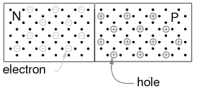
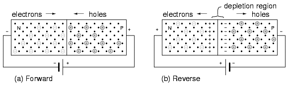
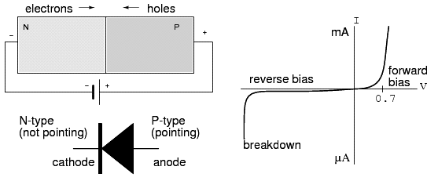
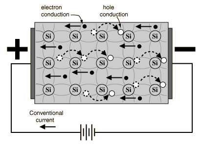

## 8. SEMICONDUCTOR DEVICES

Materials can be categorized into conductors, semiconductors or insulators by their ability to conduct electricity.

Insulators do not conduct electricity because their valence electrons are not free to wander throughout the material.

Metals conduct electricity easily because the energy levels between the conduction and valence band are closely spaced or there are more energy levels available than there are electrons to fill them so very little energy is required to find new energies for electrons to occupy.

The resistivity of a material is a measure of how difficult it is for a current to flow.

The band theory of materials explains qualitatively the difference between these types of materials.

Elemental semiconductors are semiconductors where each atom is of the same type such as Germanium (Ge), Silicon (Si). These atoms are bound together by covalent bonds, so that each atom shares an electron with its nearest neighbor, forming strong bonds.

Compound semiconductors are made of two or more elements. Common examples are gallium arsenide (GaAs) or Indium Phosphorus (InC). In compound semiconductors, the difference in electro-negativity leads to a combination of covalent and ionic bounding.

Intrinsic semiconductors are essentially pure semiconductor material. The semiconductor material structure should contain no impurity atoms. Elemental and compound semiconductors can be intrinsic semiconductors.

At room temperature, the thermal energy of the atoms may allow a small number of the electrons to participate in the conduction process. Unlike metals where the resistance of semiconductor material decreases with temperature for semiconductors, as the temperature increases, the thermal energy of the valence electrons increases, allowing more of them to breach the energy gap into the conduction band. When an electron gains enough energy to escape the electrostatic attraction of its parent atom, it leaves behind a vacancy which may be filled by another electron. The vacancy produced can be thought of as a second carrier of positive charge. It is known as a hole.

As electrons flow through the semiconductor, holes flow in the opposite direction. If there are n free electrons in an intrinsic semiconductor, then there must also be n holes. Holes and electrons created in this way are known as intrinsic charge carriers. The carrier concentration or charge density defines the number of charge carriers per unit volume. This relationship can be expressed as n=p where n is the number of electrons and p the number of holes per unit volume.

Extrinsic Semiconductor can be formed from an intrinsic semiconductor by adding impurity atoms to the crystal in a process known as doping.

Silicon belongs to group IV of the periodic table, it has four valence electrons. In the crystal form, each atom shares an electron with a neighboring atom. In this state it is an intrinsic semiconductor.

Boron (B), Aluminum (Al), Indium (In), Gallium (Ga) all have three electrons in the valence band. When a small proportion of these atoms, (less than 1 in 10⁶), is incorporated into the crystal the dopant atom has an insufficient number of bonds to share bonds with the surrounding Silicon atoms. One of the Silicon atoms has a vacancy for an electron. It creates a hole that contributes to the conduction process at all temperatures. Dopants that create holes in this manner are known as acceptors. This type of extrinsic semiconductor is known as P-Type as it create positive charge carriers.

Elements that belong to group V of the periodic table such as

Arsenic (As), Phosphorus (P), Antimony (Sb,) Bismuth (Bi) have an extra electron in the valence band. When added as a dopant to intrinsic Silicon, the dopant atom contributes an additional electron to the crystal. Dopants that add electrons to the crystal are known as donors and the semiconductor material is said to be N-Type as it create negative charge carriers.

If a block of P-type semiconductor is placed in contact with a block of N-type semiconductor in Figure.

The result is of no value. We have two conductive blocks in contact with each other, showing no unique properties. The problem is two separate and distinct crystal bodies. The number of electrons is balanced by the number of protons in both blocks. Thus, neither block has any net charge.

However, a single semiconductor crystal manufactured with P-type material at one end and N-type material at the other in Figure below (b) has some unique properties. The P-type material has positive majority charge carriers, holes, which are free to move about the crystal lattice. The N-type material has mobile negative majority carriers, electrons. Near the junction, the N-type material electrons diffuse across the junction, combining with holes in P-type material. The region of the P- type material near the junction takes on a net negative charge because of the electrons attracted. Since electrons departed the N-type region, it takes on a localized positive charge. The thin layer of the crystal lattice between these charges has been depleted of majority carriers, thus, is known as the depletion region. It becomes nonconductive intrinsic semiconductor material. In effect, we have nearly an insulator separating the conductive P and N doped regions.

(a) Blocks of P and N semiconductor in contact have no exploitable properties. (b) Single crystal doped with P and N type impurities develops a potential barrier.

This separation of charges at the PN junction constitutes a potential barrier. This potential barrier must be overcome by an external voltage source to make the junction conduct. The formation of the junction and potential barrier happens during the manufacturing process. The magnitude of the potential barrier is a function of the materials used in manufacturing. Silicon PN junctions have a higher potential barrier than germanium junctions.

In Figure below (a) the battery is arranged so that the negative terminal supplies electrons to the N- type material. These electrons diffuse toward the junction. The positive terminal removes electrons from the P-type semiconductor, creating holes that diffuse toward the junction. If the battery voltage is great enough to overcome the junction potential (0.6V in Si), the N-type electrons and P- holes combine annihilating each other. This frees up space within the lattice for more carriers to flow toward the junction. Thus, currents of N-type and P-type majority carriers flow toward the junction. The recombination at the junction allows a battery current to flow through the PN junction diode. Such a junction is said to be forward biased.

(a) Forward battery bias repels carriers toward junction, where recombination results in battery current. (b) Reverse battery bias attracts carriers toward battery terminals, away from junction. Depletion region thickness increases. No sustained battery current flows.

If the battery polarity is reversed as in Figure above (b) majority carriers are attracted away from the junction toward the battery terminals. The positive battery terminal attracts N-type

majority carriers, electrons, away from the junction. The negative terminal attracts P-type majority carriers, holes, away from the junction. This increases the thickness of the non conducting depletion region. There is no recombination of majority carriers; thus, no conduction. This arrangement of battery polarity is called reverse bias.

### The crystal PN Junction called Diode

The diode schematic symbol is illustrated in Figure below corresponding to the doped semiconductor bar. The diode is a unidirectional device. Electron current only flows in one direction, against the arrow, corresponding to forward bias. The cathode, bar, of the diode symbol corresponds to N-type semiconductor. The anode, arrow, corresponds to the P-type semiconductor. To remember this relationship, Not-pointing (bar) on the symbol corresponds to N-type semiconductor. Pointing (arrow) corresponds to P-type.

Forward biased PN junction (left above) Corresponding diode schematic (right above) Silicon Diode I vs V characteristic curve.

If a diode is forward biased as in Figure above, current will increase slightly as voltage is increased from 0 V. In the case of a silicon diode a measurable current flows when the voltage approaches 0.6 V at. As the voltage increases past 0.6 V, current increases considerably after the knee. Increasing the voltage well beyond 0.7 V may result in high enough current to destroy the diode. The forward voltage, VF, is a characteristic of the semiconductor: 0.6 to 0.7 V for silicon, 0.2 V for germanium, a few volts for Light Emitting Diodes (LED). The forward current ranges from a few mA for point contact diodes to 100 mA for small signal diodes to tens or thousands of amperes for power diodes.

If the diode is reverse biased, only the leakage current of the intrinsic semiconductor flows. This is plotted to the left of the origin in Figure above(c). This current will only be as high as 1 µA for the most extreme conditions for silicon small signal diodes. This current does not increase appreciably with increasing reverse bias until the diode breaks down. At breakdown, the current increases so greatly that the diode will be destroyed unless a high series resistance limits current. We normally select a diode with a higher reverse voltage rating than any applied voltage to prevent this. Silicon diodes are typically available with reverse break down ratings of 50, 100, 200, 400, 800 V and higher. It is possible to fabricate diodes with a lower rating of a few volts for use as voltage standards.

We previously mentioned that the reverse leakage current of under a µA for silicon diodes was due to conduction of the intrinsic semiconductor. This is the leakage that can be explained by theory. Thermal energy produces few electron hole pairs, which conduct leakage current until recombination. In actual practice this predictable current is only part of the leakage current. Much of the leakage current is due to surface conduction, related to the lack of cleanliness of the semiconductor surface. Both leakage currents increase with increasing temperature, approaching a µA for small silicon diodes.

For germanium, the leakage current is orders of magnitude higher. Since germanium semiconductors are rarely used today, this is not a problem in practice.

### Electron and Hole conduction

If a piece of P-type material is joined to a piece of N-type material and a voltage is applied to the pair, current will flow across the boundary or junction between the two when the battery has the polarity indicated. Electrons, indicated by the minus symbol, are attracted across the junction from the N material through the P material to the positive terminal of the battery. Holes, indicated by the plus symbol, are attracted in the opposite direction across the junction by the negative potential of the battery. Thus, current flows through the circuit by means of electrons moving one way and holes the other.

If the battery polarity is reversed, the excess electrons in the N material are attracted away from the junction and the holes in the P material are attracted by the negative potential of the battery away form the junction. This leaves the junction region without any current carriers; consequently, there is no Conduction.

In other words, a junction of P and N type materials constitutes a rectifier. It differs from the vacuum tube diode rectifier in that there is a measurable, although comparatively very small, reverse current. The reverse current results from the presence of some carriers of the type opposite to those that principally characterize the material.

With the two plates separated by practically zero spacing, the junction forms a capacitor of relatively high capacitance. This places a limit on the upper frequency at which semiconductor devices of this construction will operate, as compared with vacuum tubes. Also, the number of excess electrons and holes in the material depends on temperature, and since the conductivity in turn depends on the number of excess holes and electrons, the device is more temperature sensitive than a vacuum tube.

Capacitance may be reduced by making the contact area very small. This is done by means of a point contact, a tiny P-type region being formed under the contact point during manufacture when N-type material is used for the main body of the device.

### Points to remember for PN junction

PN junctions are fabricated from a mono crystalline piece of semiconductor with both a P-type and N-type region in proximity at a junction.

The transfer of electrons from the N side of the junction to holes annihilated on the P side of the junction produces a barrier voltage. This is 0.6 to 0.7 V in silicon, and varies with other semiconductors.

A forward biased PN junction conducts a current once the barrier voltage is overcome. The external applied potential forces majority carriers toward the junction where recombination takes place, allowing current flow.

A reverse biased PN junction conducts almost no current. The applied reverse bias attracts majority carriers away from the junction. This increases the thickness of the non-conducting depletion region.

Reverse biased PN junctions show a temperature dependent reverse leakage current. This is less than a µA in small silicon diodes.
