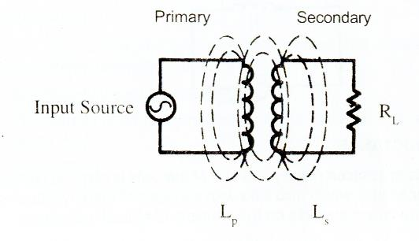
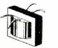
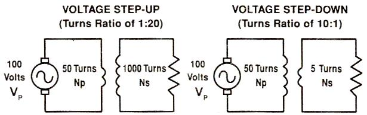
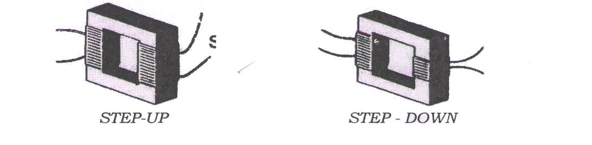
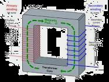

## 6. TRANSFORMER

Transformer is a device used to transfer electrical energy from one Alternating current circuit to another of the same frequency. In the process of transfer, the voltage or current is transformed from one set of values to another.

*TRANSFORMER*

The transformer essentially consists of two windings separated magnetically through a Ferro magnetic core. The windings are insulated from each other. The coil connected to the power supply is called the primary and the one connected to the load is called the secondary.

The Transformer is an important application of mutual inductance.

It has the primary winding L connected to an alternating voltage while the secondary winding L5 is connected across to load Resistance RL. The purpose of the transformer is to transfer power from the primary to the secondary.

The secondary voltage can be increased or decreased with respect to the primary voltage depending on the number of turns of secondary winding with respect to primary winding

TURNS RATIO: It is the Ratio of the number of turns in the secondary to the number of turns in the primary. Turns Ratio = NS/NP

Where NS is the number of turns in secondary NP is the number of turns in primary.

VOLTAGE RATIO: With unity turns ratio between primary and secondary the voltage induced in secondary is equal to the voltage available in primary.

CURRENT RATIO: When zero losses are assumed for the transformer, power at the secondary equals to the power in primary.

VP IP = VS IS

### STEP UP AND STEP DOWN TRANSFORMERS

*VP IPS = VS IS* *VS = VP (NS/NP) = 100 x (1000/50) = 2000 volts* *VS = VP (NS/NP) = 100 x (5/50) 10 volts*

Depending on the relative number of turns in the primary and secondary, the applied voltage may be stepped up or down when the voltage is taken out from the transformer. If secondary windings are greater to that of primary it means step up, its transformation ratio is more than one. When secondary windings are less than primary it means step down transformer. Its ratio is less than one.

### DIFFERENT TYPES OF TRANSFORMERS
1. Auto Transformers 2. Power transformers 3. Audio transformers 4. Radio Frequency transformers 5. Intermediate frequency transformers 6. Instrument transformers 7. Three phase transformers.

### AUTO TRANSFORMER

An Auto transformer consists of one coil with a tapped connection. These can be either stepped up or stepped down. These are used often because they are compact, efficient and low price

### AUDIO TRANSFORMER

These are mainly used to increase the voltage of audio frequency signals. They are used in AF circuits as coupling devices and operate at frequency ranging between 100 to 5000 cycles. They consist of primary and secondary windings wound on laminated iron or steel core.

### INTERMEDIATE FREQUENCY TRANSFORMER

These are mainly used to increase the voltage of IF frequency signals. They are used in IF circuits as coupling devices and operate at frequency ranging between 450 to 460 KHz. They consist of primary and secondary windings wound on laminated ferrite core.

### RADIO FREQUENCY TRANSFORMER

These are used for coupling one stage of RF amplification to another. Because of the high frequencies involved core losses may become excessive. The windings are usually air- cored, or core made of special powdered iron.

### BASIC TRANSFORMER CONSTRUCTION

An alternating current or a varying DC current flowing in one coil can induce a varying voltage in a neighboring coil. The changing magnetic lines of force from the varying current in one coil (which we call the primary) cuts the turns of the other coil (called the secondary) and induces a changing voltage in each of the turns of the secondary. A changing current in one induces a voltage in the other, the combination of windings constitutes a transformer.

### Basic Construction and working of a transformer

When two coil windings are arranged so that transformer has a primary winding and one or more secondary windings. The primary winding (usually labeled P) receives the input electrical energy from a voltage source, whereas the secondary winding or windings (labeled S) delivers the induced output voltage to a load.

The transformer serves many functions. It enables the transfer of electrical energy from one electrical circuit to another by using changing magnetic lines of force as the link between the two. N this way it behaves as a coupling device. Also, it provide a means whereby an alternating voltage of a given amount can be changed (transformed) to higher or lower amounts, making electrical power distribution practical. Such transformation can be applied to current and impedance.

Transformers designed to operate at high frequencies (above audio range) are referred to as intermediate-frequency and radio frequency types.

### TRANSFORMER LOSSES

We have stated that the transformer can be made almost a 100% efficient device. There are however certain inherent losses in a transformer that can be minimized but never completely eliminated. The most apparent losses are called copper losses. Since the primary and secondary are wound with many turns of copper wire, there will be wasted I²R losses. This accounts for the secondary voltage being slightly lower under load than when unloaded. These losses are reduced by using the largest practical cross sectional area wire.

### HYSTERESIS LOSSES

Hysteresis losses are due to the lagging of the magnetization and demagnetization of the soft steel core behind the alternating current in the circuit. The atoms of the core material must keep changing polarity, and a sort of frictional loss is developed. The use of material such as soft silicon steel for the core greatly reduces hysteresis losses.

### EDDY CURRENT LOSS

Ferromagnetic Materials are also good conductors, and a core made from such a material also constitutes a single short-circuited turn throughout its entire length. Eddy currents therefore circulate within the core in al plane normal to the flux, and are responsible for resistive heating of the core material. The eddy current loss is a complex function of the square of supply frequency and Inverse Square of the material thickness. Eddy current losses can be reduced by making the core of a stack of plates electrically insulated from each other, rather than a solid block; all transformers operating at low frequencies use laminated cores.

### IMPEDANCE MATCHING

In the transfer of power from any electrical source of its load, the impedance of the load must be equal to or match the internal impedance of the source for maximum transfer of power. The transformer is a useful device for matching the impedance of a generator to that of its load. This is important because in radio work, it is often necessary to connect a low-impedance load to a high- impedance generator, and vice versa. Unless there is an impedance match, there will not be maximum transfer of power. Assuming a source or generator impedance of 10,000 ohms, we will match it to a load of 400 ohms. Using a transformer, the primary impedance must match the load impedance. The turns ratio of the transformer must be: Ns/Np= √ Zp/Zs= √10,000/400=√25/1, then √Np/Ns=5:1

If 100 volts are applied to the primary, the secondary voltage is 20 volts. Secondary current is 20/400m is 0.05 ampere. The primary current is 100/10,000, or 0.01 ampere. Since the primary

power (1 watt) is equal to the secondary power, the transformer has matched a 400-ohm load to a 10,000ohm source with maximum transfer of power. We can say that the source sees the primary impedance as matching impedance, and the secondary which by transformer action receives the primary power, sees the load impedance as matching impedance.

### SUMMARY

Any change of current flowing in a circuit containing inductance produces a counter emf which opposes the change taking place. This self-induced emf tends to prevent an increasing current from increasing and a decreasing current from decreasing. Basically, Lenz’s law states, “A changing current induces an emf whose polarity is such as to oppose the change in current.

The greater the coil inductance, the higher the induced emf, and the greater the opposition to the increase and decrease of current in the coil. Mutual induction occurs when a changing magnetic field produced by one coil cuts the winding of a second coil and induces an emf in the second coil. Inductive reactance (XL) is the opposition presented by an inductance to an alternating current. X =2Пfl. In a series R-L circuit, the voltage drops across R and L are 90o out of phase. In a circuit L containing both inductance and resistance, impedance (Z) is the total opposition to the flow of alternating current, and is a combination of X and R. It is expressed in ohms. Z= √X ²+R².Ohm’s L L law for a-c circuits is : E=IZ; I=E/Z; and Z=E/I. The vectorial sum of all the voltage drops in a series R-L circuit is equal to the applied voltage. The primary winding of a transformer absorbs the input electrical energy from a voltage source; the secondary winding delivers the induced output voltage to a load.

The turns ratio between the secondary and primary winding of a transformer determines whether the secondary voltage is greater or less than the primary voltage. The primary–secondary current ratio is opposite to that of the primary secondary voltage ratio. In the transfer of power from an electrical source to a load, the load impedance must be equal to, or match, the internal impedance of the source for maximum transfer of power.

### TURNS RATIO

Each winding of a transformer contains a certain number of turns of wire. The turns ratio is defined as the ratio of turns of wire in the primary winding to the number of turns of wire in the secondary winding. Turns ratio can be expressed as: Np Ns where Np= number of turns on the primary coil and Ns= number of turns on the secondary coil.

The coil of a transformer that is energized from an AC source is called the primary windi ng(coil), and the coil that delivers this AC to the load is called the secondary winding.

### IMPEDANCE RATIO

Maximum power is transferred from one circuit to another through a transformer when the impedances are equal, or matched. A transformer winding constructed with a definite turns ratio can perform an impedance matching function. The turn’s ratio will establish the proper relationship between the primary and secondary winding impedances.
