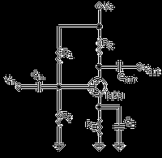
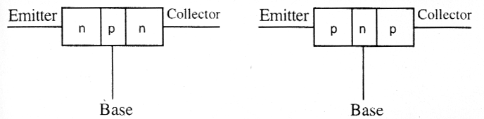
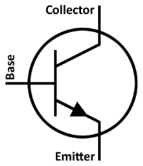
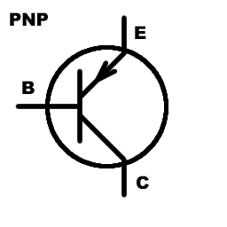

## 10. TRANSISTOR

Solid –state devices are also called semi-conductors. The prefix semi means half. They have electrical properties between those of conductors and those of insulators. The conductivity of a material is proportional to the number of free electrons in the material. Pure Germanium and pure Silicon crystals have relatively few free electrons. If carefully controlled amount of impurities (materials having a different atomic structure, such as arsenic or antimony) are added, the number of free electrons, and consequently the conductivity, is increased. When certain other impurities are introduced (Such as Aluminum, Gallium or Indium), an electron deficiency, or hole, is produced. As in the case of free electrons, the presence of holes encourages the flow of electrons in the semiconductor material that conducts by virtue of the free electrons is called N-type material; material that conducts by virtue of an electron deficiency is called P-type.

The word “transistor” was chosen to describe the function of a three-terminal PN junction device

that is able to amplify signal energy (current).

A thin N layer sandwich between two P-type layers semiconductor material. There are in effect two PN junction diodes back-to-back. If a positive bias is applied to the P-type material at the left current will flow through the left-hand junction, the holes moving to the right and the electrons from the N-type material will combine with the electrons there and be neutralized, but some of them also will travel to the region of the right-hand junction.

If the PN combination at the right is biased negatively there would normally be no current flow in this circuit. However, there are now additional holes available at the junction to travel to point and electrons can travel so, a current can flow even though this section of the sandwich is biased to prevent conduction. Most of the current is between the two points and does not flow out through the common connection to the N-type material is sandwich.

A semiconductor combination of this type is called a Transistor, and the three sections are known as the emitter, base and collector. The amplitude of the collector current depends principally on the amplitude of the emitter current i,e, the collector current is controlled by the emitter current.

Between each PN junction exits an area known as the depletion, or transition region. It is similar in characteristics to a dielectric layer, and its width varies in accordance with the operating voltage. The semiconductor materials either side of the depletion region constitute the plates of a capacitor. The capacitance from base to emitter and the base-collector capacitance are represented by Cbe and Cbc Power Amplification.

Because the collector biased in the back direction the collector to base resistance is high. On the other hand, the emitter and collector currents are substantially equal, so the power in the collector circuit is larger than the power in the emitter circuit (P=I2R, so the powers are proportional to the respective resistance, if the currents are the same). In practical transistors emitter resistance is on the order of a few ohms while the collector resistance is hundreds or thousands of times higher, so power gains of 20 to 40 db or even more are possible.

### Transistor types

As shown in the figure the transistors may be one of PNP and NPN type. The assembly of P-type and N-Type materials may be reversed. The first two letters of the NPN and PNP designations indicate the respective polarities of the voltages applied to the emitter and collector in normal operation. In a PNP transistor, for example, the emitter is made positive with respect to both the

collector and the base, and the collector is made negative with respect to both the emitter and the base.

### Transistor Characteristics

An important characteristic of a transistor is its current amplification factor, which is sometimes expressed as static forward current transfer ratio or small signal forward current transfer ratio. Both relate to the grounded-emitter configuration.

A transistor consists of two PN junctions formed by sandwiching either P-type or N-type semiconductor between a pair opposite types. Accordingly, there are two types of transistors namely:

(i) N-P-N transistor (ii) P-N-P transistor

An N-P-N transistor is composed of two N-type semiconductors separated by a thin section of P- type as shown below

(i) However, a P-N-P transistor is formed by two p-sections separated by a thin section of N-type as shown below.

When a third doped element is added to a crystal diode in such a way that two PN junctions are formed, the resulting device is known as a transistor.

A transistor consists of two PN junctions formed by sandwiching either p type or n-type semiconductor between a pair of opposite types. Accordingly; there are two types of transistors, namely

(I) P-N-P transistor (II) N-P-N transistor An N-P-N transistor is composed of two N-type semiconductors separated by a thin section of P- type. A P-N-P transistor is formed by two p-sections separated by a thin section of N-type.

### EMITTER

The section on one side that supplies charge carriers (electrons or holes) is called the emitter. The emitter is always forward biased w.r.t. Base so that it can supply a large number of majority carriers (Holes if emitter is p-type and electrons if the emitter is N-type). The emitter is heavily doped so that it can inject a large number of charge carriers (electrons or holes) into the base.

### COLLECTOR

The section on the other side that collects the charges is called the collector. The collector is always reverse biased. Its function is to remove charges from its junction with the base. The collector is moderately doped.

BASE The middle section which forms two PN -junctions between the emitter and collector is called the base. The base-emitter junction is forward biased, allowing low resistance for the emitter

circuit. The base-collector junction is reverse biased and provides high resistance in the collector circuit. The base is lightly doped and very thin: it passes most of the emitter injected charge carriers to the collector

### WORKING OF NPN TRANSISTOR

The below figure shows the NPN transistor with forward bias to emitter- base junction and reverse bias to collector-base junction. The forward bias causes the electrons in the n-type emitter to flow towards the base. This constitutes the emitter current le. As these electrons flow through the p-type base, they tend to combine with holes. As the base is lightly doped and very thin, therefore, only a few electrons (less than 5%) combine with holes to constitute base current lb (The electrons which combine with holes become valence electrons Then as valence electrons, they flow down through holes and into the external base lead This con lightly doped and very thin; it passes most of the emitter injected charge carriers to the collector.

*N-P-N transistor*

The reasons that most of the electrons from emitter continue their journey through the base to collector to form collector current are.

(i) The base is lightly doped and very thin. Therefore, there are a few holes, which find enough time to combine with electrons.

(ii) The reverse bias on collector is quite high and exerts attractive forces on these electrons

### WORKING OF PNP TRANSISTOR

The below figure shows the PNP transistor with forward bias causes the holes in the p-type emitter to flow towards the base. This constitutes the emitter current le. As these holes cross in to n-type base, they tend to combine with the electrons. Beta = ΔIc/ΔIb

*P-N-P transistor* As the base is lightly doped and very thin, therefore, only a few holes (less than 5%) combine with the electrons. The remainder (more than 95%) cross over into the collector region to constitute collector current IC. In this way, almost the entire emitter current flows in the collector circuit. It may be noted that current conduction within PNP transistor is by holes.

In this circuit input is applied between base and emitter and output is taken from the collector and emitter. Here emitter of the transistor is common to both input and output circuits and hence the name common emitter Connection. Base current Amplification factor: In common emitter connection input current is ‘b and output current is I. The ratio of change in collector current delta I to the change in base current delta ‘b is known as

base current amplification factor. It is represented by letter Beta. In any transistor less than 5% of emitter current flows as the base current. Therefore the value of Beta is generally greater than 20.

Usually its value changes from 20 to 500. This type of connection is widely used because of appreciable current gain as well as voltage gain.

### RELATION BETWEEN BETA AND ALPHA

When Alpha approaches unity, Beta approaches infinity that is the current gain in common emitter connection is very high. Because of this reason this circuit arrangement is used in about 90 to 95% of all transistor applications

Input characteristics: It is the curve between base current ‘b' and base - emitter voltage Vbe at constant collector - emitter voltage Vce.

By keeping Vce constant say at 10 volts note the base current lb for various values of Vbe. Then plot the readings obtained on the graph, taking lb along Y-axis and Vbe along X-axis. This gives the input characteristic at Vce = 10 volts. Following the similar procedure as above, a family of input characteristics can be drawn.
