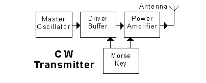
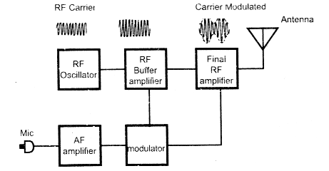
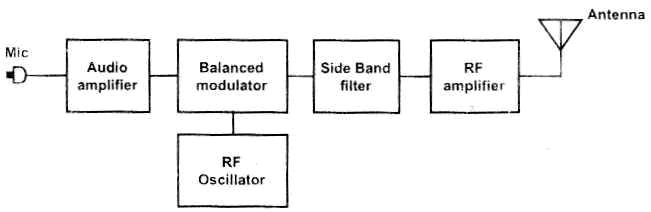

## 15. TRANSMITTER

An electronic device that generates and amplifies a carrier wave, modulates it with a signal derived from speech or from other sources and then radiates the resulting signal from the antenna. The simplest of all transmitters is one for sending Morse code - a CW (Continuous Wave) transmitter as shown in the diagram below.

An oscillator generates the signal and it is then amplified to raise the power output to the desired level. A Morse key is used to chop the transmission up into the dots and dashes of Morse code. Oscillators Morse Code.

The oscillator runs continuously. The Driver/Buffer are isolation stages, to isolate the oscillator from the sudden load-changes due to the keying of the amplifier. This minimises frequency chirp on the transmitted signal.

The oscillator is usually supplied with DC from a voltage-regulated source to minimise chirp (slight changes in the output frequency) due to variations in the supply voltage.

Several driver and buffer stages may be used. The keying may be in the final amplifier alone - usually in the cathode or emitter lead - or may also be applied to the driver stage too.

*TRANSMITTER BLOCK DIAGRAM*

A keying relay may be used to isolate the Morse key from the transmitter circuits, to keep high voltages away from the operator's Morse key. In the interests of operator safety, the moving bar of the Morse key is ALWAYS kept at earth potential.

### A.M. TRANSMITTER

Amplitude modulated transmitters may use plate modulation or collector modulation for the generation of the modulated signal. The different stages of the transmitter are shown in the diagram.

*BLOCK DIAGRAM OF AM TRANSMITTER*

### Microphone

The function of a microphone is to convert the variations in air pressure produced by the human voice or a musical instrument into the electrical voltage or current of the same frequency and corresponding amplitude.

### RF Oscillator

It produces RF carrier wave which is amplified by the RF buffer amplifiers. The output of the AF modulator and RF buffer amplifiers are mixed in the final RF amplifier to produce the modulated carrier wave.

### RF Buffer Amplifier

It is used to increase the power and isolate the oscillator. A Stage of amplification is placed between the oscillator and the antenna or following stages. This is called Buffer Amplifier. Its basic function is to simply amplify, making no frequency changes. This results in Isolating and reducing the load of the Oscillator and increased stability. It is generally biased to operate in class A mode.

### Modulator

The modulator section is essentially an audio amplifier. The speech amplifiers are of the voltage type, while the modulator being basically a power amplifier. The modulator delivers the required amount undistorted audio power to the modulator RF amplifier.

### RF Power Amplifier

The final stage of a transmitter is the power amplifier. The RF power amplifier, sometimes referred to as the final is a Class-C tuned amplifier It is the last stage in the chain of amplification between the oscillator and the antenna.

### SSB TRANSMITTER

### BLOCK DIAGRAM OF SSB TRANSMITTER

We know that both sidebands of an amplitude modulated signal contain all of the intelligence being transmitted. So, to recover the intelligence, all that is required is one sideband and the carrier. If one of the sidebands therefore was removed from the modulator carrier immediately after modulation, it would have no harmful effects on the transmission of the intelligence. The intelligence would be transmitted in the other sideband, and the unmodulated carrier would accompany it for later use in converting the intelligence to its original lower frequency.

This technique of removing one sideband from an amplitude modulated signal is called single sideband modulation (SSB); and has certain advantages over conventional transmission in which both side bands are used .The most important advantage to be gained by eliminating one side band is that the bandwidth of the signal is cut in half.

We know that in both side bands, half of the bandwidth is above the carrier frequency and half below. But both halves represent the same intelligence, only at different frequencies. So by eliminating one side band, the range of frequencies that carry intelligence is cut in half this reduction in bandwidth improves reception of the signal.

Narrower the bandwidth, the less atmospheric noise, or static, that will enter the receiving circuits with the signal

Also it each carrier uses less bandwidth in a given range, more carrier signals can be sent, or there will be less interference between different carrier signals.

Thus, Single side band (SSB) is a method of radio transmission in which one side band and the carrier are suppressed; only one intelligence bearing side band is transmitted.

### FUNCTION OF EACH BLOCK

Microphone (Mic): The microphone converts the audio signal into electrical signals which are fed to the AF amplifier stage.

Audio Amplifier: The output from the mic is fed to the speech amplifier where the electrical signal is amplified to a required level.

RF Oscillator: The carrier frequency intended is generated by using either crystal or an LC tank circuit. It is designed to have frequency stability. It can be operated with low voltage power supply with little dissipation of heat.

Balanced Modulator: In this modulator the audio is super imposed on the carrier frequency. The output contains two side band frequencies carrying audio intelligence without carrier frequency.

Side Band filter: It eliminates (filters or discards) anyone of the side bands.

RF Amplifier: RF power amplification is done and is coupled to the antenna through antenna impedance matching circuit at this stage Proper care is taken at this stage so that no harmonic frequency is generated which may cause interference in adjustment band or other bands

Antenna: The output of the RE amplifier is fed to the antenna for broadcasting

### NEUTRALIZATION

In circuits such as buffers, drivers and power amplifiers, where both the input and the output frequency are identical, while using triodes the positive feedback through the grid-to-plate inter- electrode capacitance may cause oscillations and instability. To prevent them, the simplest method called neutralization is used to counter or neutralize with an amount of compensatory feedback

### COMPARISION BETWEEN AM & FM

### AM

It has only two side bands LSB: Fc-Fm USB: Fc+Fm

In an AM the amplitude of the carrier is varied but frequency remains constant

Modulation Index is independent of modulating frequency.

Transmitted power by the AM includes carrier power and side bands power.

Thus it needs more modulation power.

Increased modulation index increases the total transmitted power.

Noise is more in the AM so fidelity is less.

Mainly used for mono transmission.

### FM

It has infinite number of sidebands. They are separated by Fm, 2Frn, 3Fm and so on from the carrier frequency.

In the FM, the frequency of the carrier is varied but amplitude of the carrier remains constant.

Modulation index is inversely proportion to the modulating frequency.

It needs less modulation power. Increased modulation index increases the band width but transmitted power remains constant.

Noise is less in the FM, so fidelity is more.

Mainly used for stereo transmission
