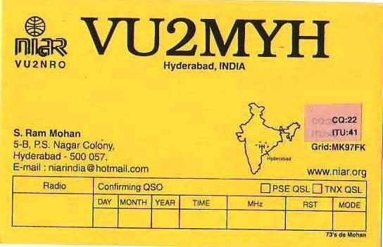
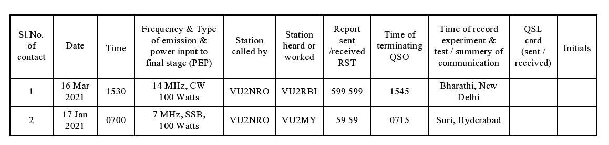

## 31. PRECAUTIONS TO BE TAKEN BEFORE ESTABLISHING

### CONTACT WITH AN AMATEUR STATION

Before transmitting, the station shall take precautions to ensure that its signals will not interfere with transmissions already in progress. If such interference is likely, the transmission shall commence only when there is an appropriate break in communications.

## 32. PROCEDURE BY WHICH AN AMATEUR STATION ESTABLISHES

### CONTACT WITH ANOTHER STATION

The General call shall Consist of the word CQ three times followed by the word DE in Morse Code and THIS IS in voice, followed by the stations callsign three times and the ending signals AR K. Eg. Morse: CQ CQ CQ DE VU2JOS VU2JOS VU2JOS AR K

Voice: CQ CQ CQ THIS IS VU2BL VU2BL VU2BL CALLING CQ & STANDING BY

The call may be sent three times at intervals of two minutes and then it shall not be repeated for another ten minutes. The reply to a call shall consist the callsign of the calling station not more than three times, the words DE in Morse Code and the words THIS IS in voice and the callsign of the station called, not more than three times. Transmission of a message shall be terminated by the signal AR in Morse Code and by the word OVER in voice. The end of work between two stations shall be indicated by the signal VA in Morse code and the word OUT in voice.

## 33. QSL CARD

QSL card is a written confirmation of a contact, exchanged between radio amateurs. These are of post card size. It must have your callsign, name and address, the particulars of the contact like date, time, frequency, RST, mode and callsign of the station contacted, power used, type of transmitter and antenna etc. Collecting these cards is also part of this hobby. For sending and receiving the cards economically, QSL Bureaus of radio clubs are used. One has to send the cards to the bureaus which will dispatch it to other foreign bureaus and vice versa.

## 34. LOG BOOK

A chronological record of all transmissions must be kept in a bound book (not loose sheet) showing the following:

a. Date and time of starting and ending of contact with each station, in Indian Standard Time using the 24 hour format. b. Callsigns of stations contacted. c. Frequency or Meter Band used. d. Mode and power used. e. In case of portable or mobile station, the temporary location. f. Brief summery of communications

No gaps shall be left between the entries and they shall be initialed. We have to preserve the log for a period of one year from the date of last entry. If the station is operated by another amateur, he must sign in the log and indicate his name, callsign and licence number.

### Specimen copy of log book

## 35. EQUIPMENT REGISTER

A register giving details of equipment owned /used by the Amateur Radio operator is to be maintained in the following format:

| Sl.No. Particulars |  | Name & | Date of | In case of | Name & | Date of | Particulars | Remarks |
|---|---|---|---|---|---|---|---|---|
|  | of the | address of | receipt | purchase | address of | sale or | of the |  |
|  | apparatus | the person | or | give receipt | the person | transfer | licence |  |
|  | Make / | from | assembly | no. and | to whom |  | issued in |  |
|  | Model / | whom |  | indicate the | sold or |  | the name |  |
|  | Chassis & | received |  | licence no. | transferred |  | of |  |
|  | Type No. | (in case |  | of the seller |  |  | purchaser |  |

assembled by licencee write self made)

| 1 | HF | Self Made | 10 Jan |  | - | - | - | - | - |
|---|---|---|---|---|---|---|---|---|---|
|  | Transceiver |  | 2016 |  |  |  |  |  |  |
| 2 | VHF | ICOM, | 15 Feb | IC/VU/7204 |  | - | - | - | - |
|  | Transceiver | Box 700, | 2016 |  |  |  |  |  |  |

Tokyo, Japan

### 36: TIMINGS OF OPERATIONS

HX : No specific working hours H 24 : 24 hours HJ: Sunrise to Sunset (Day frequency) HN: Sunset to Sun rise (Night frequency)

Amateur Radio comes under HX: No specific times

## 40. DOCUMENTS TO BE DISPLAYED AT AN

### AMATEUR WIRELESS STATION

a. Original Licence with renewal cards if any.

b. Log Book for the period of one year from the date of last entry.

c. Copy of Indian Wireless (Amateur Service) rules.

d. Register for Wireless equipments.

## 41. LICENCE FEE

The licence is issued for 20 years (Rs.1000) / Life (Rs.2000) depending on the fees paid. If it is issued for 20 years, it can be renewed for 20 years / Life by paying the prescribed fees before the expiry of the licence. One must also send a declaration that the licensee has made at least 40 occasions per year. It can be also renewed on expiry of the licence by paying a surcharge of Rs.100 for every 6 months or part thereof.

All correspondence (except exam) must be with:

The Assistant Wireless Advisor to Government of India,

### Ministry of Communications, (WPC Wing)

Department of Telecommunications, Amateur Section, Sanchar Bhavan, 20 Ashoka Road,

### New Delhi -110001.

## 42. FEES AT A GLANCE

Sl.No. Details Fee in Rs.

| 1. | Examination fee | Rs.100/-per Grade |
|---|---|---|
| 2. | Licence fee for any Grade | Rs.1000/- for 20 years or Rs.2000/- for life time |
| 3. | Renewal fee | Rs. 1000/- for 20 years, Rs.2000/- for life time |
| 4. | Surcharge for late renewal | Rs.100/- for every 6 months or part there of |
| 5. | Permanent change of location | Rs.200/- |
| 6. | Duplicate licence | Rs.100/- |
| 7. | Duplicate renewal | Rs.100/- |

### Exercise
1. What is the 40 Meter Band allocation for Amateur Radio License in India? a) 14.000 to 14.350 MHz b) 7.000 to 7.100 MHz c) 7.000 to 7.200 MHz.

d) 7.100 to 7.200 MHz
2. How much power is permitted on HF for Restricted Grade Amateur Radio Licence in India? a) 50 watts b) 100 watts c) 400 watts d) 25 watts
3. By what name in general are the Amateur Radio Satellites known as:

a) INSAT b) INTELSAT c) IRIDIUM d) OSCAR
4. What is the meaning of DE in Morse code? a) How are you? b) This is c) Who are you? d) Distant station
5. What type of emission is A1A? a) Morse Code b) SSB c) FM d) AM
6. What is emission for SSB, suppressed carrier :

a) A1A b) F3E c) J3E d) A3E
7. When it is 10.30 pm IST, What will UTC time be? a) 1000 Hrs b) 1500 Hrs c) 0000 Hrs d) 1700 Hrs
8. The frequency band of 30 to 300 MHz is :

a) HF b) UHF c) VHF d) SHF
9. How long must a log book be preserved? a) One year b) One year from date of last entry c) Two years d) Permanently

The Time in the log book must be in : a) IST b) UTC c) GMT d) Local Time

### Exercise
1. What does the first symbol indicate in emission: Type of modulation of main carrier

2.What is the meaning is QRM: I am being interfered with

3.What is the meaning of QSL? Can you acknowledge receipt?

4.What is the meaning of QRZ? Who is calling me?

5.How long can a Test signal be transmitted for ? 30 seconds
6. What does R stands for in RST Code? Readability

7.When is the suffix MO is used for? For Mobile operation

8.Which type of signal has the highest priority? Distress Signal

9.What is the Phonetics for 5? Panta Five

10.What is the meaning of Roger? Received fully
11. Signal Strength 9 means. Strong signals
12. Ultra High Frequency is : 300 to 3000 MHz

13.What is the standard shift between transmitting and receiving

frequency for Amateur Radio VHF Repeater : 600 kHz

14.What is the minimum age for foreign nations to apply for reciprocal licence : 18 years

15.Who operates Standard Time & Frequency station in India : National Physical Laboratory

16.What is the Q code for sending test signal : QSV

17.Amateur Radio licence can be renewed for : 20 years or Life long

18.What is the International Distress Frequency in Radio telephony: 2182 kHz

19.What is the speed of Morse code if 200 letters are sent in one minute? 40 wpm

20..What is the Morse Code alphabet denoted by: .._. F

21.What is the space duration between letters in Morse Code? 3 dits

22.Mobile permission is issued for 90 days
23. Amateur Radio Messages must be in Plain language
24. Power permitted for Restricted grade on 144-146 MHz is : 10 watts
25. The fee for change of address is: Rs. 200
