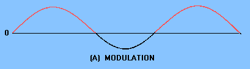
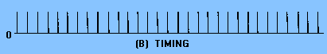
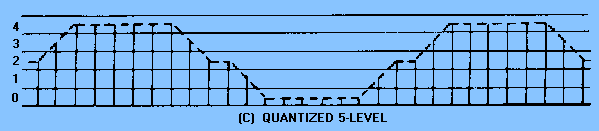
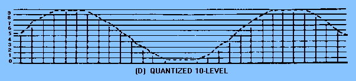

## 18. PRINCIPLES OF COMMUNICATIONS

### Analog and Digital Communication

### ANALOG SIGNALS

Analog signals are signals with continuous values. Analog signals are used in many systems, although the use of analog signals has declined with the advent of cheap digital signals. Analog systems are less tolerant to noise, make good use of bandwidth, and are easy to manipulate mathematically. However, analog signals require hardware receivers and transmitters that are designed to perfectly fit the particular transmission. If you are working on a new system, and you decide to change your analog signal, you need to completely change your transmitters and receivers.

### DIGITAL DIGNALS

Digital signals are signals that are represented by binary numbers, "1" or "0". The 1 and 0 values can correspond to different discrete voltage values, and any signal that doesnt quite fit into the scheme just gets rounded off. Digital signals are more tolerant to noise, but digital signals can be completely corrupted in the presence of excess noise. In digital signals, noise could cause a 1 to be interpreted as a 0 and vice versa, which makes the received data different than the original data. Imagine if the army transmitted a position coordinate to a missile digitally, and a single bit was received in error? This single bit error could cause a missile to miss its target by miles. Luckily, there are systems in place to prevent this sort of scenario, such as checksums and CRCs, which tell the receiver when a bit has been corrupted and ask the transmitter to resend the data. The primary benefit of digital signals is that they can be handled by simple, standardized receivers and transmitters, and the signal can be then dealt with in software (which is comparatively cheap to change).As compared to Analog Communications, the flexibility, Performance and efficiency of the Digital communications are much high.

### Facsimile

The earliest operational system for image transmission, facsimile or FAX networks date back to the late 20s and early 30. Like any other imaging system, FAX compromises in some areas to gain advantages in others. Conventional fast –scan TV is capable of handling moving images of moderate resolution, but the rapid image repetition rate requires several megahertz of signal bandwidth, which confines it to the UHF range. FAX is used widely in a number of services. Weather chart distribution is perhaps the most common, using both HF and landline links to weather service and forecast centers throughout the world. News photographs, sometimes called “wire photos” are also distributed throughout the world in a similar manner. A wide variety of

weather satellites transmit cloud-cover pictures back to Earth using FAX.

### Image Transmission

A typical FAX transmitter consists of a drum driven by a synchronous motor operating from a crystal or tuning fork frequency standard. The material to be transmitted is wrapped around the drum, which rotates at a constant speed. A small spot of light is focused on the printed material (photo, text, map, etc), and the light reflected from the subject is picked up by a photocell, photomultiplier or phototransistor. The rotation of the drum provides the equivalent of the “horizontal scanning” of the material. A carriage, supporting the light source and pickup assembly is moved along the drum at a constant rate providing the “vertical scanning”. The carriage is

usually operated by a threaded rod driven by another synchronous motor. As the carriage travels from one end of the drum to the other, the entire picture area is scanned. The voltage variations from the light pickup are amplified and used to modulate an audio sub carrier, using either amplitude or frequency modulation. For positive AM, the modulation is proportional to brightness which typically ranges from 4% for black through 90 to 100% for white. Negative modulation reverses this relationship with minimum modulation level corresponding to white and maximum to black. Amplitude modulated sub carrier systems are typically used with VHF microwave FM links

(weather satellites using positive modulation) or weather chart and photo transmission via landline (typically negative modulation). FM sub carrier operation uses the voltage variations from the light pickup to shift the sub carrier frequency. Black material results in a 1500 Hz frequency, rising in linear fashion to 2300 Hz for white. The FM format is used with all FAX systems that operate on HF, reducing problems caused by the fading that is inevitable on any long distance short wave transmission circuit.

### Image Display

The options for image display are far more varied than those for transmission. The device that displays the picture is known as the recorder and is found in a wide variety of configurations. Drum type recorders hold a single sheet of the recording medium on a drum that is quite similar to that used in the transmitter. By contrast continuous-feed FAX recorders are designed to display pictures using material fed from a roll. Such recorders do not require that material be reloaded for each picture but are typically more complex than drum –type recorders.

Facsimile recorders also differ widely in the nature of the recording medium. Photographic systems use film or photographic paper that is exposed by a modulated-light source and lens. Such systems require a darkroom and photographic processing chemicals and are not well suited for high volume use. The most advanced photographic systems use a dry silver paper and modulated laser light source. These are usually continuous read-out machines in which the paper is heat processed prior to emerging from the recorder. Such systems provide superb image quality and are convenient to use.

### Standards

The essential standards for a FAX unit are defined by three parameters: Drum speed (Helix speed in the case of continuous read-out recorders), carriage or paper feed rate, and modulation characteristics. It also depends on the Drum Speed and Scanning Density.

### Slow Scan Television

Slow –Scan television (SSTV) started in 1958 as the effort of a small band of Amateur Radio operators. The intention of the project was to send television pictures on the HF amateur bands. By virtue of HF radio design and propagation characteristics, the SSTV system design is tailored to allow operation in a 3-khz bandwidth which is considerably less than the 6-Mhz width of a commercial TV channel. Reception of SSTV is quite simple. The SSB voice of the transmitting amateur is tuned in so it sounds “natural”. When the SSTV transmission begins, the signal should

be in tune. The picture can be improved by using a transceiver that has pass band tuning. Under ideal conditions the audio highs can be boosted to give higher resolution. When poorer conditions exits, the pass band can be tuned to minimize interference.

### Receiving

The converter has input detection circuitry to translate the SSTV audio frequency variations from the receiver audio output into digital pulses. These contain horizontal and vertical synchronization as well as binary values representing the gray scales being sent. The pulses are stored in memory. The information is then sent to a digital-to –analog converter, which converts the stored data into an analog video signal fully compatible with a standard TV monitor to produce a non decaying image.

### Transmitting

Output from a black and white TV camera is converted into horizontal and vertical pulses along with digitized gray-scale values. The image is “snapped” in 1/60 of a second from the TV camera. The information is stored in memory. The digital output from memory goes to circuitry that produces the audio-frequency-modulated signal conforming to the SSTV standards. This SSTV output is then fed to the microphone input of the transceiver. Since the SSTV FM audio signal to the transmitter is continuous, the transceiver/linear amplifier RF power should be reduced to safe dissipation levels under this high-duty cycle operation.

### PULSE MODULATION

The Modulation of the amplitude, characteristic, ect of a sequence of pulses in order to convey information, often used in codes or the formation of an intermittent carrier wave by the generation and transmission of a sequence of short, periodic pulses is called Pulse Modulation normally used in Radar. PCM refers to a system in which the standard values of a QUANTIZED WAVE are indicated by a series of coded pulses. When these pulses are decoded, they indicate the standard values of the original quantized wave. These codes may be binary, in which the symbol for each quantized element will consist of pulses and spaces: The pulse-modulation provide methods of converting analog wave shapes to digital wave shapes.

### ELEMENTARY IDEA ABOUT DEMODULATION

Since the early days of radio when all transmissions were in Morse Code, a demodulator has also been used called a detector. Early demodulators had only to detect the presence (or absence) of a radio wave using a device such as a Coherer, without necessarily making it audible. Demodulation is the act of extracting the original information bearing signal from a modulated Carrier Wave. A demodulator is an Electronic Circuit that is used to recover the information content from the modulated carrier wave. These terms are traditionally used in connection with Radio Receivers but many other systems use many kinds of demodulators. Another common one is in a Modem, which is a contraction of the terms Modulator/demodulator. There are several ways of demodulation depending on what parameters of the base-band signal are transmitted in the carrier signal, such as amplitude, frequency or phase. An example of a demodulation system is a Modem, which receives a signal (electrical signal) and turns this signal from the wire net into a binary signal for the computer.

### AM DEMODULATION

An AM signal can be rectified without requiring a Coherent Demodulator. For example, the signal can be passed through an Envelop Detector (a diode rectifier). The output will follow the same curve as the input Base Band signal. There are forms of AM in which the Carrier is reduced or suppressed entirely, which require coherent demodulation.

### FM DEMODULATION

There are several ways to demodulate an FM signal. The most common is to use a discriminator. This is composed of an Electronic Filter, which decreases the amplitude of some frequencies relative to others, followed by an AM demodulator. If the filter response changes linearly with frequency, the final analog output will be proportional to the input frequency, as desired.
