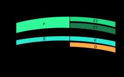

## 23. PROPAGATION

### TROPOSPHERE

The word troposphere derived from the Greek word tropo and it means turbulence or mixing. This is the lower most layer of the atmosphere and is known as troposphere and is the most important layer because almost all the weather events (e.g fog, cloud, due, frost, hailstorm, storms, cloud- thunder, lightening etc) occur in this layer. Thus the troposphere is utmost significance for all life- forms including man because these are concentrated in the lowermost portion of the atmosphere. Temperature decreases with increasing height at the average rate of 6.5⁰C per 1000m (1 kilometer) which is called as normal lapse rate. The height of troposphere changes from equator towards the poles (decreases) and from one season of a year to the other season (increases during summer while decreases during winter). The average height of the troposphere is about 16km over the equator and 6km over the poles. The upper limits of the troposphere is called as TROPOPAUSE.

### Troposphere Characteristics
1. Most of the weather phenomena take place in this layer. The troposphere contains almost all the water vapour and most of the dust.
2. This layer is subjected to intense mixing due both horizontal and vertical mixing.
3. Temperature decreases with height at an average rate of 1⁰C per 167m of height above sea level. This is called the normal lapse rate.
4. The troposphere extends up to a height of about 18km at the equator and declines gradually to a height of 8km at the poles.
5. The upper limit of the troposphere is called the tropopause. The temperature stops decreasing in it. It may be as low as -58⁰C.
6. All weather changes occur in the troposphere. Since it contains most of the water vapor, clouds form in this layer.

Critical Frequency changes with time of day, atmospheric conditions and angle of fire of the radio waves by antenna.

The existence of the critical frequency is the result of electron limitation, i.e., the inadequacy of the existing number of free electrons to support reflection at higher frequencies.
