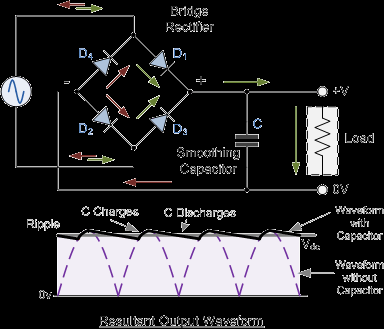

## 21. POWER SUPPLIES

(Smoothing and regulating circuits for a Full Wave Bridge Rectifiers)

### The Smoothing Capacitor

The single phase half-wave rectifier produces an output wave every half cycle and that it was not practical to use this type of circuit to produce a steady DC supply. The full-wave bridge rectifier however, gives us a greater mean DC value (0.637 Vmax) with less superimposed ripple while the output waveform is twice that of the frequency of the input supply frequency. We can therefore increase its average DC output level even higher by connecting a suitable smoothing capacitor across the output of the bridge circuit as shown below. Full-wave Rectifier with Smoothing Capacitor

The smoothing capacitor converts the full-wave rippled output of the rectifier into a smooth DC output voltage. Generally for DC power supply circuits the smoothing capacitor is an Aluminum Electrolytic type that has a capacitance value of 100uF or more with repeated DC voltage pulses from the rectifier charging up the capacitor to peak voltage.
