## 20. SEMICONDUCTOR DEVICES AND TRANSISTORS

CONDUCTION AND CONSTRUCTION OF SEMICONDUCT DEVICES AND TRANSISITORS.

Diodes are essentially "pressure-" operated (voltage-operated) devices. The essential Difference between forward-bias and reverse-bias is the polarity of the voltage dropped across the diode. Let's take a closer look at the simple battery-diode-lamp as shown in the circuit.

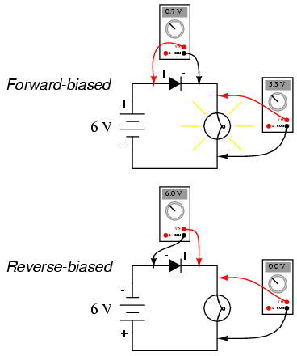

When the diode is forward-biased and conducting current, there is a small voltage dropped across it, leaving most of the battery voltage dropped across the lamp. When the battery's polarity is reversed and the diode becomes reverse-biased, it drops all of the battery's voltage and leaves none for the lamp.

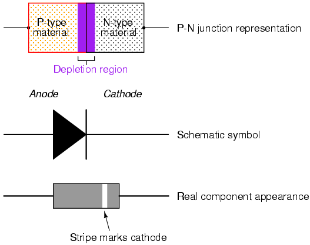

If a reverse-biasing voltage is applied across the P-N junction, this depletion region expands, further resisting any current through it:

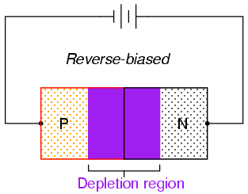

Conversely, if a forward-biasing voltage is applied across the P-N junction, the depletion region will collapse and become thinner, so that the diode becomes less resistive to current through it. In order for a sustained current to go through the diode, though, the depletion region must be fully

collapsed by the applied voltage. This takes a certain minimum voltage to accomplish, called the forward voltage:

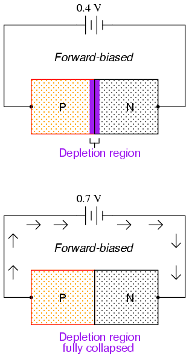

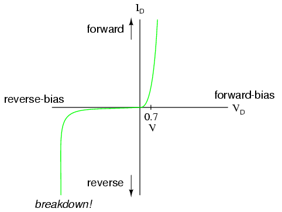
- A diode is an electrical component acting as a one-way valve for current. When voltage is applied across a diode in such a way that the diode allows current, the diode is said to be forward-biased.
- When voltage is applied across a diode in such a way that the diode prohibits current, the diode is said to be reverse-biased. The voltage dropped across a conducting, forward-biased diode is called the forward voltage. Forward voltage for a diode varies only slightly for changes in forward current and temperature, and is fixed principally by the chemical composition of the P-N junction.
- Silicon diodes have a forward voltage of approximately 0.7 volts. Germanium diodes have a forward voltage of approximately 0.3 volts.
- The maximum reverse-bias voltage that a diode can withstand without "breaking down" is called the Peak Inverse Voltage, or PIV rating.

Transistors are three terminal active devices made from different semiconductor materials that can act as either an insulator or a conductor by the application of a small signal voltage. The transistor's ability to change between these two states enables it to have two basic functions: "switching" (digital electronics) or "amplification" (analogue electronics). Then bipolar transistors have the ability to operate within three different regions.

The Transistor basic construction consists of two PN-junctions producing three connecting terminals with each terminal being given a name to identify it from the other two. These three

terminals are known and labeled as the Emitter ( E ), the Base ( B ) and the Collector ( C ) respectively.

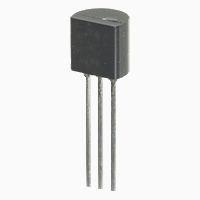

Typical Bipolar Transistor

Transistors are current regulating devices that control the amount of current flowing through them in proportion to the amount of biasing voltage applied to their base terminal acting like a current- controlled switch. The principle of operation of the two transistor types PNP and NPN, is exactly the same the only difference being in their biasing and the polarity of the power supply for each.

### Transistor construction

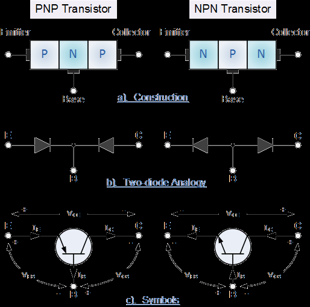

The construction and circuit symbols for both the PNP and NPN bipolar transistor are given above with the arrow in the circuit symbol always showing the direction of "conventional current flow" between the base terminal and its emitter terminal. The direction of the arrow always points from the positive P-type region to the negative N-type region for both transistor types, exactly the same as for the standard diode symbol.

As a Transistor is a three terminal device, there are basically three possible ways to connect it within an electronic circuit with one terminal being common to both the input and output. Each method of connection responding differently to its input signal within a circuit as the static characteristics of the transistor varies with each circuit arrangement.
1. Common Base Configuration - has Voltage Gain but no Current Gain.
2. Common Emitter Configuration - has both Current and Voltage Gain.
3. Common Collector Configuration - has Current Gain but no Voltage Gain.

### The Common Base (CB) Configuration

In the Common Base or grounded base configuration, the BASE connection is common to both the input signal and the output signal with the input signal being applied between the base and the

emitter terminals. The output signal is taken from the base and the collector terminals as shown with the base terminal grounded. The input current flowing into the emitter is high as it is the sum of the base current and collector current. Therefore, the collector current output is less than the emitter current input resulting in a current gain for this type of circuit of "1" (unity) or less, in other words the common base configuration "attenuates" the input signal.

### The Common Base Transistor Circuit

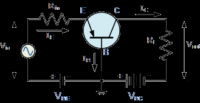

### Common Base Voltage Gain

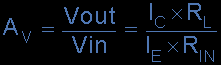

Where: Ic/Ie is the current gain, alpha (α) and RL/Rin is the resistance gain.

The common base circuit is generally used in single stage amplifier circuits such as microphone pre-amplifier or radio frequency (Rf) amplifiers due to its very good high frequency response.

### The Common Emitter (CE) Configuration

In the Common Emitter or grounded emitter configuration, the input signal is applied between the base, while the output is taken between the collector and the emitter as shown. This type of configuration is the most commonly used circuit for transistor based amplifiers and which represents the "normal" method of bipolar transistor connection. The common emitter amplifier configuration produces the highest current and power gain of all the three bipolar transistor configurations. This is mainly because the input impedance is LOW as it is connected to a forward- biased PN-junction, while the output impedance is HIGH as it is taken from a reverse-biased PN- junction.

### The Common Emitter Amplifier Circuit

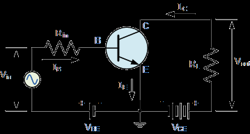

In this type of configuration, the current flowing out of the transistor must be equal to the currents flowing into the transistor as the emitter current is given as Ie = Ic + Ib. Also, as the load resistance (RL) is connected in series with the collector, the current gain of the common emitter transistor configuration is quite large as it is the ratio of Ic/Ib and is given the Greek symbol of Beta, (β). As the emitter current for a common emitter configuration is defined as Ie = Ic + Ib, the

This type of bipolar transistor configuration has greater input impedance, current and power gain than that of the common base configuration but its voltage gain is much lower. The common emitter configuration is an inverting amplifier circuit resulting in the output signal being 180o out- of-phase with the input voltage signal.

### The Common Collector (CC) Configuration

In the Common Collector or grounded collector configuration, the collector is now common through the supply. The input signal is connected directly to the base, while the output is taken from the emitter load as shown. This type of configuration is commonly known as a Voltage Follower or Emitter Follower circuit. The emitter follower configuration is very useful for impedance matching applications because of the very high input impedance, in the region of hundreds of thousands of Ohms while having relatively low output impedance.

### The Common Collector Transistor Circuit

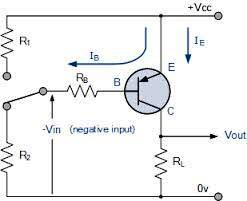

The common emitter configuration has a current gain approximately equal to the β value of the transistor itself. In the common collector configuration the load resistance is situated in series with the emitter so its current is equal to that of the emitter current. As the emitter current is the combination of the collector AND the base current combined, the load resistance in this type of transistor configuration also has both the collector current and the input current of the base flowing through it. Then the current gain of the circuit is given as:

NPN Transistor in more detail when used in the common emitter configuration as an amplifier is the most widely used configuration due to its flexibility and high gain. We will also plot the output characteristics curves commonly associated with amplifier circuits as a function of the collector current to the base current.
