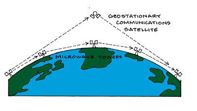
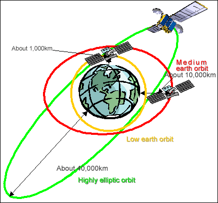
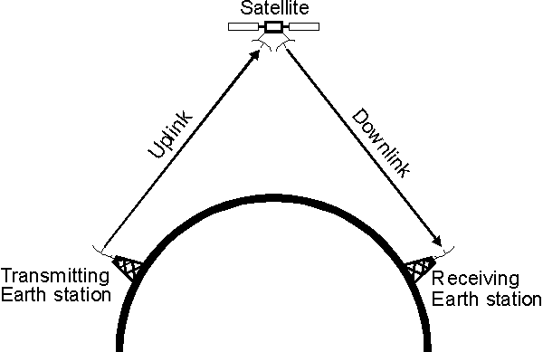
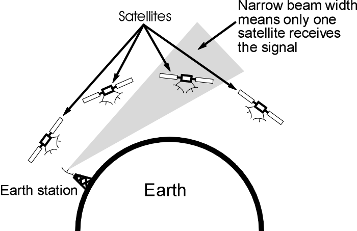

## 25. SPACE COMMUNICATIONS

### ELEMENTARY PRINCIPLES OF COMMUNICATION VIA SATELLITE

A communications satellite (sometimes abbreviated to COMSAT) is an artificial satellite stationed in space for the purpose of telecommunications. Modern communications satellites use a variety of orbits including geostationary orbits, Molniya orbits, other elliptical orbits and low (polar and non- polar) earth orbits.

For fixed (point to point) services communications satellites provide a microwave radio relay technology complementary to that of communication cables. They are also services used for mobile applications such as communications to ships, vehicles, planes and hand-held terminals, and for TV and radio broadcasting, for which application of other technologies, such as cable television, is impractical or impossible.

### Geostationary orbits

A satellite in a geostationary orbit appears to be in a fixed position to an earth-based observer. A geostationary satellite revolves around the earth at the same angular velocity of the earth itself, 360 degrees every 24 hours in an equatorial orbit, and therefore it seems to be in a fixed position over the equator.

### Low-Earth-Orbiting-Satellites

A Low Earth Orbit (LEO) typically is a circular orbit about 400 kilometers above the earth’s

surface and, correspondingly, a period (time to revolve around the earth) of about 90 minutes. Because of their low altitude, these satellites are only visible from within a radius of toward the satellite, can operate effectively without the need for expensive equipment to track the satellite’s motion. Roughly 1000 kilometers from the sub- satellite point (The point at which a line between the satellite and the centre of the Earth intersects the Earth’s surface is called the sub-satellite point). In addition, satellites in low earth orbit change their position relative to the ground position quickly. So even for local applications, a large number of satellites are needed if the mission requires uninterrupted connectivity.

Low earth orbiting satellites are less expensive to launch into orbit than geostationary satellites and, due to proximity to the ground, do not require as high Signal strength.

A group of satellites working in concert is known as a Satellite Constellation.

### Structure of a Communications Satellite

Communications Satellites are usually composed of the following subsystems:

Communication Payload, normally composed of transponders, antenna, and switching systems.

Engines used to bring the satellite to its desired orbit.

Station Keeping Tracking and stabilization subsystem used to keep the satellite in the right orbit, with its antennas pointed in the right direction, and its power system pointed towards the sun.

Power subsystem, used to power the Satellite systems, normally composed of solar cells, and batteries that maintain power during solar eclipse.

Command and Control subsystem, which maintains communications with ground control stations. The ground control earth stations monitor the satellite performance and control its functionality during various phases of its life-cycle.

### Bandwidth of a Satellite

The bandwidth available from a satellite depends upon the number of transponders provided by the satellite. Each service (TV, Voice, Internet, radio) requires a different amount of bandwidth for transmission. The bandwidth of transponder is used to carry these services.

### Amateur Radio Satellites

Amateur radio operators have access to the amateur radio satellites that have been designed specifically to carry amateur radio traffic. Most such satellites operate as space borne repeaters, and are generally accessed by amateurs equipped with UHF or VHF radio equipment and highly directional antennas such as Yagis or dish antennas. Due to launch costs, most current amateur satellites are launched into fairly low Earth orbits, and are designed to deal with only a limited number of brief contacts at any given time. Some satellites also provide data-forwarding services using the AX.25 or similar protocols.

### Terms related with Satellite Communications

### Kepler’s Law

Artificial satellites which orbit the earth follow the same laws that govern the motion of the planets around the sun. Johannes Kepler empirically derived three laws describing planetary motion.

### Kepler’s first law

The path followed by the satellite around the primary will be an ellipse.

### Kepler’s second law

For equal time intervals, the satellite will sweep areas in its orbital plane.

### Kepler’s third law

The square of periodic time of orbit is proportional to the cube of the mean distance between the two bodies.

### Definitions and terms related to Earth Orbiting Satellites

Apogee: the point farthest from earth.

Perigee: the point of closest approach to earth.

Line of apsides: the line joining the perigee and apogee through the centre of the earth.

Ascending node: the point where the orbit crosses the equatorial plane going from south to north.

Line of nodes: the line joining the ascending and descending nodes through the centre of the earth. Inclination: The angle between the orbital plane and the earth’s equatorial plane.

Prograde orbit: An orbit in which the satellite moves in the same direction as the earth’s rotation.

Retrograde orbit: An orbit in which the satellite moves in the same direction s the earth’s rotation.

### Argument of perigee

The angle from ascending node to perigee, measured in the orbital plane at the earth’s centre in

direction of satellite motion.

### Mean anomaly

Mean anomaly gives an average value of the angular position of the satellite with reference to the perigee.

### True anomaly

The true anomaly is the angle from perigee to the satellite position, measured at the earth’s centre.

This gives the true angular position of the satellite in the orbit as a function of time.

### Satellite System

A satellite communication system can be broadly divided into two segments, a ground segment and a space segment. The space system includes satellite. Satellite system consists of the following 6(six) main systems.

### Power supply

The primary electrical power for operation electronic equipment is obtained from solar cells. Individual cells can generate small amounts of power, and therefore array of cells in series –parallel connection are required.

Cylindrical solar arrays are used with spinning satellites. (The gyroscopic effect of the spin is used for mechanical orientational stability). Thus the array is only partially in sunshine at any given time. Another type of solar panel is the rectangular array or solar sail. Solar sail must be folded during the launch phase and extended when in geo-stationary orbit. Since the full component of solar cells are exposed to sun light, and since the sail rotate to track the sun they are capable of greater power output than cylindrical arrays having a comparable number of cells. To maintain service during an eclipse, storage batteries are provided.

### Altitude control

The altitude of a satellite refers to its orientation in space. Much of equipment carried aboard a satellite is for the purpose of controlling its altitude. Altitude control is necessary to ensure that directional antennas point in the proper direction. In the case of earth environmental satellites the earth sensing instrument must cover the required regions of the earth, which also requires altitude control A number of forces, referred to as disturbance forces can alter altitude, some examples being the gravitational forces of earth and moon, solar radiation, and meteorite impacts.

### Station keeping

A satellite that is normally in geo-stationary will also drift in latitude, the main forces being the gravitational pull of the sun and the moon. To prevent the shift in inclination from exceeding specified limits, jets may be pulled at the appropriate time to return the inclination to zero. Counteracting jets must be pulsed when the inclination is at zero to halt that change in inclination.

### Thermal control

Satellites are subject to large thermal gradients, receiving the sun radiation on one side while the other side faces into space. In addition, thermal radiation from the earth, and the earths albedo, which is the fraction of the radiation falling on earth is reflected can be sighted for low altitude, earth-orbiting satellites, though negligible for geo-stationary satellites. Equipment in the satellite also generates heat which has to be removed, since the satellites equipment should operate as near as possible in a stable temperature environment, through various steps. Thermal blankets and shields may be used to provide insulation. Radiation mirrors are often used to remove heat from

communication payload. These mirrored drums surround the communication equipment shelves in each case and provide good radiation paths for the generated heat to escape into surround space. In order to maintain constant-temperature conditions, heaters may be switched on to make up for the heat that occurs when transponders are switched off.

### TT&C Subsystem

The Telemetry, Tracking, and Command (TT&C) performs several routine functions abroad a spacecraft.

### Telemetry

Telemetry or telemetring function is measurement at a distance referring to the over all operation of generating an electrical signal proportional to the quantity being measured, as well as encoding and transmitting this to a distant station, which for satellite is one of the earth stations. Data that are transmitted as telemetry signals include information obtained from sun earth sensors; environmental information (magnetic field intensity and direction); the frequency of meteorite impact and so on; and spacecraft information such as temperatures and power supply voltages, and stored fuel pressure.

### Tracking

Tracing of the satellite is accomplished by having the satellite transmit beacon signals which are received at the TT&C earth stations. Tracking is obviously important during the transmitter and drift orbital phases of the satellite launch. When on-station, a geo-stationary satellite will tend to be shifted as a result of the various distributing forces. It is necessary to be able to tract the satellites movements and send correction signals as required. Satellite range is also required for time to time. This can be determined by measurement of propagation delay of signals specially transmitted for ranging purposes.

### Command systems

Command system receives instruction from ground system of satellite and decodes the instruction and sends commands to other systems as per the instructions.

### Transponders

A transponder is the series of interconnected units which forms a single communication channel between the receiving and transmitting antennas in a communication satellite. Some of the units used by a transponder in a given channel may be common to a number of transponders. Thus, although reference may be made to specific transponder, this must be thought of as an equipment channel rather than single item of equipment. Transponder consists of wideband receivers, input de- multiplexer, power amplifier components.

### Antenna sub system

The antennas carried abroad a satellite provide the dual functions of receiving the up-link and transmitting the down link signals. They range from dipole-type antennas, where omni directional characteristics are required, to the highly directional antennas required for telecommunications purposes and TV relay and broadcasting.

### Doppler’ effect

The Doppler Effect in satellite communications is the change in frequency of an electromagnetic signal that results from the relative speed of the satellite and the Earth terminal. When the orbital parameters of a satellite are known, Doppler shift can be used to determine the position of the Earth

terminal. When an Earth terminal's position is known, Doppler shift can be used to estimate the orbital parameters of a satellite. When the satellite (or the Earth station) is moving quickly, the Doppler effects an important consideration in satellite communications.

Satellites are able to fulfill a number of roles. One of the major roles is for satellite communications. Here the satellite enables communications to be established over large distances - well beyond the line of sight. Communications satellites may be used for many applications including relaying telephone calls, providing communications to remote areas of the Earth, providing satellite communications to ships, aircraft and other mobile vehicles, and there are many more ways in which communications satellites can be used.

### Basics of Satellite communications

When used for communications, a satellite acts as a repeater. Its height above the Earth means that signals can be transmitted over distances that are very much greater than the line of sight. An earth station transmits the signal up to the satellite. This is called the up-link and is transmitted on one frequency. The satellite receives the signal and retransmits it on what is termed the down link which is on another frequency.

### Using a satellite for long distance communications

The circuitry in the satellite that acts as the receiver, frequency changer, and transmitter is called a transponder. This basically consists of a low noise amplifier, a frequency changer consisting a mixer and local oscillator, and then a high power amplifier. The filter on the input is used to make sure that any out of band signals such as the transponder output are reduced to acceptable levels so that the amplifier is not overloaded. Similarly the output from the amplifiers is filtered to make sure that spurious signals are reduced to acceptable levels. Figures used in here are the same as those mentioned earlier, and are only given as an example. The signal is received and amplified to a suitable level. It is then applied to the mixer to change the frequency in the same way that occurs in a super heterodyne radio receiver. As a result the communications satellite receives in one band of frequencies and transmits in another.

In view of the fact that the receiver and transmitter are operating at the same time and in close proximity, care has to be taken in the design of the satellite that the transmitter does not interfere with the receiver. This might result from spurious signals arising from the transmitter, or the receiver may become de-sensitised by the strong signal being received from the transmitter. The filters already mentioned are used to reduce these effects.

Block diagram of a basic satellite transponder

Signals transmitted to satellites usually consist of a large number of signals multiplexed onto a main transmission. In this way one transmission from the ground can carry a large number of telephone circuits or even a number of television signals. This approach is operationally far more effective than having a large number of individual transmitters.

Obviously one satellite will be unable to carry all the traffic across the Atlantic. Further capacity can be achieved using several satellites on different bands, or by physically separating them apart from one another. In this way the beam width of the antenna can be used to distinguish between different satellites. Normally antennas with very high gains are used, and these have very narrow beam widths, allowing satellites to be separated by just a few degrees.

Separating satellites by position

### Telecommunications satellite links

Communications satellites are ideally placed to provide telecommunications links between different places across the globe. Traditional telecommunications links used direct "cables" linking different areas. As a result of the cost of installation and maintenance of these cables, satellites were seen as an ideal alternative. While still expensive to put in place, they provided a high bandwidth and were able to operate for many years.

In recent years the bandwidth that can be offered by cables has increased considerably, and this has negated some of the gains of satellites. Additionally the geostationary satellites used for telecommunications links introduce a significant time delay in view of the very large distances involved. This can be a problem for normal telephone calls.

### Mobile satellite communications systems

There are many instances where communications need to be maintained over wide areas of the globe. Ships, aircraft and the like, need to be able to communicate from points all around the world. Traditionally HF radio communications ahs been used, but this is unreliable. Satellite communications provide an ideal solution to this problem as satellite communications are much more reliable and they are able to provide interference free stable communications links. As a result, Satellite communications is now fitted as standard to all maritime vessels, and it is becoming increasingly used by aircraft, although it is not yet adopted for Air Traffic Management (ATM).

In addition to these users, these services can be sued by many land mobile or land portable radio users. Satellite terminals provide are able to access the satellite and the users is able to achieve communications from almost anywhere on the globe. As these communications satellites are in geostationary orbits, communications is not possible towards the poles as in these regions it is not possible to see the satellites.

### Direct broadcast communications satellites

Another variant of communications satellites is those used for direct broadcasting. This form of broadcasting has become very popular as it provides very high levels of bandwidth because of the high frequencies used. This means that large numbers of channels can be carried. It also enables large areas of the globe to be covered by one delivery system. For terrestrial broadcasting a large number of high power transmitters are required that are located around the country. Even then coverage may not be good in outlying areas.

These DBS satellites are very similar to ordinary communications satellites in concept. Naturally they require high levels of transmitted power because domestic users do not want very large antennas on their houses to be able to receive the signals. This means that very large arrays of solar cells are required along with large batteries to support the broadcasting in periods of darkness. They also have a number of antenna systems accurately directing the transmitted power to the required areas. Different antennas on the same satellite may have totally different footprints.

### Satellite phone systems

Satellites have also been used for cellular style communications. They have not been nearly as successful as initially anticipated because of the enormously rapid growth of terrestrial cellular telecommunications, and its spread into far more countries and areas than predicted when the ideas for satellite personal communications was originally envisaged. Nevertheless these satellite phone systems are now well established and have established a specific market. Accordingly these satellite phone systems are now widely available for mobile communications over wide areas of the globe.

The satellite phone systems that are available have varying degrees of coverage. Some provide true global coverage, although others are restricted to the more densely populated areas of the globe.

The systems that were set up used low earth orbiting satellites, typically with a constellation of around 66 satellites. Handheld phones then communicated directly with the satellites which would then process and relay the signals as required.

Other satellite phone systems use a number of geostationary satellites, although these satellite phone systems generally require the use of a directional antenna in view of the larger distances that need to be covered to and from the satellite. Additionally the levels of latency are higher (i.e. time delay for the signal to travel to and from the satellite) in view of the much higher orbit required. However as the satellites is geostationary, satellite or beam handover is less of a problem.

The main advantage of the satellite system is that it is truly global and communications can be made from ships, in remote locations where there would be no possibility of there being a communications network. However against this the network is expensive to run because of the cost of building and maintaining the satellite network, as well as the more sophisticated and higher power handsets required to operate with the satellite. As a result calls are more expensive than those made over terrestrial mobile phone networks.

### Satellite communications summary

Although the basics of satellite communications are fairly straightforward, there is a huge investment required in building the satellite and launching it into orbit. Nevertheless many communications satellites exist in orbit around the globe and they are widely used for a variety of applications from providing satellite telecommunications links to direct broadcasting and the use of satellite phone and individual satellite communication links.
