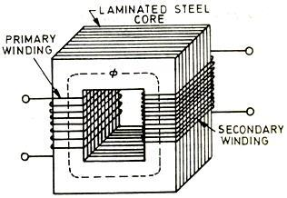

## 19. ALTERNATING CURRENT

Basic Construction and Working Principle of Transformer

An elementary transformer consists of a soft iron or silicon steel core and two windings, placed on it. The windings are insulated from both the core and each other. The core is built up of thin soft iron or low reluctance to the magnetic flux. The winding connected to the magnetic flux. The winding connected to the supply main is called the primary and the winding connected to the load circuit is called the secondary. Although in the actual construction the two windings are usually wound one over the other, for the sake of simplicity, the figures for analyzing transformer theory show the windings on opposite sides of the core.

### TRANSFORMERS LOSES

Transformer losses are produced by the electrical current flowing in the coils and the magnetic field alternating in the core. The losses associated with the coils are called the load losses, while the losses produced in the core are called no-load losses.

### What Are Load Losses?

Load losses vary according to the loading on the transformer. They include heat losses and eddy currents in the primary and secondary conductors of the transformer. Heat losses, or I²R losses, in the winding materials contribute the largest part of the load losses. They are created by resistance of the conductor to the flow of current or electrons. The electron motion causes the conductor molecules to move and produce friction and heat. The energy generated by this motion can be calculated using the formula: Watts = (volts)(amperes) or VI.

According to Ohm’s law, V=RI, or the voltage drop across a resistor equals the amount of resistance in the resistor, R, multiplied by the current, I, flowing in the resistor. Hence, heat losses equal (I)(RI) or I²R. Transformer designers cannot change I, or the current portion of the I²R losses, which are determined by the load requirements. They can only change the resistance or R part of the I²R by using a material that has a low resistance per cross-sectional area without adding significantly to the cost of the transformer. Most transformer designers have found copper the best conductor considering the weight, size, cost and resistance of the conductor. Designers can also reduce the resistance of the conductor by increasing the cross-sectional area of the conductor.

### What Are No load Losses?

No-load losses are caused by the magnetizing current needed to energize the core of the transformer, and do not vary according to the loading on the transformer. They are constant and occur 24 hours a day, 365 days a year, regardless of the load, hence the term no-load losses. They can be categorized into five components: hysteresis losses in the core laminations, eddy current losses in the core laminations, I²R losses due to no-load current, stray eddy current losses in core

clamps, bolts and other core components, and dielectric losses. Hysteresis losses and eddy current losses contribute over 99% of the no-load losses, while stray eddy current, dielectric losses and I²R losses due to no-load current are small and consequently often neglected. Thinner lamination of the core steel reduces eddy current losses. The biggest contributor to no-load losses is hysteresis losses. Hysteresis losses come from the molecules in the core laminations resisting being magnetized and demagnetized by the alternating magnetic field. This resistance by the molecules causes friction that result in heat. The Greek word, hysteresis, means "to lag" and refers to the fact that the magnetic flux lags behind the magnetic force. Choice of size and type of core material reduces hysteresis losses.

### TRANSFORMERS AS A MATCHING DEVICE

The term impedance is used for the opposition of a system to the flow of energy from an energy source. For constant signals, this impedance can also be constant. For varying signals, it usually changes with frequency. The energy involved can be electrical, mechanical, magnetic or even thermal.

### Reflectionless or broadband matching

Impedance matching to minimize reflections and maximize power transfer over a (relatively) large bandwidth (also called reflectionless matching or broadband matching) is the most commonly used. To prevent all reflections of the signal back into the source, the load (which must be totally resistive) must be matched exactly to the source impedance

### Complex conjugate matching

This is used in cases in which the source and load are reactive. This form of impedance matching can only maximize the power transfer between a reactive source and a reactive load at a single frequency.

### IMPEDANCE MATCHING DEVICES

Adjusting the source impedance or the load impedance, in general, is called "impedance matching". There are three possible ways to improve an impedance mismatch, all of which are called "impedance matching":
- devices intended to present an apparent load to the source.
- devices intended to present an apparent load of Rload = Rline (complex impedance matching), to avoid echoes.
- devices intended to present an apparent source resistance as close to zero as possible, or presenting an apparent source voltage as high as possible. This is the only way to maximize energy efficiency, and so it is used at the beginning of electrical power lines. Such an impedance bridging connection also minimizes distortion and electromagnetic interference, and so it is also used in modern audio amplifiers and signal processing devices.

There are a variety of devices that are used between some source of energy and some load that perform "impedance matching". To match electrical impedances, engineers use combinations of Transformers, Resistors, Inductors, Capacitors and Transmission Lines.

These passive and active impedance matching devices are optimized for different applications, and are called baluns, antenna tuners (sometimes called ATUs or roller coasters because of their appearance), acoustic horns, matching networks, and terminators. Transformers are sometimes used to match the impedances of circuits with different impedances. A transformer converts Alternating Current at one voltage to the same waveform at another voltage. The power input to the transformer

and output from the transformer is the same (except for conversion losses). The side with the lower voltage is at low impedance, because this has the lower number of turns, and the side with the higher voltage is at higher impedance as it has more turns in its coil.
