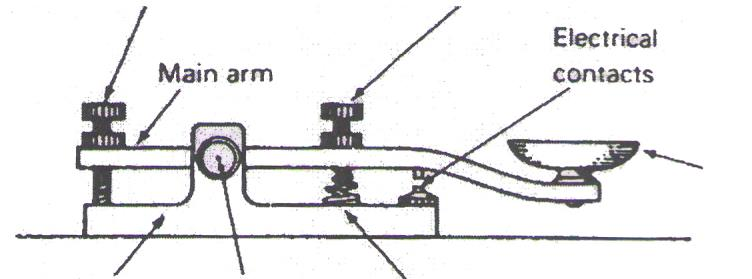
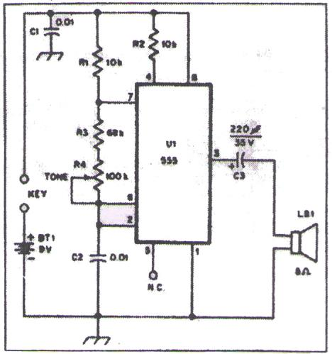

### PART II

### MORSE CODE

### (Only for General Grade)

### MORSE CODE

Morse Code is a method of transmitting text information as a series of on-off tones, lights, or clicks that can be directly understood by a skilled listener or observer without special equipment.

Each character (letter or numeral) is represented by a unique sequence of dots and dashes. The duration of a dash is three times the duration of a dot. Each dot or dash is followed by a short silence, equal to the dot duration. The letters of a word are separated by a space equal to three dots (one dash), and the words are separated by a space equal to seven dots. The dot duration is the basic unit of time measurement in code transmission.

Morse code is most popular among amateur radio operators, although it is no longer required for licensing in most countries.

Radiotelegraphy by Morse code is named after its inventor Samuel Finley Breese Morse, 1791- 1872, an American artist and promoter of the telegraph.

### LANGUAGE

Radiotelegraphy by itself is a language. Not every amateur understands English, but through a recognised systems and combinations of dits and dashes every ham can converse in a common language, the Morse code. One of the Amateur logo is: “ONE WORLD ONE LANGUAGE”

because of this Morse Code.

### EFFICIENT

Compared to voice, Morse code is less sensitive to poor signal conditions, yet still comprehensible to humans without a decoding device. Morse code is the most efficient means of radio communication. Nothing beats code for providing vital communication through noise and interference under marginal conditions.

### ADVANTAGES

Continuous Wave and Distant Station go hand in hand. With less crowded bands increased efficiency CW affords the opportunity for every Amateur to work his share of the rare ones. On Morse code much more modest stations can compete successfully.

A majority of public service, health, welfare and emergency messages can be handled quickly and with greater accuracy on Morse code.

The amateur bands are narrow and often very crowded. The CW occupies a small fraction of the band of a phone signal. Many more CW stations can squeeze into the same band reducing interference thus conserving spectrum.

Morse code is economical, compact, less expensive, uses low power, gives global coverage and free from disturbances. It is the proud language of the amateur and is thoroughly enjoyable.

Morse is a very effective mode of communication, which, depending on the skill of the operators, can facilitate communication when other modes fail due to low signal strengths. It thus enables low power, low cost equipment to be surprisingly effective - an important point to those working on a limited budget. Being a narrow band width, it uses the spectrum in a most effective way.

### HINTS ON LEARNING MORSE CODE

There is no magic, mystery or formula connected to this code Remember you are learning the language of “SOUND’.

Learn to listen to the sound of the letters and avoid memorizing dots and dashes.

Write down each letter immediately as it is received and ignore doubtful ones.

Do not guess hut leave a blank space and concentrate on the next letter.

Avoid thinking back, you may lose more letters.

Practice Morse half an hour a day and think of it rest of the day.

Start writing the code as you learn and do not use capitals. This helps in picking up higher speed.

Set aside a definite time every day and stick to the schedule of daily practice.

Concentrate on writing what you hear and read it later. Try and copy with eyes closed or the paper covered.

Practice Morse code with a friend together and send to one another.

### TRANSMITTING MORSE CODE

### Contact space adjustment Return spring adjustment Knob

### TELEGRAPH KEY

A key is a means of making and breaking a connection easily. Mount the key firmly to the operating table. Adjust the contacts until the handle moves about 1/16”

when depressed. Fixing and adjustments are to he done to reduce side to side sway. Finally adjust the spring tension to a comfortable feel.

Now send from the wrist, not the fingers. Keeping the wrist off the table. a gentle grip around the knob and a smooth tip and down motion make for clean and effortless sending.

### CODE PRACTICE OSCILLATOR

To send, you need a Morse key and a Code Practice Oscillator (CPO). For the do it yourself amateurs a common circuit is shown for guidance. This is a simple code practice oscillator and is capable of providing sufficient output power for classroom instruction. The tone is adjustable from a few hundred to several thousand Hertz. You may also choose any other circuit that provides any Tone which can be transmitted preferably from 800 to 1000 Hertz.

### TIMING OF MORSE CODE ELEMENTS AND SPACES

The basic unit of time in Morse code is the length of the dot. The duration of the dash is three times that of the dot. The term “element” is used to indicate both dots and clashes. The space between two elements forming the same character is also the length of the dot. The space between letters is equal to three dots and the space between words is equal to five dots.

The above relationships are indicated below for the guidance of learners.

· Dit (One Unit) - Dah (Three Units)

Character to Character One Dit (Unit)

Letter to Letter Three Dits (Units);

Word to Word Five Dits (Units)

### MORSE CODE

### Alphabet Morse Number Morse

| A | · - |  | 1 | · - - - - |
|---|---|---|---|---|
| B | - · · · |  | 2 | · · - - - |
| C | - · - · |  | 3 | · · · - - |
| D | - · · |  | 4 | · · · · - |
| E | · |  | 5 | · · · · · |
| F | · · - · |  | 6 | - · · · · |
| G | - - · |  | 7 | - - · · · |
| H | · · · · |  | 8 | - - - · · |
| I | · · |  | 9 | - - - - · |
| J | · - - - |  | 0 | - - - - - |
| K | - · - |  |  |  |
| L | · - · · Full Stop |  |  | · - · - · - |
| M | - - | Comma |  | - - · · - - |
| N | - · | Semi-colon |  | - · - · - · |
| O | - - - | Break sign |  | - · · · - |
| P | · - - · Hyphen |  |  | - · · · · - |
| Q | - - · - Question mark · · - - · · |  |  |  |
| R | · - · | Error Signal |  | · · · · · · · · |
| S | · · · |  |  |  |
| T | - |  |  |  |
| U | · · - |  |  |  |
| V | · · · - |  |  |  |
| W | · - - |  |  |  |
| X | - · · - |  |  |  |
| Y | - · - - |  |  |  |
| Z | - - · · |  |  |  |

Error Signal: If the sending operator becomes aware of an error, he/she shall stop, send the error signal (••••••••) , repeat the last word correctly transmitted and continue the transmission.

It can be also learnt via the website : http://morsecat-beta.software.informer.com/
