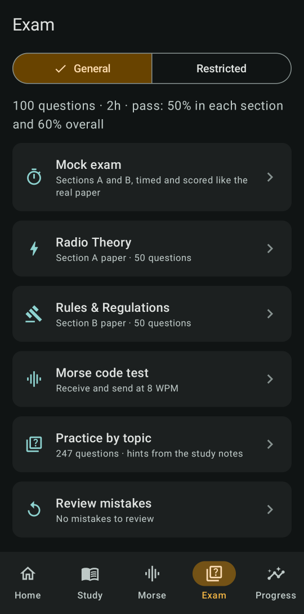
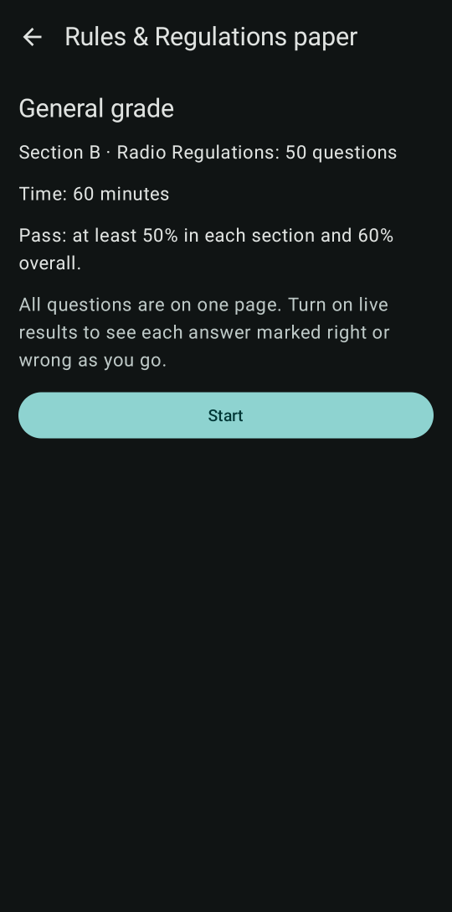
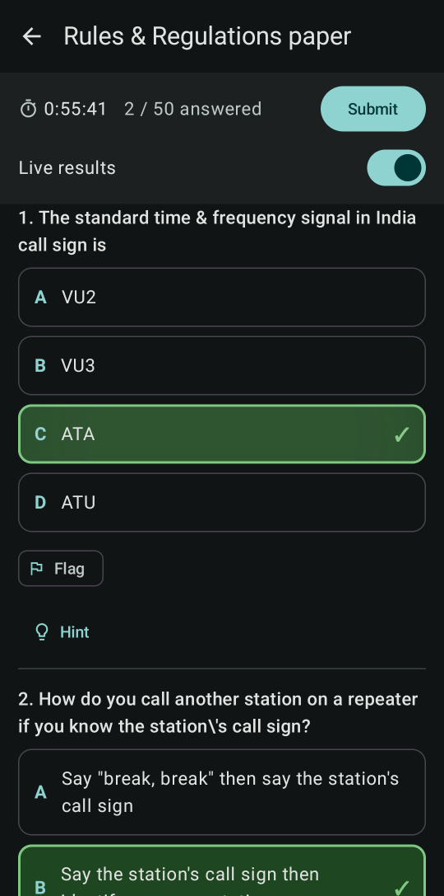
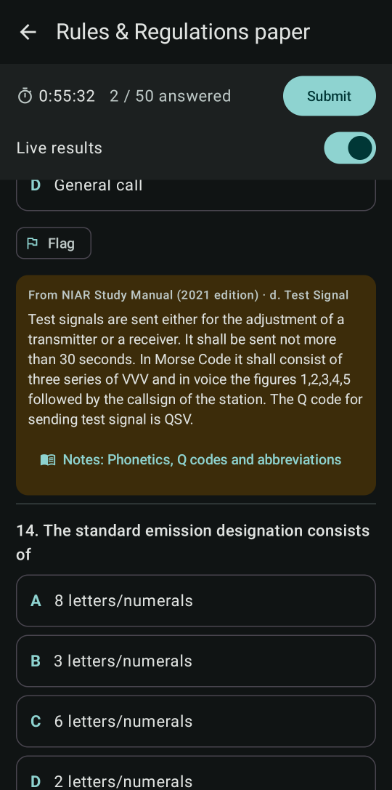
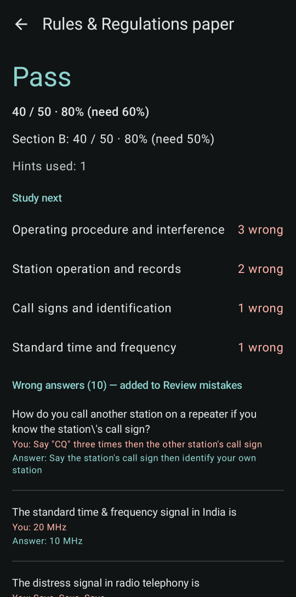
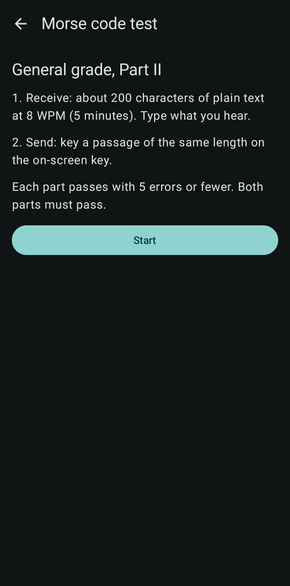
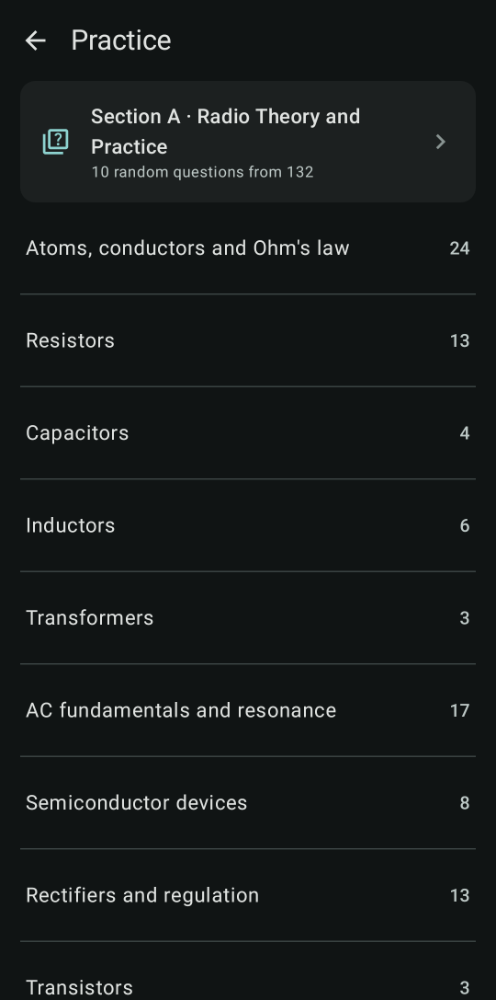
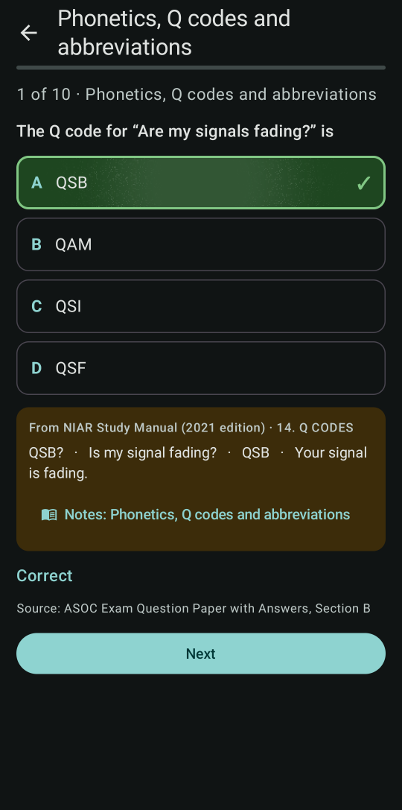

# Exams and practice

The **Exam** tab has everything for testing yourself. The line at the top shows the pattern and
pass mark for your grade.

<figure markdown>
{ .shot }
<figcaption>The Exam tab (General grade)</figcaption>
</figure>

| Option | What it is |
|---|---|
| **Mock exam** | A full paper: Section A and Section B, timed and scored like the real exam. |
| **Radio Theory** | A Section A paper on its own: 50 questions. |
| **Rules & Regulations** | A Section B paper on its own: 50 questions. |
| **Morse code test** | The General grade's receiving and sending test at 8 WPM. |
| **Practice by topic** | 10 questions at a time, from one topic or a whole section, with the answer shown straight away. |
| **Review mistakes** | Questions you got wrong, brought back until you get them right. |

!!! info "About the questions"
    Every question comes from a published ASOC question bank with its **published answer key**:
    the VU2MUE study material and the RPC Ham Radio Club Section B paper. Some answer keys were
    cross-checked against the NCVEC question pools. Questions whose published keys contradicted
    each other were left out. After you answer, the question's source is shown.

## Papers: mock exam and section papers

<figure markdown>
{ .shot }
<figcaption>Before you start: questions, time and pass mark</figcaption>
</figure>
<figure markdown>
{ .shot }
<figcaption>The whole paper on one page, with live results on</figcaption>
</figure>

### Timing

| Paper | General | Restricted |
|---|---|---|
| Mock exam (100 questions) | 2 hours | 1 hour |
| Radio Theory or Rules & Regulations (50 questions) | 1 hour | 30 minutes |

Section papers get time in proportion to their share of the full paper. When the timer reaches
zero, the paper is submitted automatically.

### Taking a paper

1. Tap the paper, read the summary, then tap **Start**.
2. All the questions are on **one scrolling page**, grouped by section. Tap an option to answer;
   tap another to change your answer.
3. The bar at the top stays in view while you scroll. It shows the **time left**, how many
   questions you've **answered**, the **Submit** button and the **Live results** switch.
4. Tap **Flag** under a question to mark it for checking later.
5. Tap **Submit** when you're done. The app tells you how many questions are unanswered (they
   count as wrong) and how many you flagged. Tap **Submit** to finish or **Keep going** to go back.

Leaving the paper with the back arrow asks first, because your answers will be lost.

### Live results

Turn on **Live results** to see each answer marked as you go:

- A correct pick turns **green** with a ✓.
- A wrong pick turns **red** with a ✗, and the correct option turns green.

Leave it off to practise under exam conditions. The app remembers your choice.

### Hints

<figure markdown>
{ .shot }
<figcaption>A hint: a passage from the study notes, with its source</figcaption>
</figure>
<figure markdown>
{ .shot }
<figcaption>Results: pass or not yet, sections, and what to study next</figcaption>
</figure>

Tap **Hint** under a question for help. A hint is **a passage copied word for word from the
study notes** that explains the answer, with its source and heading, and a link to the notes
for that topic. Hints are never written by hand. Questions without a closely matching passage
say *No hint for this question* and link to the notes instead.

The results show how many hints you used, so you know how much of the score was your own.

### Results

After you submit, you see:

- **Pass** or **Not yet**, your total and the overall pass mark.
- Each section's score against its pass mark.
- **Hints used**.
- **Study next**: the topics where you lost marks, with how many you got wrong in each.
- **Wrong answers**: each one with your answer and the correct answer. All of them are added to
  **Review mistakes**.

After a full General paper, a button takes you straight on to the Morse code test. The Exam tab
shows your last paper's score.

## Morse code test

<figure markdown>
{ .shot }
<figcaption>The two parts of the Morse code test</figcaption>
</figure>

For the General grade, the test has two parts, and **both must pass**:

1. **Receive**: about 200 characters of plain text at 8 WPM, about 5 minutes. Tap play, then type
   what you hear.
2. **Send**: key a passage of the same length on the on-screen key. The decoder shows what you
   sent.

Each part passes with **5 errors or fewer**. Practise first with **Morse → Copy practice → Exam
test** and **Send practice**; see [Morse code](morse.md).

## Practice by topic

<figure markdown>
{ .shot }
<figcaption>Pick a section or a topic</figcaption>
</figure>
<figure markdown>
{ .shot }
<figcaption>Instant feedback, the hint and the source</figcaption>
</figure>

1. Tap **Practice by topic**.
2. Pick **Section A** or **Section B** for 10 random questions from the whole section, or a single
   topic. The number beside each topic is how many questions it has.
3. Answer each question. You see straight away whether you were right, the correct answer, the
   hint from the notes, and the question's source.
4. Tap **Next**. After 10 questions you get your score.

You can also start topic practice from a topic's page in **Study**, with **Practice questions**.

## Review mistakes

Every question you get wrong, in a paper or in practice, goes into **Review mistakes**. The card
shows how many are due.

- A question you got wrong is due straight away.
- When you get it right, it comes back once more **a day later**.
- Answer it right that second time and it leaves the review list.
- Get it wrong at any point and it starts over.

A little review each day fixes your weak spots faster than doing new questions.
