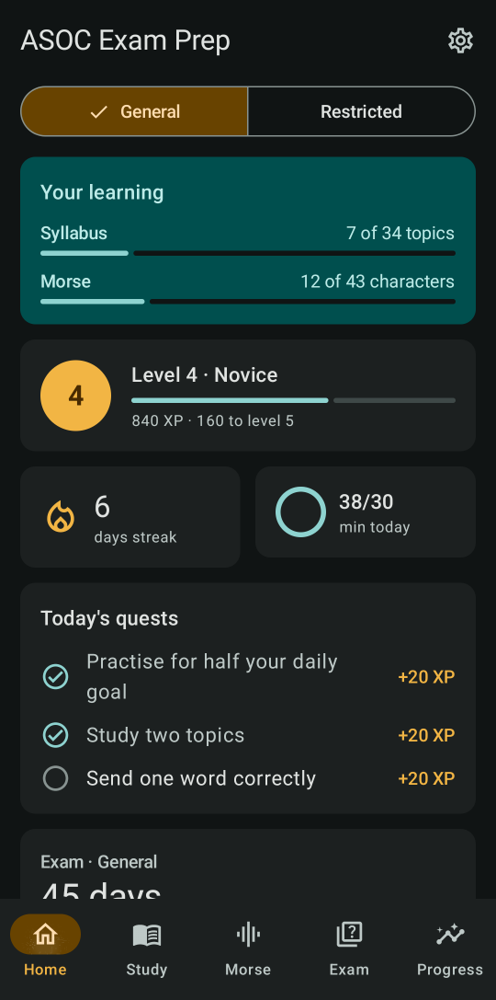

# First steps

## The five tabs

The bar at the bottom of the screen has five tabs:

| Tab | Use it to |
|---|---|
| **Home** | See your learning progress, level, streak, daily goal, today's quests and the days left to your exam. |
| **Study** | Read the notes for each syllabus topic, licence information and the reference tables. |
| **Morse** | Learn and practise Morse code, receiving and sending. |
| **Exam** | Sit mock papers, practise by topic and review your mistakes. |
| **Progress** | See your level, stars, streak, active days and badges. |

## Choose your grade

There are two ASOC grades, and they have different exams:

| | General | Restricted |
|---|---|---|
| Written exam | 100 questions, 2 hours | 100 questions, 1 hour |
| Pass mark | 50% in each section and 60% overall | 40% in each section and 50% overall |
| Morse code test | Yes: receive and send at 8 words per minute | No |

Choose your grade with the **General / Restricted** switch at the top of the **Home**, **Study**
and **Exam** tabs, or in [Settings](settings.md). The app then uses the topics, questions
and pass marks for that grade. With Restricted selected, the Morse code test is marked
"General grade only". Your progress is kept when you switch.

!!! info "Where these numbers come from"
    The exam pattern and pass marks are taken from the published syllabus. The Telecommunications
    (Amateur Services) Rules, 2024 set a minimum of 40% of total marks; the syllabus's stricter
    per-section and overall marks are the ones the app uses. Check
    **Study → Licence info → Exam pattern and pass marks** for the details and sources.

## The Home screen

<figure markdown>
{ .shot }
<figcaption>Home</figcaption>
</figure>

From top to bottom:

- **Settings** (gear icon, top right): exam date, daily goal, grade and the About page.
- **Your learning**: how many syllabus topics you've studied, and how many Morse characters
  you've learned.
- **Level**: your level and rank, and the XP needed for the next level. See
  [Progress and rewards](progress.md).
- **Streak**: how many days in a row you've studied.
- **Daily goal ring**: minutes studied today against your goal.
- **Today's quests**: three small goals that change every day.
- **Exam countdown**: days left to your exam date, once you've set one.

## A good daily routine

1. **Morse, 10 to 15 minutes**: one Learn session, then a little copy or send practice.
   Short daily sessions work better than long weekly ones.
2. **One topic**: read the notes, tap **Mark as studied**, then tap **Practice questions**.
3. **Review mistakes**: questions you got wrong come back for review until you've answered them
   right twice.
4. Closer to the exam, sit a full **mock exam** under time pressure.
