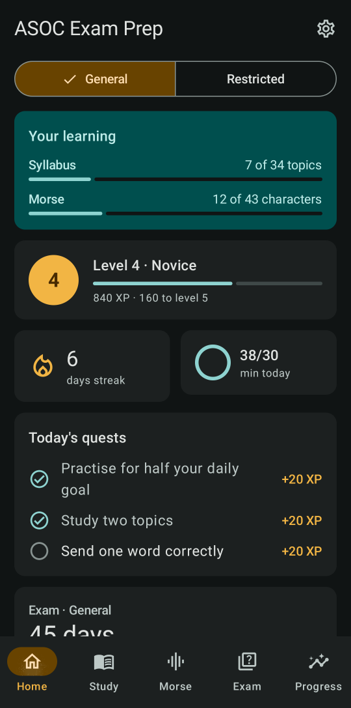
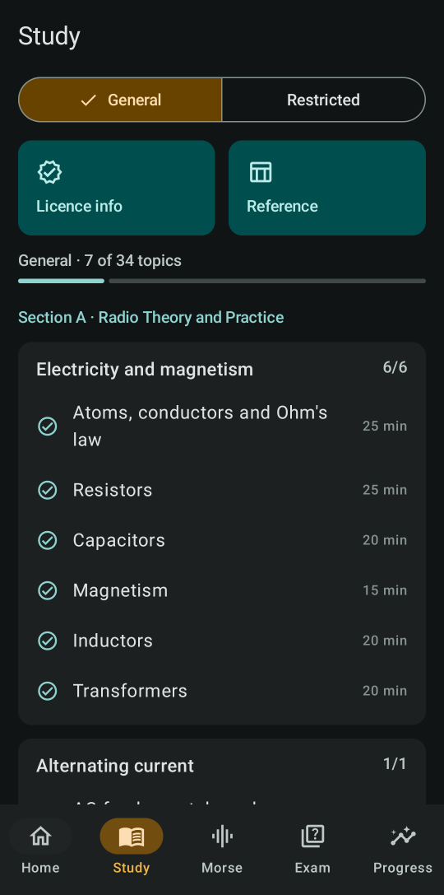
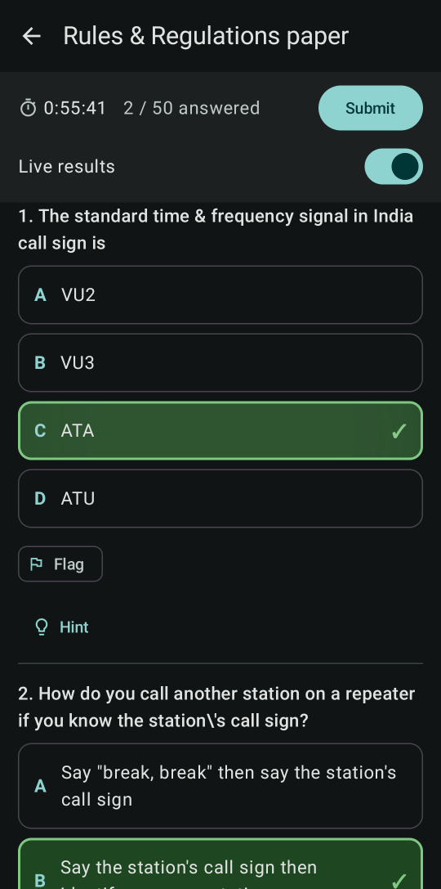

# ASOC Exam Prep

**ASOC Exam Prep** is a free Android app for preparing for India's
**Amateur Station Operator's Certificate (ASOC)** exam, run by the Department of
Telecommunications (WPC). It covers both licence grades, **General** and **Restricted**.

[Download the latest APK](https://github.com/ClaudeShaji/asoc-exam-prep/releases/latest){ .md-button .md-button--primary }
[Install guide](install.md){ .md-button }

<figure markdown>
{ .shot }
<figcaption>Home: your learning, level, streak and today's quests</figcaption>
</figure>
<figure markdown>
{ .shot }
<figcaption>Study: every syllabus topic, with notes</figcaption>
</figure>
<figure markdown>
{ .shot }
<figcaption>Exam papers with live results and hints</figcaption>
</figure>

## What the app does

| Area | What you get |
|---|---|
| [Study notes](study.md) | Notes for all 34 syllabus topics, taken from the NIAR Study Manual and the Telecommunications (Amateur Services) Rules, 2024, with the source and page numbers on every topic. Licence information: who can apply, exam pattern, fees, how to apply. |
| [Reference](reference.md) | Phonetic alphabet with audio and a "spell it out" box, Q codes, abbreviations and the amateur band plan. |
| [Morse code](morse.md) | A step-by-step trainer: one character at a time, then letter groups, words and sentences. Copy practice, send practice on an on-screen key, and the full alphabet. |
| [Exams](exams.md) | Full mock papers, Section A and Section B papers, a Morse code test, practice by topic and a review queue for your mistakes. |
| [Progress](progress.md) | Levels, stars, streaks, a daily goal, quests and badges that reward real progress. |

## Where the content comes from

Nothing in the app is made up. Notes are quoted from published study material, exam
questions come from published question banks **with their published answer keys**, and hints
are passages copied from the notes. Every question shows its source. See
[Sources and licences](sources.md).

!!! note "Not an official app"
    ASOC Exam Prep is not affiliated with or endorsed by the Department of Telecommunications,
    WPC or NIAR. Always check the current official rules before your exam.

## Quick start

1. [Install the app](install.md) from the Releases page.
2. Pick your grade, **General** or **Restricted**, on the Home screen.
3. Set your exam date and daily goal in [Settings](settings.md).
4. Read a topic in **Study**, practise its questions, and do a few minutes of **Morse** each day.
5. When you're ready, sit a timed paper in **Exam**.
