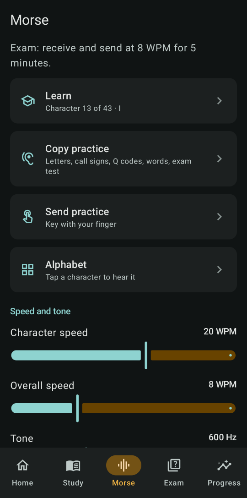
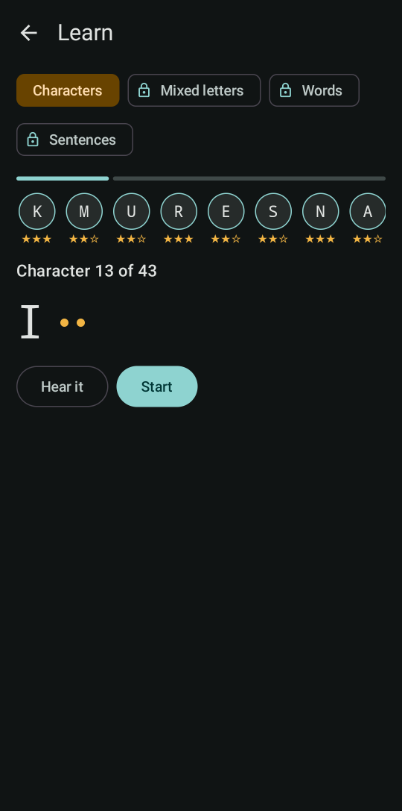
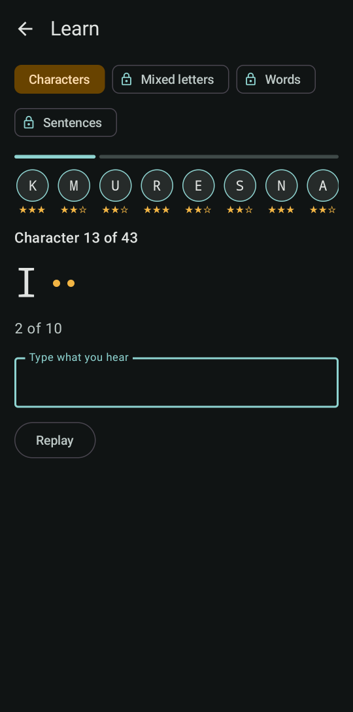
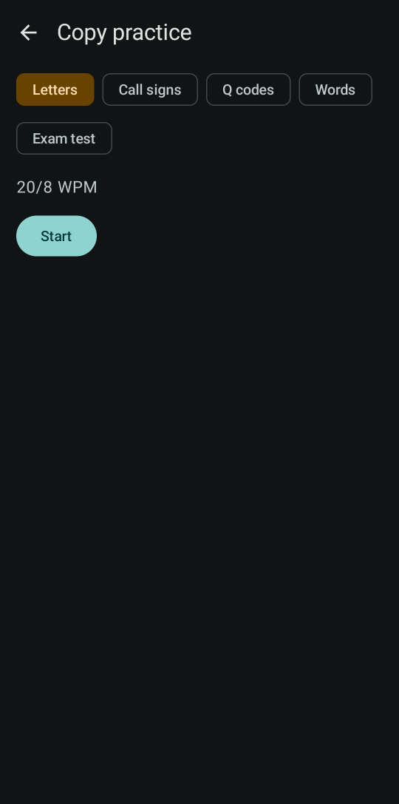
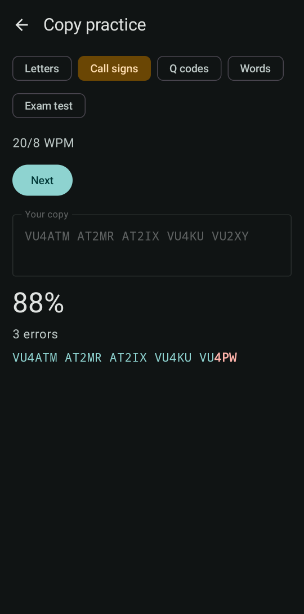
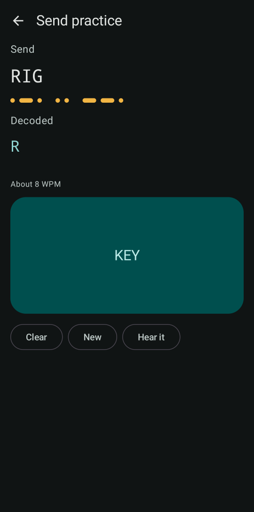
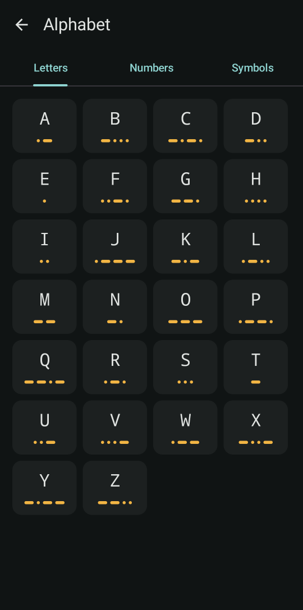

# Morse code

The General grade exam includes a Morse code test: **receiving and sending at 8 words per
minute (WPM) for 5 minutes**. The **Morse** tab takes you there step by step.

<figure markdown>
{ .shot }
<figcaption>Morse: Learn, practice, alphabet and speed settings</figcaption>
</figure>

!!! tip "Use headphones or the speaker"
    Turn your media volume up. Morse plays as a tone through the phone's speaker or headphones.

## Learn

**Morse → Learn** is the main trainer. It teaches by sound, one step at a time:

1. **Characters**: 43 characters, one at a time. The 26 letters come first, in the Koch
   method's order (K, M, U, R, E, S, N, A…), then the figures (5 9 2 3 8 4 7 1 6 0), then the
   punctuation used in the exam (`. , ? / = - ;`).
2. **Mixed letters**: random groups of 2, 3, 4 and then 5 letters.
3. **Words**: short words, then longer words.
4. **Sentences**: full sentences.

<figure markdown>
{ .shot }
<figcaption>The step map and the current character</figcaption>
</figure>
<figure markdown>
{ .shot }
<figcaption>A drill: type each character you hear</figcaption>
</figure>

### How a step works

1. The screen shows the current step, for example **Character 13 of 43**, the character and its
   pattern of dots and dashes.
2. Tap **Hear it** to listen to it as often as you like.
3. Tap **Start**. You hear 10 prompts: the new character three times, then a mix of it and the
   characters you already know. Type what you hear after each one; use **Replay** to hear a
   prompt again.
4. Score **90% or more** to unlock the next step.

Characters you often get wrong come up more often.

In the **Mixed letters**, **Words** and **Sentences** stages, you hear a whole passage instead.
Type all of it in the box and check it; the score is the share of characters you copied
correctly, and 90% unlocks the next step.

### Stars and the step map

The row of circles under the stage chips is the **step map**: one circle per step you've reached,
with your best stars underneath:

| Stars | Best score in that step |
|---|---|
| ★☆☆ | 90% |
| ★★☆ | 95% |
| ★★★ | 100% |

Tap any circle to go back and practise that step. Tap a stage chip, such as **Words**, to jump
ahead and try a later stage. Locked steps can be practised, but they don't unlock anything until
you reach them in order.

## Needs work

When some characters keep catching you out, a **Needs work** card appears on the Morse tab
listing them. It opens copy practice built from just those characters.

## Copy practice

**Morse → Copy practice** plays a group of text for you to write down ("copy"), then marks it.

<figure markdown>
{ .shot }
<figcaption>Choose what to copy</figcaption>
</figure>
<figure markdown>
{ .shot }
<figcaption>Your copy marked: mistakes in red</figcaption>
</figure>

| Mode | What plays |
|---|---|
| **Letters** | Random letter groups. |
| **Call signs** | Indian amateur call signs such as `VU2ABC`. |
| **Q codes** | Q codes from the syllabus. |
| **Words** | Common words. |
| **Exam test** | A 200-character passage at 8 WPM, like the real receiving test. 5 errors or fewer is a pass. |

Tap **Start**, listen, type what you heard in **Your copy**, then check it. You get an accuracy
percentage, the number of errors and the correct text with your mistakes marked in red. Tap
**Next** for another one.

## Send practice

**Morse → Send practice** turns the screen into a Morse key.

<figure markdown>
{ .shot }
<figcaption>Key the target; the decoder shows what you sent</figcaption>
</figure>

1. The target to send is shown at the top, with its dots and dashes.
2. Press and hold the **KEY** area: a short press is a dot, a long press is a dash. You hear a
   tone while the key is down.
3. **Decoded** shows what the app understood. It learns your own speed and spacing as you go.
4. Send the target correctly and it's accepted and a new one appears.

Buttons: **Clear** empties the decoded text, **New** gives a different target, and **Hear it**
plays the target so you can copy its rhythm.

!!! tip "Spacing matters"
    Leave a gap of about three dots between letters, and longer between words. If two letters run
    together, slow down and lengthen the gaps.

## Alphabet

**Morse → Alphabet** shows every character with its pattern, on three pages: **Letters**,
**Numbers** and **Symbols**. Tap a character to hear it.

<figure markdown>
{ .shot }
<figcaption>Tap a character to hear it</figcaption>
</figure>

## Speed and tone

At the bottom of the Morse tab:

- **Character speed**: how fast each character is sent (default 20 WPM).
- **Overall speed**: your effective speed, including the gaps between characters (default 8 WPM,
  the exam speed).
- **Tone**: the pitch of the beep.

Sending characters fast with extra space between them (here, 20 WPM characters at 8 WPM overall)
helps you hear each character as one sound rather than counting dots and dashes. As you improve,
raise the overall speed.

## The Morse code test

The exam's Morse test is in the **Exam** tab. See
[Exams and practice](exams.md#morse-code-test).
