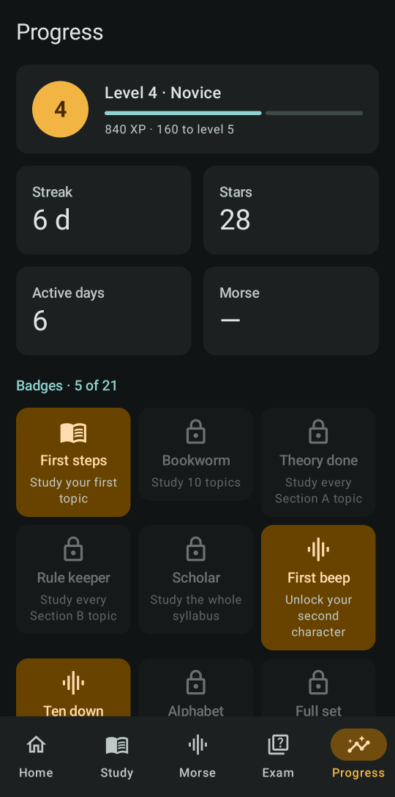
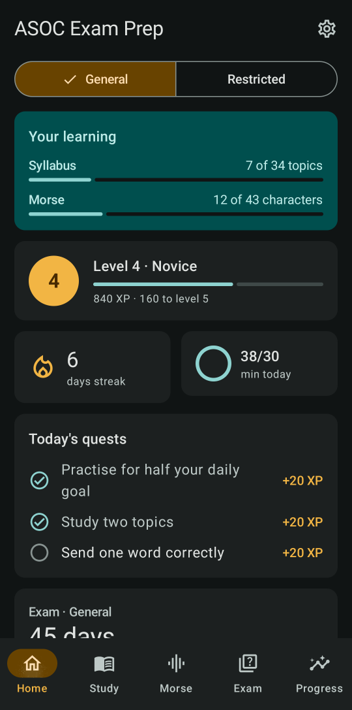

# Progress and rewards

The app's rewards exist to **keep you learning**, not to be farmed. XP comes from real progress:
learning a new character, earning stars, studying a topic, passing a test. Repeating something
you've already done earns little or nothing, and practice is never locked behind rewards.

<figure markdown>
{ .shot }
<figcaption>Level, streak, stars, active days and badges</figcaption>
</figure>
<figure markdown>
{ .shot }
<figcaption>Daily goal and quests on Home</figcaption>
</figure>

## XP and levels

| You… | XP |
|---|---|
| Study a topic for the first time | +20 |
| Unlock a new Learn step | +25 |
| Earn a new star on a Learn step | +10 per star |
| Pass the 8 WPM copy test (Copy practice → Exam test) | +50, once a day |
| Pass a full mock exam | +50, once a day |
| Meet your daily goal | +30 |
| Complete a daily quest | +20 |
| Finish a practice session with at least 50% | +5, up to 10 times a day |

Levels need more XP as you go: level 2 at 100 XP, level 3 at 300, level 4 at 600, level 5 at
1,000, and so on. Your rank changes as you level up:

| Level | Rank |
|---|---|
| 1 | Listener |
| 3 | Novice |
| 5 | Operator |
| 8 | Ragchewer |
| 12 | DXer |
| 16 | Contester |
| 20 | Elmer |

## Daily goal and streak

- Set your **daily goal** in minutes in [Settings](settings.md). The ring on Home fills as you
  study: reading topics, Morse practice and exam practice all count.
- Your **streak** is how many days in a row you've studied. Miss a day and it starts again.
- **Active days** on the Progress tab counts every day you've studied.

## Daily quests

Home shows three quests each day, such as *Study two topics* or *Send one word correctly*. They
change daily and each one completed is worth +20 XP.

## Stars

Each Learn step can earn up to three stars: ★ for 90%, ★★ for 95% and ★★★ for 100%. Go back to
earlier steps from the step map to improve them. See [Morse code](morse.md#stars-and-the-step-map).

## Badges

The Progress tab shows 21 badges. Earned ones are coloured; locked ones show what to do.

| Badge | How to earn it |
|---|---|
| First steps | Study your first topic |
| Bookworm | Study 10 topics |
| Theory done | Study every Section A topic |
| Rule keeper | Study every Section B topic |
| Scholar | Study the whole syllabus |
| First beep | Unlock your second Morse character |
| Ten down | Learn 10 characters |
| Alphabet | Learn all 26 letters |
| Full set | Learn every character, figure and sign |
| Wordsmith | Reach the word stage |
| Fluent | Reach the sentence stage |
| Perfect | Score 100% in a Learn session |
| Star collector | Earn 3 stars on 10 steps |
| On the key | Send a call sign or word correctly |
| Exam ready | Pass the 8 WPM copy test |
| Paper passed | Pass a full mock exam |
| Consistent | Pass mock exams on 3 days |
| Warming up | 3-day streak |
| On air every day | 7-day streak |
| Goal met | Meet your daily goal |
| Operator | Reach level 5 |

Small celebrations pop up at the bottom of the screen when you level up or earn a badge. They
don't block what you're doing.
