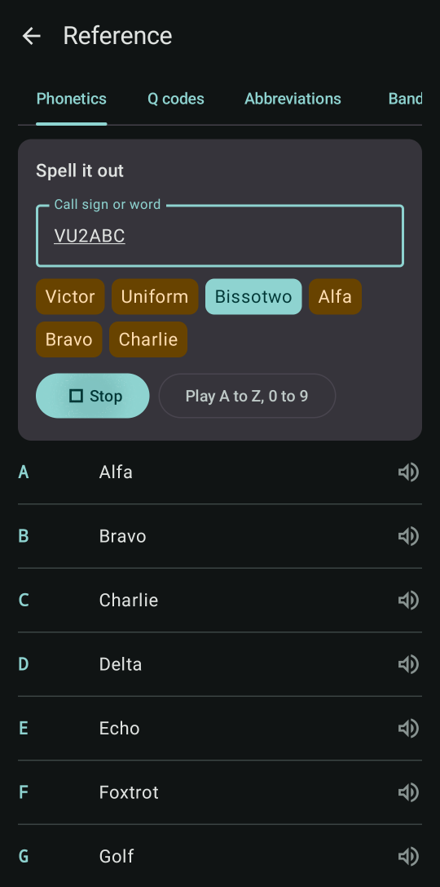
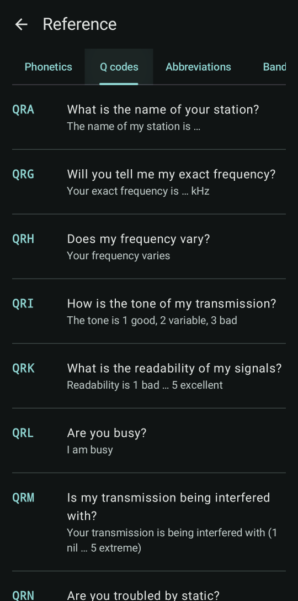
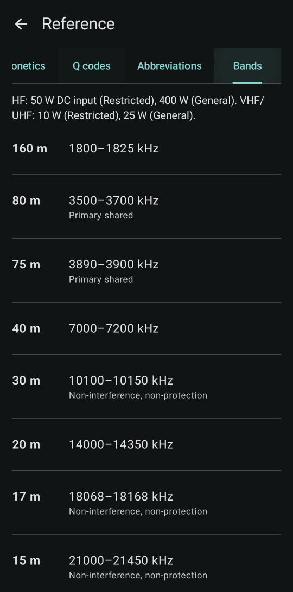

# Reference and phonetics

**Study → Reference** has four quick-reference tables: **Phonetics**, **Q codes**,
**Abbreviations** and **Bands**. Swipe the tab row or tap a tab to switch.

## Phonetic alphabet

<figure markdown>
{ .shot }
<figcaption>Spelling a call sign; the word being spoken is highlighted</figcaption>
</figure>

The table lists the ITU phonetic alphabet (Alfa, Bravo, Charlie…) and the ITU figure code words
(Nadazero, Unaone, Bissotwo…), as given in the study manual.

### Listen to a letter

Tap any row to hear its code word spoken. The row is highlighted while it plays.

### Spell it out

Use **Spell it out** to practise spelling call signs and words by voice:

1. Type a call sign or word, for example `VU2ABC`.
2. The code words appear as chips under the box.
3. Tap **Play**. Each word is spoken in turn, and its chip is highlighted as it plays.
4. Tap **Stop** to stop.

Spaces add a short pause between words; other punctuation is skipped.

### Play the whole table

**Play A to Z, 0 to 9** plays every letter and figure in order. Tap it again to stop.

!!! note "About the recordings"
    The voice recordings are by Allison Smith, made for the open-source Asterisk project
    (Creative Commons Attribution-ShareAlike 3.0). Letters are spoken as their code words.
    The recordings say figures as plain spoken numbers ("two"), so the ITU figure code word, such
    as *Bissotwo*, is shown on screen beside each figure.

## Q codes

<figure markdown>
{ .shot }
<figcaption>Q codes: question and answer forms</figcaption>
</figure>
<figure markdown>
{ .shot }
<figcaption>Bands: frequencies and power limits</figcaption>
</figure>

Each Q code is listed with its **question** form (with `?`) and its **answer or advice** form.
These are the Q codes in the ASOC syllabus.

## Abbreviations

Common Morse and operating abbreviations, such as **CQ**, **DE**, **K**, **73** and **VA**, with
their meanings.

## Bands

The amateur bands allotted in India, with their frequency ranges, notes such as *primary shared*
or *non-interference, non-protection*, and the power limits for each grade. The source and page
are shown at the bottom.
