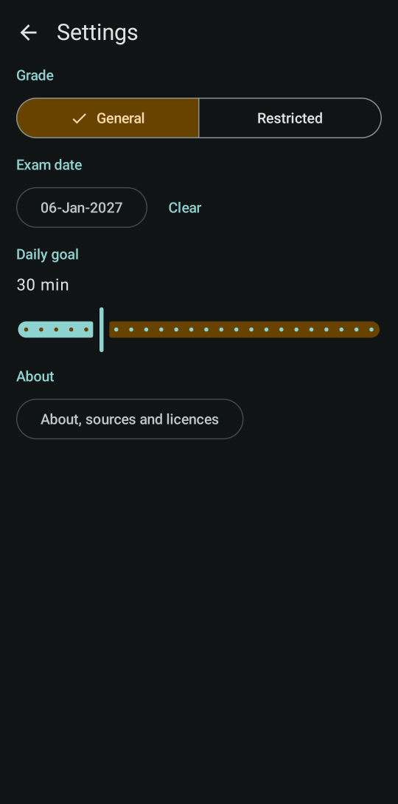
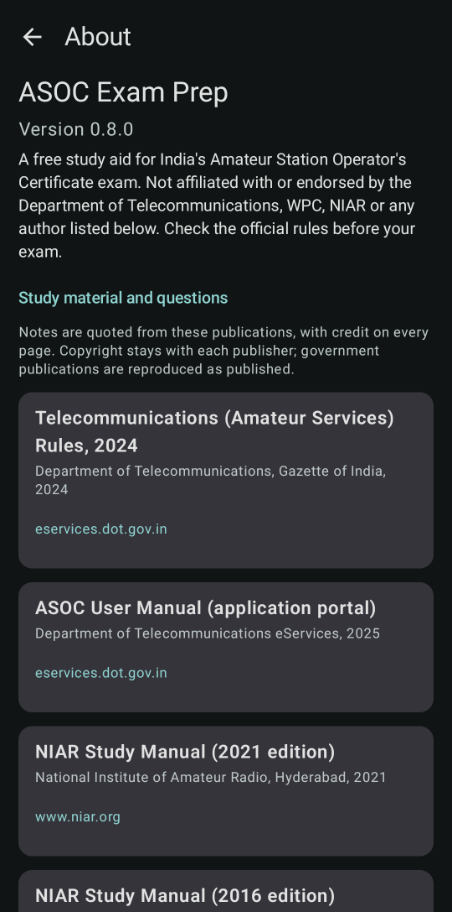

# Settings and About

Open **Settings** with the gear icon at the top right of the **Home** tab.

<figure markdown>
{ .shot }
<figcaption>Settings</figcaption>
</figure>
<figure markdown>
{ .shot }
<figcaption>About: version, sources and licences</figcaption>
</figure>

| Setting | What it does |
|---|---|
| **Grade** | General or Restricted. Changes the topics, questions, timings and pass marks. See [First steps](first-steps.md#choose-your-grade). |
| **Exam date** | Tap to pick your exam date. Home then counts down the days. **Clear** removes it. |
| **Daily goal** | Minutes of study you aim for each day, from 5 to 120. Fills the ring on Home. |
| **About, sources and licences** | Opens the About page. |

Morse speeds and tone are set on the **Morse** tab; see [Morse code](morse.md#speed-and-tone).

## About

The About page shows:

- The **app version**.
- A note that the app isn't affiliated with or endorsed by the Department of Telecommunications,
  WPC, NIAR or any author.
- Every **study and question source**, with its publisher, a link, and how many exam questions
  came from it.
- The **voice recordings** credit, with the full Creative Commons licence text.
- The **open-source libraries** the app uses, with the full Apache 2.0 licence text.

Tap **Show licence text** to read a licence in full.

## Your data

All your progress is stored **only on your phone**. The app has no account, sends nothing
anywhere and works offline. Uninstalling the app deletes your progress.
