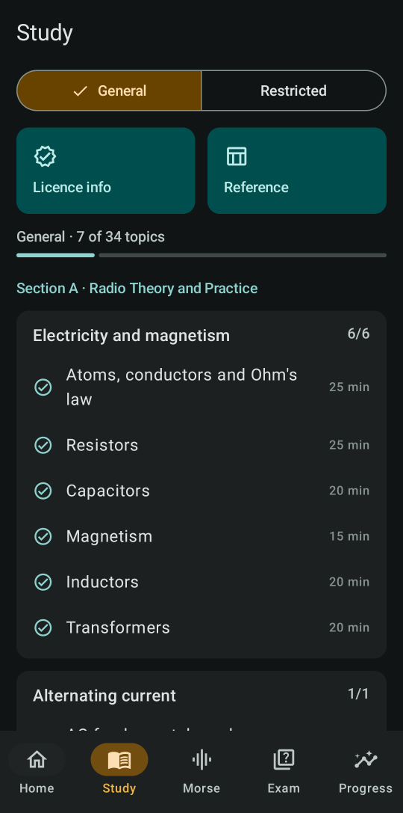
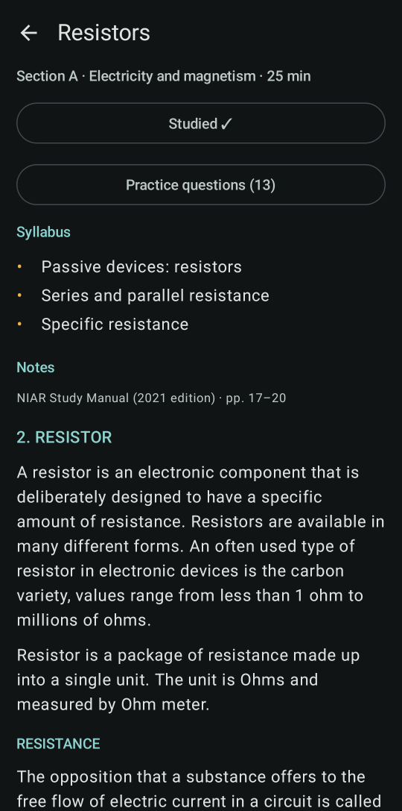
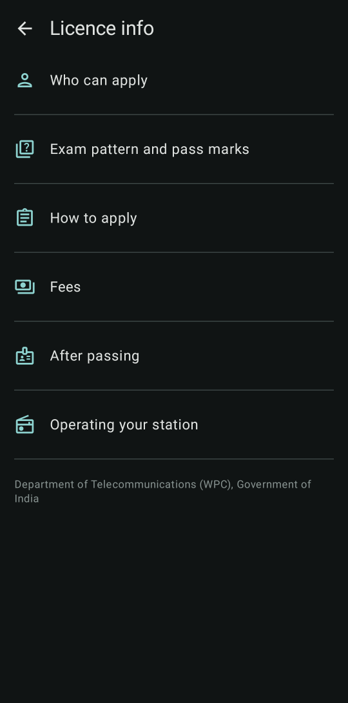
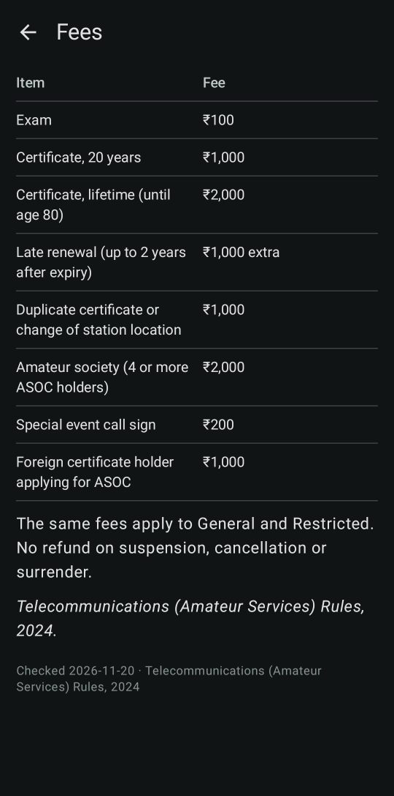

# Study notes

The **Study** tab follows the official ASOC syllabus: **Section A, Radio Theory and Practice**,
and **Section B, Radio Regulations**, split into units and topics.

<figure markdown>
{ .shot }
<figcaption>Topics grouped by unit, with progress</figcaption>
</figure>
<figure markdown>
{ .shot }
<figcaption>A topic: syllabus points and notes</figcaption>
</figure>

## Find a topic

- The bar under **Licence info** and **Reference** shows how many topics you've studied for
  your grade.
- Each unit card lists its topics, with a reading time and a tick for each topic you've studied.
  The number at the top right of a card, such as **6/6**, shows how much of that unit is done.
- Topics that only apply to the General grade are hidden when Restricted is selected.

## Read a topic

Tap a topic to open it. A topic page has:

- **Section, unit and reading time** at the top, and a **General only** chip on topics that
  apply only to the General grade.
- **Mark as studied**: tap when you've finished reading; the button changes to **Studied ✓**.
  The first time you mark a topic, it earns XP and its reading time counts toward today's goal.
  Tap **Studied ✓** to unmark it; marking it again doesn't count twice.
- **Practice questions (n)**: practise only this topic's questions. See
  [Exams and practice](exams.md#practice-by-topic).
- **Syllabus**: the points the official syllabus lists for this topic.
- **Notes**: the study material for the topic. The line under **Notes** names the source and
  pages, for example *NIAR Study Manual (2021 edition) · pp. 17–20*. Notes include the tables
  and figures from the source.

!!! tip
    Read the notes, tap **Mark as studied**, then go straight to **Practice questions**
    while it's fresh. Questions you get wrong are queued for **Review mistakes**.

## Licence info

**Study → Licence info** collects the practical facts about getting your licence, each with its
source and the date it was checked:

<figure markdown>
{ .shot }
<figcaption>Licence info pages</figcaption>
</figure>
<figure markdown>
{ .shot }
<figcaption>Fees, from the Rules, 2024</figcaption>
</figure>

- **Who can apply**
- **Exam pattern and pass marks**
- **How to apply**
- **Fees**
- **After passing**
- **Operating your station**

!!! warning
    Fees and procedures can change. Each page shows the date it was checked and its source; confirm
    with the Department of Telecommunications before you apply.
